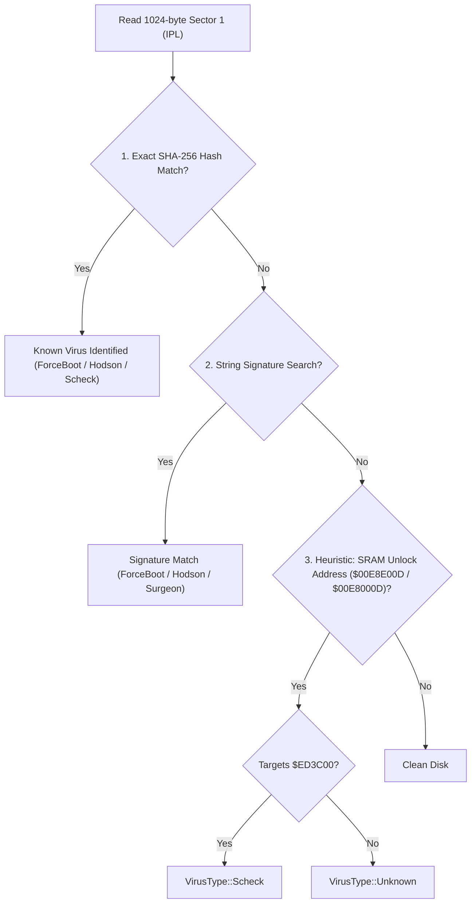

# Floppy Boot Virus Detection & Live Repair Subsystem

This document specifies the technical design, detection heuristics, filesystem repair algorithms, and UI integration of **msx68k**'s automated anti-virus engine ([`crates/msx68k-bus/src/virus.rs`](../crates/msx68k-bus/src/virus.rs)).

---

## 1. Motivation: Preventing SRAM-Mediated Cross-Infection

Because **msx68k** faithfully emulates the Sharp X68000's battery-backed static RAM (`SRAM.DAT`, `$ED0000`–`$ED3FFF`), historical boot-sector viruses present a concrete threat of persistent cross-contamination:

1. **Persistent SRAM Contamination**:
   - On the X68000, booting an infected floppy compromises the virtual SRAM: the virus configures SRAM boot priority (`$ED0018 = $B000`) and hooks reset vectors (`$ED0010`).
   - Subsequent reboots execute the virus directly from SRAM *before* any floppy IPL is evaluated, silently infecting clean disks inserted into drives 0 and 1.
2. **Emulator-Level Interception**:
   - Because guest-side software cannot prevent pre-boot execution from persistent SRAM, **msx68k** inspects media at mount time—both at cold boot and upon dynamic disk swaps inside SX-Window.

---

## 2. Target Virus Profiles & Detection Methods

The detection engine classifies infections into five categories ([`VirusType`](../crates/msx68k-bus/src/virus.rs)):

```rust
pub enum VirusType {
    ForceBoot,
    Hodson,
    Scheck,
    Surgeon,
    Unknown,
}
```

### 2.1 DBF-1: ForceBoot (`"NX68K IPL"`)
- **Behavior**:
  - Overwrites Sector 1 (the 1024-byte IPL) with its resident dropper.
  - Copies the first **640 bytes (`$280`)** of the original IPL into **Track 0, Head 0, Sector 4**.
  - **FAT Corruption**: In standard FAT12 floppies (8 sectors/track, 1024 bytes/sector), Sector 1 is the IPL, Sectors 2–3 are FAT #1, and Sectors 4–5 are FAT #2 (the backup FAT). Overwriting Sector 4 destroys the first half of FAT #2. Human68k relies on FAT #1 during normal operation, so this corruption remains silent until FAT #2 is read.
  - Leaves bytes 640..1024 of Sector 1 filled with virus code. Disks with non-standard bootloaders exceeding 640 bytes (e.g. self-booting games) are permanently truncated.
- **Payload**: Activates on or after July 1990; overwrites FATs, directories, and data tracks with ROM dummy bytes.
- **Detection**:
  - String signature: `"NX68K IPL V1."` (covers V1.00, V1.02, V1.05).
  - SHA-256 (1024-byte IPL): `01d1538f262e738b35e3932778d07324a0105e071913042dd29426a9517c38d5`.

### 2.2 DBH-4: Hodson
- **Behavior**:
  - Replaces `"Hudson soft"` in the disk header with **`"Hodson soft 2.00"`** (altered spelling).
  - Inspects SRAM boot settings; if configured, hooks into `$ED0100` via a jump trampoline to `$ED0064`.
- **Payload**: Activates on January 7; zeroes a byte at offset 256 of write buffers (`clr.b $0100(a1)`), corrupting sectors during saves.
- **Detection**:
  - String signature: `"Hodson soft"` or `"Hodson"` + date `"90/04/20"`.
  - SHA-256 (1024-byte IPL): `f6295fd8e202513f56e632d4dc4401bb05c3d258ce878f877ca43b71ebf58694`.

### 2.3 Scheck
- **Behavior**:
  - Non-destructive stealth spreader. Contains no destructive payload or visible strings.
  - Uses an ~80-byte IPL loader to copy 1024 bytes to `$ED3C00`, sets SRAM boot vector `$ED0010 = $00ED3F60`, and forces SRAM boot (`$ED0018 = $B000`).
  - At every reboot from SRAM, inspects drives 0 and 1; if byte offset 8 is `'s'` (matching `"??Hudson soft"`), writes itself to Sector 1 and continues the standard boot path.
- **Detection**:
  - Structural byte patterns targeting SRAM addresses `$00ED3C00` and `$00ED3F60`.
  - SHA-256 (1024-byte IPL): `9accfb670975e58fa51eb5f86c03b86a82deee891b48d3cd513dda1a2bc73df4`.

### 2.4 Surgeon
- **Behavior**: Joke/adware virus displaying `"Buy Surgeon! Wohoo"` (circulated on Harumi Comiket 35 disk magazines).
- **Detection**: String signature `"Surgeon"`.

### 2.5 Heuristic Detection for Unknown Variants
Legitimate Human68k and game IPL code never touches the memory-mapped SRAM write-protect register:
- If a 1024-byte IPL contains the 32-bit address **`$00E8E00D`** or **`$00E8000D`** (the SRAM write-protection unlock registers), it is flagged as `VirusType::Unknown` (or `Scheck` if the destination matches `$ED3C00`).

---

## 3. Multi-Stage Detection Pipeline

Inspection operates on a normalized 1024-byte slice representing Track 0, Head 0, Sector 1. Media reading and writing are performed transparently through the [`FloppyImage`](../crates/msx68k-bus/src/floppy_image.rs) interface (`FloppyImage::probe`, `image.read`, `image.write`), decoupling virus detection and repair from container formats (RAW, DIM, etc.) and allowing future image formats to be supported automatically.

The pipeline runs in strict order of specificity:



SHA-256 is implemented in pure Rust directly within [`virus.rs`](../crates/msx68k-bus/src/virus.rs) without external cryptography dependencies.

---

## 4. Filesystem Repair Operations

Before modifying any media, **msx68k always creates a backup copy with the `.org` extension** (CLI) or `.ORG` (GUI).

### 4.1 ForceBoot Self-Repair (`repair_floppy_forceboot_from_sector4`)
Disks infected by ForceBoot can be repaired **self-contained without requiring an external clean donor image**:

1. **Restore Sector 1 (IPL)**:
   - Copy the first 640 bytes (`$280`) from Sector 4 back to Sector 1.
   - Zero out the remaining 384 bytes (`640..1024`) of Sector 1 to remove residual virus code.
2. **Restore FAT #2 (Sector 4 Repair)**:
   - In standard 1024-byte sector FAT12 floppies, Sector 2 (the first sector of FAT #1) and Sector 4 (the first sector of FAT #2) are byte-for-byte identical.
   - Copy the 1024 bytes of Sector 2 over Sector 4, completely healing the corrupted FAT #2.

### 4.2 Donor-Based Clean IPL Restoration (`repair_floppy_from_clean_ipl`)
For Scheck, Hodson, or Unknown viruses where no backup is stored on the media:
1. **Extract Donor IPL**:
   - Reads Sector 1 from a verified clean disk image (default: `disks/HUMAN302.XDF` or `A:\VMX68K\DRIVE0.XDF`).
2. **Replace Sector 1**:
   - Replaces the 1024 bytes of Sector 1 in the target disk with the clean donor IPL.
   - All other sectors and filesystem metadata remain untouched.

---

## 5. UI Integration & Interception Points

### 5.1 CLI Interception (`crates/msx68k-app/src/main.rs`)
At application startup, before initializing the display or CPU emulation:
- Evaluates `--fd0`, `--fd1`, and `--vm-fd0`.
- If an infection is found, prompts in English on console:
  - If self-repair is possible (ForceBoot), reports that original boot code was found in Sector 4 and prompts for confirmation.
  - If a donor is needed (Scheck, etc.), prompts for a clean disk path.
  - Backs up the original image to `.org` before applying repairs.
- If the user declines, execution aborts immediately with exit code 1 to ensure infected code never executes.

### 5.2 VMX68K GUI Interception (`guest/vmx68k/vmx68k.s`)
Inside SX-Window, floppy images can be mounted or swapped dynamically:
1. The guest issues hypercall **`MSX68K_FN_VM_VIRUS` (`16`)** with the candidate path.
2. The host mixed-mode handler invokes `scan_floppy_image`.
3. If infected:
   - VMX68K displays a native modal Japanese alert via `DMError`:
     `「ディスクにウイルス (${NAME}) が検出されました。修復しますか？」 [はい] [いいえ]`
   - **「いいえ」**: The disk is ejected immediately without mounting.
   - **「はい」**: Prompts for donor path (`A:\VMX68K\DRIVE0.XDF`), creates a `.ORG` backup, applies the repair in-place, and mounts the sanitized image.
