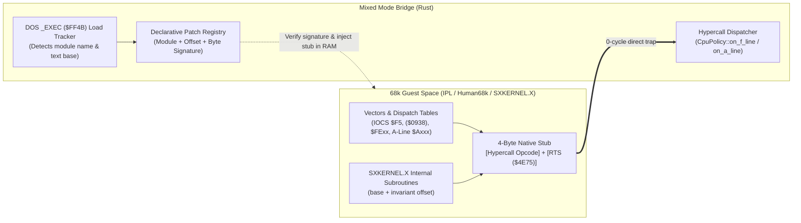

# Mixed Mode Hook Architecture, `SXKERNEL.X` Patching, and Virtual SCSI Bridge

This document specifies the design of the **Mixed Mode (`68k` ⇄ `Rust/ARM`) Hook & Module-Load Patching System** and the **Virtual SCSI (`IOCS $F5` `_SCSIDRV`) Storage Bridge** used to install, boot, and progressively modernize **SX-Window v3.1**.

---

## 1. Design Goals & Principles

As **msx68k** evolves from pure hardware emulation (Phase 1) to hybrid native execution (Phase 2+: 1:1 host mouse integration, TVRAM-free high-resolution Drawing Manager, native `FLOAT`/`PCM8`/`TwentyOne` TSRs), we need a systematic mechanism to intercept and replace internal routines of Human68k, IOCS, and `SXKERNEL.X`.

Two anti-patterns must be avoided:
1. **No Hardcoded Physical RAM Addresses**:
   - The load address of `SXKERNEL.X` in Main RAM shifts whenever `CONFIG.SYS` device drivers or resident TSRs (`OPMDRV3.X`, `FDDEVICE.X`, `FLOAT2.X`, `PCM8.X`, etc.) are added, removed, or reordered. Hooks must never rely on fixed physical RAM addresses like `$0A79A6`.
2. **No Destructive On-Disk Binary Patching**:
   - Modifying `SXKERNEL.X` or system files directly inside the guest HDD image makes iterative development brittle and alters file hashes. The guest disk image should remain a clean, unmodified installation of Human68k and SX-Window v3.1; all hooks are applied **in-memory at module load or reset time** by the emulator's Mixed Mode bridge.

---

## 2. Three-Layer Mixed Mode Hook Architecture



### 2.1 Layer 1: Native Hypercall Opcode Gateway
- We reserve a dedicated range of unallocated F-Line opcodes (`$FE80`–`$FEFF` or `$FF80`–`$FFEF` when executed from supervisor/stub context) as **Native Hypercalls**.
- When the monomorphized MC68000 core fetches a Native Hypercall opcode, `CpuPolicy::on_f_line` traps directly into the Rust hypercall dispatcher in **0 emulated CPU cycles**, without pushing a 68000 exception frame or traversing RAM vectors.
- A native replacement stub in 68k memory requires only **4 bytes (2 words)**:
  ```text
  +0: $FE80 | hypercall_id   ; Traps into Rust Hypercall Dispatcher
  +2: $4E75                  ; RTS (returns cleanly to 68k caller)
  ```

### 2.2 Layer 2: Relocation-Aware Declarative Module Patcher
- When Human68k loads an executable (`.X` / `.SX`) via DOS `_EXEC` (`$FF4B`), or when `SXWIN.X` loads `SXKERNEL.X`, the text segment is placed at a contiguous base address `text_base` in Main RAM and relocated.
- While physical addresses change with `CONFIG.SYS`, **offsets relative to `text_base` (`text_base + offset`) and non-relocated instruction opcodes are 100% invariant** for a given binary version.
- Each entry in the Rust **Declarative Patch Registry** specifies:
  - `module_name`: e.g. `"SXKERNEL.X"`
  - `offset`: byte offset from `text_base`
  - `expected_signature`: original instruction bytes at `text_base + offset` (verified before patching to guarantee safety)
  - `hypercall`: the `HypercallId` to inject (`[$FE80 | id, $4E75]`).

### 2.3 Layer 3: Two Unified Hook Injection Patterns

1. **Vector & Dispatch Table Redirection (API / Driver Level)**:
   - Used for **IOCS calls** (`IOCS $F5` `_SCSIDRV`), **F-Line traps** (`$FExx` floating-point pack), **interrupt/callback vectors** (`($0938)` mouse packet callback), and **SX-Window A-Line (`$A000`–`$AFFF`) Manager APIs** (Drawing Manager `DM`, Window Manager `WM`, Event Manager `EM`).
   - The vector or jump-table entry is pointed to a 4-byte `[Hypercall] + [RTS]` stub stored in ROM/reserved stub space.
2. **Internal Subroutine Prologue Patching (`SXKERNEL.X` Internal Level)**:
   - Used when an internal subsystem of `SXKERNEL.X` is not exposed via an A-Line vector, or when `SXKERNEL.X` already sets up internal register pointers (such as `A4` pointing to a private kernel work structure) immediately before calling a helper subroutine.
   - Overwriting the first 4 bytes of that helper subroutine with `[Hypercall] + [RTS]` allows the Rust handler to read and update the exact internal structure via `A4` without needing to search RAM for private global pointers.

---

## 3. Case Study #1: SX-Window v3.1 Mouse Subsystem & 1:1 Host Cursor Sync

### 3.1 Disassembly Findings in `SXKERNEL.X`
During startup, `SXKERNEL.X` hooks the IOCS mouse packet completion vector at **`($0938)`** (saving the previous IOCS handler `$FF9F58` into `SXKERNEL` data and installing its own handler).

When the Z8530 SCC Channel B finishes receiving a 3-byte mouse packet (`$0CB1` = button status, `$0CB2` = `dx`, `$0CB3` = `dy`), the `SXKERNEL.X` handler executes four internal subroutines in sequence with **`A4` pointing to SX-Window's `MouseWorkArea`** (`56` bytes):

| Call Order | Routine Role | Key Operations & `MouseWorkArea (A4)` Offsets |
|---|---|---|
| **1** | **Button Extraction** (`$0A781E` in standard boot) | Reads status byte `0(A1)` (`$0CB1`), checks the left/right button swap flag at **`$06(A4)`**, and writes `0xFF` (pressed) or `0x00` (released) to **`$0E(A4)` (Left)** and **`$0F(A4)` (Right)**. |
| **2** | **Raw Delta Extraction** (`$0A7860`) | Sign-extends `1(A1)` (`dx`) and `2(A1)` (`dy`), applies axis-inversion flags at **`$07(A4)`** / **`$08(A4)`**, and stores 16-bit raw deltas into **`$16(A4)` (`dx`)** and **`$18(A4)` (`dy`)**. |
| **3** | **Ballistic Acceleration** (`$0A78B2` → `$0A788E`) | For `\|delta\| >= 8`, computes **`\|delta\| * (\|delta\| >> 3)` (quadratic acceleration)**, multiplies by `1.25` (`+ (d >> 2)`), scales by the speed multiplier at **`$04(A4)`**, and accumulates fractional remainders in **`$1A(A4)`** / **`$1C(A4)`**. |
| **4** | **Coordinate Update & Clamping** (`$0A78E4`) | Adds the accelerated `(dx, dy)` to **`$0A(A4)` (Cursor X)** and **`$0C(A4)` (Cursor Y)** and clamps them against the active screen clipping rectangle `[min_x, min_y, max_x, max_y]` stored at **`$34(A4)`..`$3B(A4)`**. |

Subsequently, on every **V-Blank interrupt** (`$0A79CE` → `$0A7946`):
1. If the re-entrancy lock **`$30(A4)`** is `0`, `SXKERNEL.X` copies `$0A(A4)`/`$0C(A4)` (`X, Y`) into latched coordinates **`$10(A4)`/`$12(A4)`** and the global SX-Window cursor variables (**`$0ACB72` = X, `$0ACB74` = Y**), and copies `$0E(A4)`/`$0F(A4)` into **`$14(A4)`** and **`$0ACB76`**.
2. It compares `$14(A4)`/`$15(A4)` against previous button states **`$22(A4)`/`$23(A4)`** and invokes `_PostEvent` (A-Line **`$A0A4`**) to enqueue `MouseDown` (`1` / `3`) or `MouseUp` (`2` / `4`) events.
3. If `$10(A4)` (`X, Y`) differs from the last drawn cursor position **`$1E(A4)`**, it restores the background bitmap under the old cursor and draws the arrow cursor at the new position on TVRAM.

### 3.2 Why Relative Deltas Drift & How the Hook Solves It
Because Subroutine 3 applies **quadratic acceleration (`|delta| * (|delta| >> 3) * 1.25`)** and relative packets cannot know where the host OS cursor entered the window, feeding relative `(dx, dy)` through SCC inevitably causes cursor drift.

By patching Subroutine 4 (`$0A78E4`, or the tail of the `($0938)` handler where `A4` is already loaded with the `MouseWorkArea` pointer) with a **Native Hypercall (`HypercallId::SxMouseSync`)**:
- Whenever the host cursor is inside the window at `(host_x, host_y)`, the hypercall clamps `(host_x, host_y)` directly against the guest's own clipping rectangle at `$34(A4)..$3B(A4)`, writes the exact `(X, Y)` to **`$0A(A4)`** and **`$0C(A4)`**, and zeroes the fractional remainders at `$1A(A4)`/`$1C(A4)`.
- The V-Blank routine (`$0A79CE`) and `_PostEvent` (`$A0A4`) continue to run unmodified, drawing the SX-Window cursor and dispatching clicks at the **exact pixel `(host_x, host_y)`** with zero lag or drift.

---

## 4. Virtual SCSI ROM (`$FC0000`) & High-Level `IOCS $F5` (`_SCSIDRV`) Bridge

### 4.1 How X68000 `IPLROM` and `HUMAN.SYS` Discover SCSI
Disassembly of `IPLROM.DAT` and `HUMAN.SYS` v3.02 reveals a clean hardware/firmware boundary:
1. **`HUMAN.SYS` Built-in SCSI Driver**:
   - During kernel initialization, `HUMAN.SYS` probes `$EA0044` for `"SCSIEX"` (external CZ-6BS1 board) and **`$FC0024` for `"SCSIIN"`** (internal SCSI ROM at `$FC0000`).
   - If `"SCSIIN"` is present at `$FC0024`, `HUMAN.SYS` activates its built-in SCSI block device driver and performs all disk operations through **`IOCS $F5` (`_SCSIDRV`)** (`TRAP #15` with `D0.B = $F5`, `D1.L` = sub-function ID).
2. **`IPLROM` ROM Boot**:
   - When booting from SCSI (or when no floppy is inserted and SRAM `$ED000C` / boot device selects ROM/SCSI), `IPLROM` jumps through the boot vector at `$FC0000` to load the SCSI partition table and Human68k boot sector into `$002000`.

### 4.2 Synthesized Virtual SCSI ROM + Hypercall `_SCSIDRV`
Instead of requiring a proprietary `SCSIIN.ROM` binary file or emulating low-level `MB89352` SPC bus phases, [`X68kBus`](../crates/msx68k-bus/src/bus.rs) synthesizes a minimal **Virtual SCSI ROM** at `$FC0000`:
- **`$FC0000`–`$FC0023`**: Boot & IOCS `$F5` entry stubs composed of `[Hypercall Opcode] + [RTS]`.
- **`$FC0024`–`$FC0029`**: ASCII signature `"SCSIIN"`.
- **Supported `IOCS $F5` (`_SCSIDRV`) Sub-functions (`D1.B`)**:
  - `$00` (`_S_RESET`): Reset SCSI bus and initialize IOCS `$F5` vector.
  - `$01`..`$09`: Low-level phase stubs (returning success for compatibility with diagnostic tools).
  - `$20` (`_S_INQUIRY`): Returns target device descriptor (Direct-Access Block Device `0x00`, `"SHARP   msx68k SCSI HDD"`).
  - `$21` (`_S_READ`) / `$22` (`_S_WRITE`): Reads/writes 512-byte or 1024-byte logical blocks between the mounted `.HDS`/`.HDF` image and guest RAM (`A1`), with `D2` = LBA, `D3` = block count, `D4` = sector size code (`0` = 256B, `1` = 512B, `2` = 1024B).
  - `$23` (`_S_FORMAT`) / `$24` (`_S_TESTUNIT`) / `$25` (`_S_READCAP`) / `$26` (`_S_READEXT`) / `$27` (`_S_WRITEEXT`) / `$2F` (`_S_REZERO`) / `$30` (`_S_REQUEST`): Full support for `HDフォーマット.X`, partition table creation (`X68SCSI1`), `HUMAN.SYS` installation, and SX-Window v3.1 multi-disk installation.
