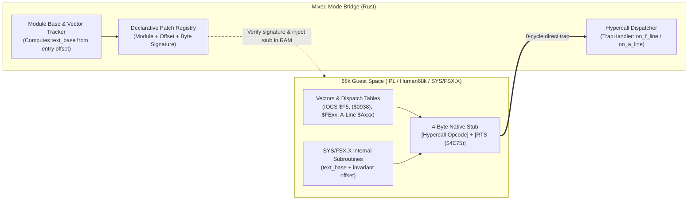

# Mixed Mode Hook Architecture, `SYS/FSX.X` Patching, and Virtual SCSI Bridge

This document specifies the design of the **Mixed Mode (`68k` ⇄ `Rust/ARM`) Hook & Module-Load Patching System** and the **Virtual SCSI (`IOCS $F5` `_SCSIDRV`) Storage Bridge** used to install, boot, and progressively modernize **SX-Window v3.1**.

---

## 1. Design Goals & Principles

As **msx68k** evolves from pure hardware emulation (Phase 1) to hybrid native execution (Phase 2+: 1:1 host mouse integration, TVRAM-free high-resolution Drawing Manager, native `FLOAT`/`PCM8`/`TwentyOne` TSRs), we need a systematic mechanism to intercept and replace internal routines of Human68k, IOCS, and SX-Window (`SYS/FSX.X`).

Two anti-patterns must be avoided:
1. **No Hardcoded Physical RAM Addresses**:
   - The load address (`text_base`) of `SYS/FSX.X` in Main RAM shifts whenever `CONFIG.SYS` device drivers, SCSI `romdb` block buffers (`+0x68` bytes when booting from SCSI HDD vs. floppy), or resident TSRs (`OPMDRV3.X`, `FDDEVICE.X`, `FLOAT2.X`, `PCM8.X`, etc.) are added, removed, or reordered. Hooks must never rely on fixed physical RAM addresses like `$0A79A6`.
2. **No Destructive On-Disk Binary Patching**:
   - Modifying `SYS/FSX.X` or system files directly inside the guest HDD image makes iterative development brittle and alters file hashes. The guest disk image remains a clean, unmodified installation of Human68k v3.02 and SX-Window v3.1; all hooks are applied **in-memory at module load or vector registration time** by the emulator's Mixed Mode bridge.

---

## 2. Three-Layer Mixed Mode Hook Architecture



### 2.1 Layer 1: Native Hypercall Gateway
The F-Line space is not ours to spend: Human68k gives `$FFxx` to DOS calls and `$FExx` to FE
function calls, and programs can take over any of them (`_INTVCS`, `__FEVECS`). So msx68k takes
one opcode only, and the address it runs at decides which hypercall it is.

- **One opcode, `$FBFF`**, defined once as `HYPERCALL_OPCODE` in
  [`hypercall.rs`](../crates/msx68k-bus/src/hypercall.rs); changing it there changes every
  hypercall. It was chosen because no MC68000–68060 instruction uses `$F801`–`$FDFF` (HAS060.X
  `M68K.DOC`), while FLOAT leaves `$FE80`–`$FEDF` unassigned but open to `__FEVECS`.
- **The calling address decides.** Whoever installs a hypercall, as a patch over guest code or a
  stub in a ROM msx68k provides, registers its exact address and the `HypercallId` it stands for
  (`X68kBus::register_hypercall`). `BusTrapHandler::on_f_line` hands every F-Line instruction to
  `X68kBus::handle_hypercall`, which carries out a registered hypercall in **0 emulated CPU
  cycles**, without a 68000 exception frame. The opcode at any other address, and every other
  F-Line opcode, goes to the guest's Line 1111 Emulator vector (`#11`) as on the real machine.
- **Lifetime.** Addresses in RAM are forgotten at a reset, when the code they patched is gone;
  addresses in ROM stay.
- **Function calls where there is room.** One registered address can serve several functions,
  with a register carrying the function number, so the registry stays small. A call is carried
  out only when it comes to a registered address and its function number is valid; nothing more
  is checked. An unknown function number is an ordinary F-Line exception.
- **Registered addresses:**
  | Hypercall | Address | Installed by |
  | :--- | :--- | :--- |
  | `SxMouseSync` | `SYS/FSX.X` `text_base + 0x04F768` | Patch (Section 2.2) |
  | `GmTextSpan`, `GmPenSpan` | `SYS/FSX.X` `text_base + 0x381FE`, `+ 0x37212` | Patch (Section 2.3, pattern 3) |
  | `AlertRowCopy`, `AlertIconCopy`, `AlertGlyphOr` | `SYS/FSX.X` `text_base + 0x4C41E`, `+ 0x4C3CC`, `+ 0x4C2CA` | Patch (Section 2.3, pattern 3) |
  | `ScsiRomBoot`, `ScsiRomdbBuild`, `ScsiIocsInstall`, `ScsiIocsDispatch`, `ScsiDriverStrategy`, `ScsiDriverInterrupt` | `$FC0050`, `$FC0060`, `$FC0064`, `$FC0068`, `$FC006C`, `$FC0070` | Virtual SCSI ROM (Section 4) |
  | `AppEntry` | `$FDFFF8` | Application entry, below |
- **Application entry.** msx68k's own applications (`SXMODE.X`, VMX68K.SX) reach the host
  through one entry, which only the primary SX-Window VM has. It sits at the end of the internal
  SCSI ROM window (`$FC0000`–`$FDFFFF`), outside the SCSI ROM itself:
  ```text
  $FDFFF0  'MSX68K', version.w (1)   ; signature
  $FDFFF8  $FBFF                     ; the hypercall, registered as AppEntry
  $FDFFFA  $4E75                     ; RTS
  $FDFFFC  reserved
  ```
  These 16 bytes can always be read in supervisor mode. The rest of the window raises a bus
  error unless the SCSI ROM is emulated, so msx68k is never taken for a machine with an internal
  SCSI ROM (`SCSIIN` at `$FC0024`) when it has none. Like the rest of the ROM, the entry cannot be
  reached in user mode.
- **Calling the entry.** [`guest/include/msx68k.mac`](../guest/include/msx68k.mac) holds the
  equates and `MSX68K_CALL_ROUTINE`, which expands `msx68k_call`: it reads the signature with DOS
  `_BUS_ERR`, so a machine without the entry reports a bus error instead of taking one, and
  calls `$FDFFF8` in supervisor mode through DOS `_SUPER_JSR`, with the function in `D0.L` and
  arguments in `D1`–`D3`. It returns `D0.L = -1` when the entry is not there. A test checks the
  equates against the host's constants. Switching modes by hand failed under SX-Window: going
  back to user mode with DOS `_SUPER` ended in a system error, and IOCS `_B_SUPER` lost `A0`,
  `D5`, or the stacked results on the way back.
  | `D0.L` | Function | Arguments and results |
  | :---: | :--- | :--- |
  | 0 | `Version` | Returns the version in `D0.L`. |
  | 1 | `GetWheelConfig` | Returns `D1` reverse (1), `D2` arrow clicks per notch, `D3` trackpad pixels per notch. |
  | 2 | `SetWheelConfig` | Sets `D1`–`D3` and returns them as clamped. |
  | 3 | `ScreenMode` | `D1.L = -1` returns the mode, width, and height in `D0`–`D2`; otherwise switches to mode `D1` (0, 1, 2) or to the size in `D1`, `D2`. Superseded by `IOCS _CRTMOD` `$50`. |
  | 4 | `VmOpen` | Starts a VM for the window `D1.L` (`WindowPtr`), with a drive 0 image of `D2.L` bytes that VMX68K.SX serves (0 for none) and `D3.L` of the primary's drives from A: for shared mode; returns its ID (1 or more) in `D0.L`. See [VMX68K.md](VMX68K.md) Section 3.5. |
  | 5 | `VmPoll` | Called by VMX68K.SX for VM `D1.L` when the host wakes it with `E_USER1`, with its buffer at `D2.L` of `D3.L` bytes. Returns the kind of the next request in `D0.L`, its numbers in `D1.L`..`D3.L`, and its bytes in the buffer; 0 for nothing to do, or -1 for an unknown VM. One request is handed out at a time. Kinds (`BridgeOp`): 1 read `D2.L` bytes at offset `D1.L` of drive 0's image into the buffer, 2 write `D2.L` bytes from the buffer there, 3 `_OPEN` the path in the buffer with mode `D1.L`, 4 read `D2.L` bytes at offset `D1.L` of handle `D3.L`, 5 `_CLOSE` handle `D3.L`, 6 `_FILES` for the path at +64 of the buffer with attribute `D1.L` into its first 53 bytes, 7 `_NFILES` with the 53-byte buffer the host put back, 8 `_DSKFRE` of drive `D1.L` (1 = A:) into the buffer, 9 `_MKDIR`, 10 `_RMDIR`, 11 `_DELETE` of the path in the buffer, 12 `_RENAME` of it to the path at +256, 13 `_CHMOD` of it to attribute `D1.L` (-1 reads), 14 `_CREATE` (`D2.L` 1) or `_NEWFILE` (0) of it with attribute `D1.L`, 15 write `D2.L` bytes from the buffer at offset `D1.L` of handle `D3.L` (0 bytes cut the file there), 16 `_FILEDATE` of handle `D3.L` to `D1.L`. |
  | 6 | `VmClose` | Stops VM `D1.L`. Returns 0, or -1 for an unknown VM. |
  | 7 | `VmReply` | Answers the request `VmPoll` handed out for VM `D1.L` with the DOS result `D2.L` (0 or -1 for drive 0's image). Bytes read are in the buffer. Returns 0, or -1 when no request was handed out. |
- Still open: whether a full X68030 ROM image would occupy the end of the window.
- In addition to hypercalls, resolution querying and switching is officially controlled via **`IOCS _CRTMOD` (`TRAP #15`, `D0.B == $10`, Mode `$50`)**, handled directly in `BusTrapHandler::on_trap`:
  - `D1.W == $0150, D2.L == -1`: Extended resolution query (`D0 = mode`, `D1 = (w << 16) | h`, `D2 = fullscreen_flag`, `D3 = (native_w << 16) | native_h`).
  - `D1.W == $0150, D2.L == 0`: Host Native Fullscreen 1:1 mode.
  - `D1.W == $0150, D2.L > 0`: Windowed 1:1 mode (`w = D2.L >> 16, h = D2.L & $FFFF`).
  - The mode is kept in battery-backed SRAM `$ED007E` (`0x80 | 0x30 = 0xB0`), and `SXMODE.X` saves the resolution in msx68k's resource library `A:\SYS\MSX68K.LB`.
- On MC68030 VMs, `BusTrapHandler::on_trap` also answers **`IOCS _SYS_STAT` (`D0.B == $AC`)**, which only the X68030 IPL ROM provides, while its IOCS table entry is the ROM's handler for undefined calls. See [CPU_AND_BUS.md](CPU_AND_BUS.md) Section 7.3.
- A native replacement stub in ROM requires only **4 bytes (2 words)**, and a patch over a
  routine's first instruction only the first word:
  ```text
  +0: $FBFF                  ; The hypercall registered at this address
  +2: $4E75                  ; RTS (returns cleanly to 68k caller)
  ```

- SX-Window APIs are replaced natively through `TrapHandler::on_a_line` without patching guest memory. Drawing that `SYS/FSX.X` reaches through direct calls rather than A-Line APIs uses pattern 3 of Section 2.3. See [NATIVE_DRAWING.md](NATIVE_DRAWING.md) and [NATIVE_FONTS.md](NATIVE_FONTS.md).

- Addresses `$F000_0000`..`$FEFF_FFFF` are reserved for msx68k extensions in the primary SX-Window VM, and the extended screen uses the first 16 MB block. Partial and full VMs mirror the range to the 24-bit space as on the 68000 (see [NATIVE_DRAWING.md](NATIVE_DRAWING.md) Section 2.5).

### 2.2 Layer 2: Relocation-Aware Declarative Module Patcher
- In SX-Window v3.1, the entire SX-Window kernel (Drawing Manager, Window Manager, Event Manager, Resource Manager, and the Mouse Subsystem) is packaged inside **`SYS/FSX.X`** (`367,436` bytes), loaded via `CONFIG.SYS` as the character device `"SXTools"` (`SXWIN.X` is a small `26,118`-byte launcher).
- While physical RAM addresses shift depending on preceding device drivers (`text_base = $05817C` on floppy boot vs. `$0581E4` on SCSI HDD boot), **offsets relative to `text_base` (`text_base + offset`) and non-relocated instruction opcodes are 100% invariant**.
- When `SYS/FSX.X` initializes, it writes its mouse packet handler address (`text_base + 0x04F82A`) into the IOCS mouse receiver vector at `$0000_0938`. [`X68kBus::check_fsx_mouse_hook_patch`](../crates/msx68k-bus/src/sxwin.rs) intercepts that write, derives `text_base = handler_addr - 0x04F82A`, verifies the expected 4-byte instruction signature at `text_base + 0x04F768` (`MOVEM.L D0-D2/A5, -(SP)` = `[0x48, 0xE7, 0xE0, 0x04]`), and patches the hypercall and `RTS`, registered as `HypercallId::SxMouseSync`.
- Dynamic screen resolution management and desktop region updates are handled entirely by `X68kBus::apply_screen_resolution` in [`crates/msx68k-bus/src/sxwin.rs`](../crates/msx68k-bus/src/sxwin.rs), completely separating SX-Window desktop virtualization from the SCSI disk subsystem.

### 2.3 Layer 3: Two Unified Hook Injection Patterns

1. **Vector & Dispatch Table Redirection (API / Driver Level)**:
   - Used for **IOCS calls** (`IOCS $F5` `_SCSIDRV`), **ROM boot & `romdb` device driver callbacks** (`$FC0000` Virtual SCSI ROM), **F-Line traps**, and **SX-Window A-Line (`$A000`–`$AFFF`) Manager APIs**.
   - The vector or jump-table entry points to a 4-byte `[Hypercall] + [RTS]` stub stored in ROM/driver space.
2. **Internal Subroutine Prologue Patching (`SYS/FSX.X` Internal Level)**:
   - Used when an internal subsystem of `SYS/FSX.X` already sets up internal register pointers (such as `A4` pointing to the private `MouseWorkArea` structure) immediately before calling a helper subroutine.
   - Overwriting the first 4 bytes of that helper subroutine with `[Hypercall] + [RTS]` allows the Rust handler to read and update the exact internal structure via `A4` without searching RAM for private global pointers.
3. **Replaced First Instruction with Guest Fallback (`SYS/FSX.X` Internal Level)**:
   - Used when a routine is called directly, with no A-Line API in front of it, and the native version must be able to decline some calls. Only the first word of the routine is overwritten with the hypercall, so no guest memory is consumed.
   - When the native version handles the call, the hypercall performs the routine's `RTS` itself. Otherwise it performs the replaced instruction on the CPU state and continues at the instruction after it, so the original routine runs unchanged.
   - `GmTextSpan` replaces `MOVEM.L D3-D7/A1-A4,-(SP)` at `text_base + 0x381FE` this way, and `GmPenSpan` replaces `MOVEM.L D2-D7/A1/A3/A6,-(SP)` at `text_base + 0x37212`. `AlertRowCopy`, `AlertIconCopy`, and `AlertGlyphOr` replace single two-byte instructions of the system error alert box, so their fallback performs exactly that instruction. The cursor routines at `text_base + 0x521BA` and `+ 0x521DC` are patched to a bare `RTS` because the host draws the cursor.

---

## 3. Case Study #1: SX-Window v3.1 Mouse Subsystem & 1:1 Host Cursor Sync

### 3.1 Disassembly Findings in `SYS/FSX.X`
During startup, `SYS/FSX.X` hooks the IOCS mouse packet completion vector at **`($0938)`** to `text_base + 0x04F82A` (`$0A79A6` on floppy boot, `$0A7A0E` on SCSI HDD boot), saving the previous IOCS handler `$FF9F58` at `text_base + 0x04F824`.

When the Z8530 SCC Channel B finishes receiving a 3-byte mouse packet (`$0CB1` = button status, `$0CB2` = `dx`, `$0CB3` = `dy`), the `SYS/FSX.X` handler at `text_base + 0x04F82A` loads **`A4 = text_base + 0x05CA44` (`MouseWorkArea`, `56` bytes)** and calls four internal subroutines in sequence:

| Call Order | Routine Role & Offset from `text_base` | Key Operations & `MouseWorkArea (A4)` Offsets |
|---|---|---|
| **1** | **Button Extraction** (`+0x04F6A2`) | Reads status byte `0(A1)` (`$0CB1`), checks the left/right button swap flag at **`$06(A4)`**, and writes `0xFF` (pressed) or `0x00` (released) to **`$0E(A4)` (Left)** and **`$0F(A4)` (Right)**. |
| **2** | **Raw Delta Extraction** (`+0x04F6E4`) | Sign-extends `1(A1)` (`dx`) and `2(A1)` (`dy`), applies axis-inversion flags at **`$07(A4)`** / **`$08(A4)`**, and stores 16-bit raw deltas into **`$16(A4)` (`dx`)** and **`$18(A4)` (`dy`)**. |
| **3** | **Ballistic Acceleration** (`+0x04F736` → `+0x04F712`) | For `\|delta\| >= 8`, computes **`\|delta\| * (\|delta\| >> 3)` (quadratic acceleration)**, multiplies by `1.25` (`+ (d >> 2)`), scales by the speed multiplier at **`$04(A4)`**, and accumulates fractional remainders in **`$1A(A4)`** / **`$1C(A4)`**. |
| **4** | **Coordinate Update & Clamping** (`+0x04F768`) | Adds the accelerated `(dx, dy)` to **`$0A(A4)` (Cursor X)** and **`$0C(A4)` (Cursor Y)** and clamps them against the active screen clipping rectangle `[min_x, min_y, max_x, max_y]` stored at **`$34(A4)`..`$3B(A4)`**. |

Subsequently, on every **V-Blank interrupt** (`text_base + 0x04F852` → `text_base + 0x04F7CA`):
1. If the re-entrancy lock **`$30(A4)`** is `0`, `SYS/FSX.X` copies `$0A(A4)`/`$0C(A4)` (`X, Y`) into latched coordinates **`$10(A4)`/`$12(A4)`** and the global SX-Window cursor variables (**`text_base + 0x0549F6` = X, `text_base + 0x0549F8` = Y**), and copies `$0E(A4)`/`$0F(A4)` into **`$14(A4)`** and **`text_base + 0x0549FA`**.
2. It compares `$14(A4)`/`$15(A4)` against previous button states **`$22(A4)`/`$23(A4)`** and invokes `_PostEvent` (A-Line **`$A0A4`**) to enqueue `MouseDown` (`1` / `3`) or `MouseUp` (`2` / `4`) events.
3. If `$10(A4)` (`X, Y`) differs from the last drawn cursor position **`$1E(A4)`**, it restores the background bitmap under the old cursor and draws the arrow cursor at the new position on TVRAM.

### 3.2 Why Relative Deltas Drift & How `SxMouseSync` Solves It
Because Subroutine 3 (`+0x04F736`) applies **quadratic acceleration (`|delta| * (|delta| >> 3) * 1.25`)** and relative packets cannot know where the host OS cursor entered the window, feeding relative `(dx, dy)` through SCC inevitably causes cursor drift.

By patching Subroutine 4 (`text_base + 0x04F768`) with **`[$FBFF, $4E75]` (the hypercall registered as `HypercallId::SxMouseSync`, + `RTS`)**:
- Whenever the host cursor is inside the window at `(host_x, host_y)`, `SxMouseSync` clamps `(host_x, host_y)` directly against the guest's own clipping rectangle (`min_x = $34(A4)`, `min_y = $36(A4)`, `max_x = $38(A4) - 1`, `max_y = $3A(A4) - 1`), writes the exact `(X, Y)` to **`$0A(A4)`** and **`$0C(A4)`**, and zeroes the fractional remainders at `$1A(A4)`/`$1C(A4)`.
- If no host cursor position is active (`host_mouse_pos == None`), `SxMouseSync` executes the exact original 68000 delta-addition and clamping logic as a fallback.
- The V-Blank routine (`+0x04F852`) and `_PostEvent` (`$A0A4`) continue to run unmodified, drawing the SX-Window cursor and dispatching clicks at the **exact pixel `(host_x, host_y)`** with zero lag or drift.

---

## 4. Virtual SCSI ROM (`$FC0000`), `romdb` Driver & All-in-One HDD Builder

### 4.1 How X68000 `IPLROM` and `HUMAN.SYS` Discover and Boot SCSI
Disassembly of `IPLROM.DAT` (`$FF0000`) and `HUMAN.SYS` v3.02 (`$00AC9C`) reveals three exact firmware interfaces implemented in [`crates/msx68k-bus/src/scsi.rs`](../crates/msx68k-bus/src/scsi.rs):
1. **Virtual SCSI ROM Header (`$FC0000`) & `romdb` Protocol**:
   - `IPLROM` and `HUMAN.SYS` check **`$FC0024` for the 6-byte ASCII signature `"SCSIIN"`**.
   - At `$FC0000`, the longword pointer `P = $00FC_0050` serves both as the ROM boot entry point and as the anchor for `HUMAN.SYS`'s `romdb` block device handshake:
     - `P` (`$FC0050`): the cold boot stub (`ScsiRomBoot` + `RTS`).
     - `P - 16` (`$FC0040`): Pointer (`$00FC_0060`) to the `romdb` builder stub (`ScsiRomdbBuild` + `RTS`).
     - `P - 12` (`$FC0044`): Pointer (`$00FC_0064`) to the `IOCS $F5` installer stub (`ScsiIocsInstall` + `RTS`), which points vector `$F5` (`$0007D4`) at the handler stub at `$FC0068` (`ScsiIocsDispatch` + `RTS`).
     - `P - 8 .. P` (`$FC0048..$FC004F`): 8-byte ASCII magic **`"Human68k"`**.
2. **`romdb` Block Device Driver Construction (`ScsiRomdbBuild`, `ScsiDriverStrategy`, and `ScsiDriverInterrupt`)**:
   - During kernel startup, `HUMAN.SYS` verifies `"Human68k"` at `P - 8` and calls `*(P - 16)` (`ScsiRomdbBuild`) with `A4` pointing to free kernel driver memory.
   - `ScsiRomdbBuild` writes a 22-byte Human68k block device header at `(A4)` whose strategy and interrupt entries point at the ROM stubs `$FC006C` (`ScsiDriverStrategy`) and `$FC0070` (`ScsiDriverInterrupt`), followed by a BPB pointer at `A4 + 22` and the BPB of the `Human68k` partition (`A:`) at `A4 + 26`.
   - `ScsiDriverStrategy` latches the request packet in `A5`, and `ScsiDriverInterrupt` handles Human68k block driver commands `0` (`INIT`), `1`/`2` (`CHECK MEDIA` / `BUILD BPB`), `4` (`READ`), `5` (`MEDIA SENSE / _DRVCTRL`, returning `req[13] = 0x02` media ready), and `8`/`9` (`WRITE`).
3. **Supported `IOCS $F5` (`_SCSIDRV`) Sub-functions (`D1.B`)**:
   - `$00` (`_S_RESET`), `$01`..`$09` (low-level bus phase stubs), `$20` (`_S_INQUIRY`), `$21` (`_S_READ`), `$22` (`_S_WRITE`), `$23` (`_S_FORMAT`), `$24` (`_S_TESTUNIT`), `$25` (`_S_READCAP`), `$26` (`_S_READEXT`), `$27` (`_S_WRITEEXT`), `$2F` (`_S_REZERO`), and `$30` (`_S_REQUEST`).

### 4.2 Pure-Rust All-in-One SX-Window v3.1 Bootable SCSI HDD Builder
[`build_bootable_sxwin_scsi_hdd`](../crates/msx68k-bus/src/scsi.rs) constructs a complete 32 MB bootable X68000 SCSI HDD image (`SXWIN31.HDS`) purely in Rust from unmodified `HUMAN302.XDF` and `SXWIN311.XDF`..`SXWIN316.XDF` floppy images:
- Synthesizes the `"X68SCSI1"` header at `0x0000`, pure-68000 SCSI IPL at `0x0400`, partition table at `0x1000` (`"Human68k"` active partition starting at 1024-byte sector `0x20` = byte `0x8000`), and FAT16 partition boot sector + BPB at `0x8000` with zero external binary blobs.
- Extracts all files and multi-level Shift-JIS subdirectories (`SYS`, `BIN`, `SHELL`, `ｼｬｰﾍﾟﾝ/EXCOM`, `福袋`, etc.) while preserving Human68k's 18+3 extended filename bytes (`chunk[12..22]`).
- Automatically updates `CONFIG.SYS` (`/DA:\X68K.DIC`) and `SHELL/SXWIN.ENV` (`path=A:\;A:\SHELL;A:\SYS;A:\BIN;...`) so SX-Window v3.1 boots directly into the full GUI desktop from a single SCSI drive (`A:`) without floppy disk swaps.

---

## 5. SX-Window v3.1 API Catalog & Hook Status Reference

For the complete disassemblies, 16 KB A-Line dispatch table analysis, 21 manager subsystems (1,050 active APIs), TVRAM `$00E00000` / CRTC `$E80000` decoupling blueprint, and the living Primary Hook & Patch Tracking Table, see:
- [SX-Window v3.1 Kernel Architecture, A-Line ($Axxx) API Catalog, and Primary Hook Tracking Reference](SX_WINDOW_API_AND_HOOK_STATUS.md)
