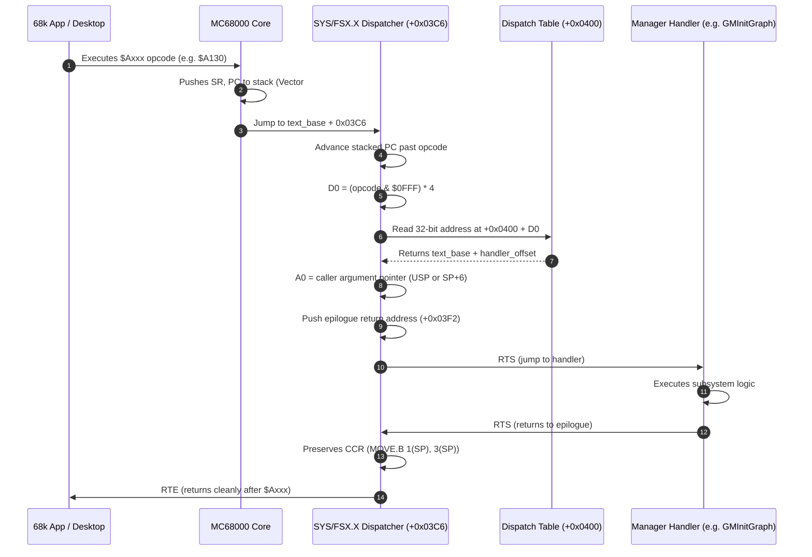
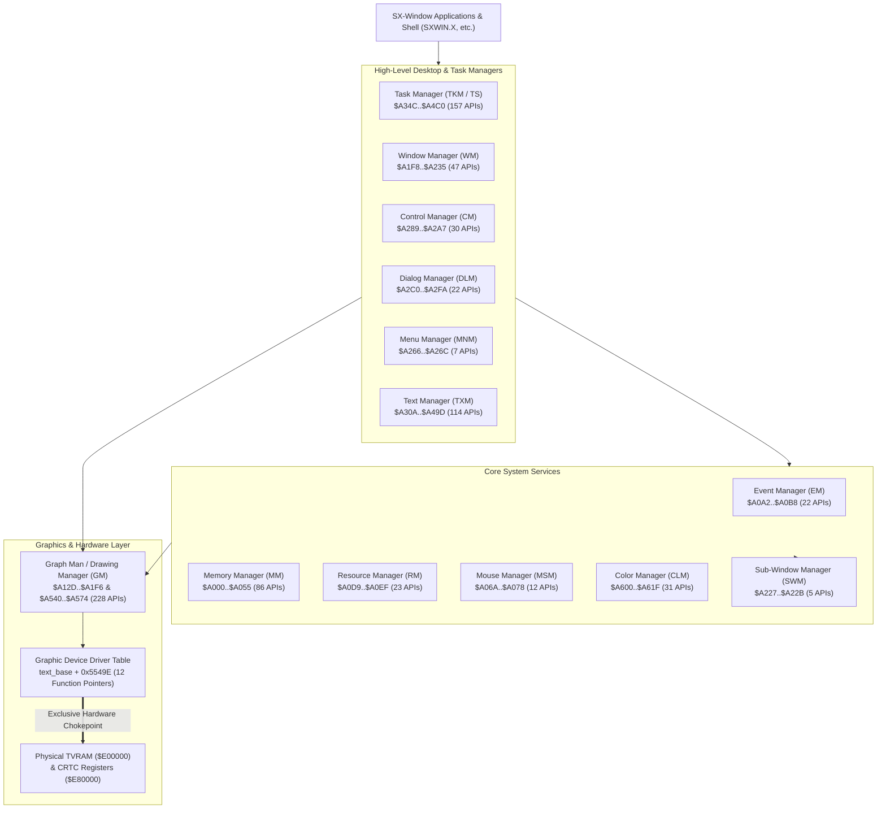
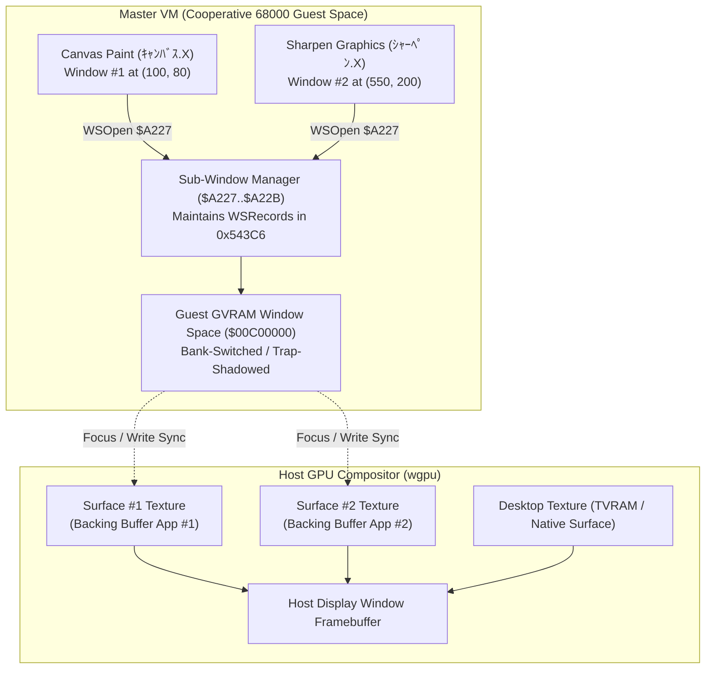

# SX-Window v3.1 Kernel Architecture, A-Line (`$Axxx`) API Catalog, and Master Hook Tracking Reference

This reference document specifies the low-level binary layout, the **Line 1010 Emulator (`Vector #10`) A-Line (`$Axxx`) Dispatcher**, the complete **SX-Window v3.1 Manager Subsystem Catalog (1,050 active APIs)**, **Screen Mode Selection & Battery-Backed SRAM Storage**, the **Sub-Window Manager (`SWM`) & Virtualized GVRAM Architecture**, and the low-level **Graph Man (`GM`) Drawing Engine Internals** inside **`SYS/FSX.X`**. It establishes the technical blueprint for **Phase 2: Decoupled High-Resolution & TrueColor Native Execution** in **msx68k**.

---

## 1. `SYS/FSX.X` Binary Layout & Vector #10 Dispatcher Architecture

### 1.1 Executable Structure & Invariant Offset Model
In SX-Window v3.1, the entire system kernel (Graphics, Window Management, Event Dispatching, Memory Management, Resource Management, and Peripheral Drivers) is contained within **`SYS/FSX.X`** (367,436 bytes on disk, loaded via `CONFIG.SYS` as character device `"SXTools"`).

The file layout conforms to the Human68k `HU` executable format with an embedded device driver header:
- **`+0x0000..+0x003F` (64 bytes)**: Human68k `HU` header (`magic = b"HU"`, `text_len = 0x53B6A`, `data_len = 0x022A8`, `bss_len = 0x0E50E`, `reloc_len = 0x03CFA`).
- **`+0x0040..+0x005F` (32 bytes)**: Character Device Driver Header (`"SXTools"`, `strategy = +0x004E`, `interrupt = +0x0056`).
- **`+0x0040..+0x53BAA`**: Relocatable code segment (`text`).
- **`+0x53BAA..+0x55E52`**: Initialized data segment (`data`).
- **`+0x55E52..+0x59B4C`**: 16-bit word-delta relocation table (`reloc`, 7,805 relocation entries).

```text
[Disk File Offset]                 [Main RAM Physical Space]
0x000000: +-----------------------+
          | Human68k HU (64B)     | (Stripped by device driver loader)
0x000040: +-----------------------+ <=== text_base (e.g. $0581E4 on SCSI HDD boot)
          | Device Header "SXTools"
          | Vector #10 Installer  | (+0x036C: IOCS $80 _B_INTVEC)
          | Vector #10 Dispatcher | (+0x03C6: Line 1010 handler)
          | 16KB Dispatch Table   | (+0x0400..+0x4400: 4096 entries)
          | Code & Subsystems     | (+0x4400..+0x53B6A)
          | Mode Table & Records  | (+0x55278 active record, +0x552F6 mode table)
          | Drawing Driver Table  | (+0x5549E: 12 primitive function pointers)
          | MouseWorkArea Pointer | (+0x633CA -> +0x5CA44)
          +-----------------------+
```

> [!IMPORTANT]
> **Invariant Offset Principle**: When `SYS/FSX.X` initializes, it hooks the IOCS mouse packet completion vector at `$0000_0938` to `text_base + 0x04F82A`. The emulator dynamically derives `text_base = handler_addr - 0x04F82A`. Any internal function or data structure inside `SYS/FSX.X` is addressed at an **invariant offset** `text_base + offset`, corresponding exactly to `file_offset = 0x40 + offset` in the un-relocated binary.

---

### 1.2 Line 1010 Emulator (`Vector #10`) Installation
During driver initialization (`SYS/FSX.X` entry), `Vector #10` (memory address `$0000_0028`) is configured via the standard IOCS interrupt vector interface:

```m68k
text+0x036C:  48E7 0040         MOVEM.L D1, -(SP)
text+0x0370:  7080              MOVEQ   #$80, D0          ; IOCS $80: _B_INTVEC (Get/Set Vector)
text+0x0372:  720A              MOVEQ   #10, D1           ; Vector #10 ($0A): Line 1010 Emulator
text+0x0374:  43F9 0000 03C6    LEA     ($03C6, text), A1 ; A1 = Handler address (text + $03C6)
text+0x037A:  4E4F              TRAP    #15               ; IOCS Call -> D0 = Old Vector #10 Address
text+0x037C:  23C0 0000 03BA    MOVE.L  D0, ($03BA, text) ; Save previous Vector #10 at text + $03BA
text+0x0382:  4A39 0000 0CBC    TST.B   ($0CBC).L         ; Test IOCS _CPU_TYPE (0=68000, 1=68010, 2=68020, 3=68030)
text+0x0388:  6708              BEQ.S   is_68000          ; If 68000 (3-word stack frame), skip
text+0x038A:  33FC 0008 0000 03B8 MOVE.W #8, ($03B8, text); On 68010/020/030, exception frame is 8 bytes
is_68000:
text+0x0392:  4CDF 0200         MOVEM.L (SP)+, D1
text+0x0396:  4E75              RTS
```

- When running on a Motorola MC68000, the Line 1010 exception stack frame is **6 bytes** (`SR` [2B] + `PC` [4B]), so `($03B8, text) = 6`.
- On MC68010/68020/68030, the frame is **8 bytes** (`SR` [2B] + `PC` [4B] + `Format/Offset` [2B]), so `($03B8, text) = 8`.
- Uninstaller at `text_base + 0x0398` restores the original vector from `text_base + 0x03BA` via `IOCS $80`.

---

### 1.3 Stack Frame & Opcode Decoding Mechanism
Whenever a 68000 application executes an `$Axxx` opcode (e.g. `GMInitGraph` `$A130`), the CPU pushes an exception frame onto the active stack and branches to `text_base + 0x03C6`:

```m68k
text+0x03C6:  206F 0002         MOVEA.L 2(SP), A0         ; A0 = Faulting PC (points to $Axxx opcode)
text+0x03CA:  3018              MOVE.W  (A0)+, D0         ; D0 = $Axxx opcode word, A0 advanced past $Axxx
text+0x03CC:  2F48 0002         MOVE.L  A0, 2(SP)         ; Update return PC on stack so RTE returns past $Axxx!
text+0x03D0:  C07C 0FFF         ANDI.W  #$0FFF, D0        ; Extract 12-bit trap index (0..4095)
text+0x03D4:  D040              ADD.W   D0, D0            ; D0 = index * 2
text+0x03D6:  D040              ADD.W   D0, D0            ; D0 = index * 4 (32-bit table stride)
text+0x03D8:  203B 0026         MOVE.L  $0026(PC, D0.W), D0 ; Fetch 32-bit handler from table at text + $0400!
text+0x03DC:  4E68              MOVE    USP, A0           ; Default parameter pointer: A0 = User Stack Pointer
text+0x03DE:  0817 0005         BTST    #5, (SP)          ; Test Supervisor bit (S) in stacked SR
text+0x03E2:  6706              BEQ.S   called_from_user  ; If User mode, USP already points to caller arguments!
text+0x03E4:  204F              MOVEA.L SP, A0            ; If Supervisor mode: A0 = SP
text+0x03E6:  D0FA FFD0         ADDA.W  -48(PC), A0       ; A0 += ($03B8, text) (Skip 6B or 8B exception frame!)
called_from_user:
text+0x03EA:  487A 0006         PEA     6(PC)             ; Push return address (text + $03F2) onto stack
text+0x03EE:  2F00              MOVE.L  D0, -(SP)         ; Push target handler address onto stack
text+0x03F0:  4E75              RTS                       ; Jumps to target handler with A0 = argument pointer!

; --- Dispatcher Epilogue (Handler returns here via RTS) ---
text+0x03F2:  40E7              MOVE    SR, -(SP)         ; Save handler condition codes
text+0x03F4:  1F6F 0001 0003    MOVE.B  1(SP), 3(SP)      ; Copy returned CCR flags (N,Z,V,C) into stacked SR
text+0x03FA:  548F              ADDQ.L  #2, SP            ; Pop temporary SR
text+0x03FC:  4E73              RTE                       ; Return to caller with updated CCR flags!
text+0x03FE:  4E71              NOP
text+0x0400:  ; === 16 KB DISPATCH TABLE BEGINS HERE ===
```



---

### 1.4 Dispatch Table Topology
- **Location**: `text_base + 0x0400` through `text_base + 0x4400` (exactly `0x4000` = 16,384 bytes).
- **Entries**: 4,096 consecutive 32-bit longwords indexed directly by `(opcode & $0FFF) * 4`.
- **Implemented APIs**: **1,050 active entries** point to distinct subroutines within `SYS/FSX.X`.
- **Default Handler**: Unimplemented opcodes contain `text_base + 0x000366`:
  ```m68k
  text+0x0366:  91C8              SUBA.L  A0, A0            ; Clear A0
  text+0x0368:  70FF              MOVEQ   #-1, D0           ; Return D0 = -1 (Error / Unimplemented)
  text+0x036A:  4E75              RTS
  ```

---

## 2. SX-Window v3.1 Manager Subsystems & A-Line API Catalog

The 1,050 implemented A-Line APIs are organized into 21 distinct functional managers:



### 2.1 Subsystem Summary Table

| Subsystem Name | Prefix | Opcode Range | Count | Primary Role & Responsibilities |
| :--- | :--- | :--- | :---: | :--- |
| **Memory Manager** | `MM` | `$A000`–`$A055` | 86 | Heap zones, relocatable handles, non-relocatable pointers, compaction, locking/unlocking. |
| **Exception Manager** | `XM` / `EX` | `$A068`–`$A069` | 2 | V-DISP vertical blanking interrupt exception hooks. |
| **Mouse Manager** | `MSM` / `MS` | `$A06A`–`$A078` | 12 | Hardware/software cursor display, visibility counts, bounding box (`MSBoundSet`). |
| **Animation Manager** | `AM` / `EX` | `$A073`–`$A075` | 3 | Animated cursor timing and state transitions. |
| **Keyboard Manager** | `KBM` / `KB` | `$A086`–`$A093` | 14 | Raw keyboard input ring buffers, LED control, repeat rates. |
| **Key Manager** | `KM` | `$A09A`–`$A0A1` | 8 | Key code translation, shift/caps/kana modifiers. |
| **Event Manager** | `EM` | `$A0A2`–`$A0B8` | 22 | Event queues, mouse crossing (`EMEnCross`/`EMDeCross`), double-click threshold. |
| **Resource Manager** | `RM` | `$A0D9`–`$A0EF` | 23 | Desktop item resources, string tables, icons, font metrics. |
| **Graph Man (Drawing Manager)** | `GM` | `$A12D`–`$A1F6`, `$A540`–`$A574` | 228 | QuickDraw-style 2D primitives: Lines, Rects, Ovals, Polygons, Regions, Text, BitMaps, Blits. |
| **Window Manager** | `WM` | `$A1F8`–`$A235` | 47 | Window creation, Z-order layering, title bars, dirty update regions, desktop port (`WMGetDTGS`). |
| **Sub Window Manager** | `SWM` | `$A227`–`$A22B` | 5 | Sub-window creation, 118-byte `WSRecord` management, child window clipping, graphics plane attach. |
| **Menu Manager** | `MNM` / `MN` | `$A266`–`$A26C` | 7 | Pull-down menubars, hierarchical menus, item selection tracking. |
| **Control Manager** | `CM` | `$A289`–`$A2A7` | 30 | UI widgets: push buttons, radio buttons, checkboxes, vertical/horizontal scrollbars. |
| **Dialog Manager** | `DLM` / `DM` | `$A2C0`–`$A2FA` | 22 | Modal/modeless dialogs, alert boxes, file open/save dialogs. |
| **Text Manager** | `TXM` / `TM` | `$A30A`–`$A49D` | 114 | Multi-line text editor widgets, cursor navigation, line-wrapping, selection highlighting. |
| **Task Manager** | `TKM` / `TS` | `$A34C`–`$A4C0` | 157 | Cooperative process scheduler, IPC messages, inter-task drag-and-drop (`TSPutDrag`). |
| **Print Manager** | `PRM` | `$A4E0`–`$A4FE` | 31 | Hardcopy printer drivers, raster spooling, page layout. |
| **Semaphore Manager** | `SMM` | `$A5F0`–`$A5F3` | 4 | Inter-task synchronization semaphores and critical section locks. |
| **Color Manager** | `CLM` | `$A600`–`$A61F` | 31 | 16-color / 256-color palette allocation, color lookup tables, color dialogs. |
| **Kernel Internal / Private** | `SYS` | Various | 204 | Private kernel routines embedded within the table for inter-subsystem dispatch. |

---

## 3. Screen Mode Selection, SRAM Storage (`$ED0072..$ED0084`), and CRTC / VICON Capabilities

### 3.1 SRAM Storage Layout (`$ED0072..$ED0089`) & `$E8E00D` Protocol
SX-Window decouples the **Virtual Desktop Size (仮想画面サイズ)** from the **Physical CRT Display Size (実画面サイズ)**, persisting screen configuration, mouse acceleration, and desktop defaults across reboots in battery-backed SRAM starting at `$00ED0072`:

| Address | Size | Name | Description & Bit Layout |
| :---: | :---: | :--- | :--- |
| **`$ED0072..$ED0073`** | 2 B | `sram_magic` | ASCII signature `"SX"` (`$5358`). Validated on boot (`cmpi.w #$5358, $00ED0072`). If absent, restored from default template at `text_base + 0x02FD5A`. |
| **`$ED0074`** | 1 B | `display_flags` | Display settings and double-click timing multiplier (`* 10 -> global $54A88`). |
| **`$ED0075`** | 1 B | `mouse_speed` | Mouse acceleration curve index passed to `$A072` (`MSCurSpeed`). |
| **`$ED0076..$ED0077`** | 2 B | `palette_tcolor0` | 16-bit RGB 5-5-5 for text palette entry 0. |
| **`$ED0078..$ED007A`** | 3 B | `palette_defaults` | 16-bit RGB 5-5-5 desktop colors (read by `text_base + 0x1E9BC` and `0x3C142` via `IOCS $12` `_TCOLOR`). |
| **`$ED007B`** | 1 B | `printer_port` | Hardcopy printer driver index (read by `text_base + 0x3DA2C` to load `"PRTD"` resource). |
| **`$ED007C`** | 1 B | **`virtual_screen_mode`** | **Virtual Desktop Screen Mode (仮想画面モード)**:<br/>• **Upper nibble (`val >> 4`)**: Virtual Screen Mode Index (0..6 from Screen Mode Table at `text_base + 0x552F6`).<br/>• **Bit 1 (`val & $02`)**: Display option flag (read by `$A3FA`, written by `$A3FB`).<br/>• **Bit 0 (`val & $01`)**: Display option flag (read by `$A364`, written by `$A365`). |
| **`$ED007D`** | 1 B | `wallpaper_id` | Desktop background pattern / wallpaper ID (read by `text_base + 0x426DE` to load `"PICT"` resource). |
| **`$ED007E`** | 1 B | **`physical_crt_mode`** | **Physical Monitor CRT Mode & Virtual Scroll (実画面モード & スクロール)**:<br/>• **Bits 0..4 (`val & $1F`)**: Physical Monitor CRT Mode ID (0..19 from table at `text_base + 0x151C0`, e.g. `16` = `768×512`, `17` = `1024×424`, `18` = `1024×848`, `19` = `640×480`).<br/>• **Bit 6 (`val & $40`)**: **Virtual Screen Scroll Enable Flag (仮想画面スクロール許可)** (1 = scroll enabled when mouse reaches viewport edge, 0 = disabled).<br/>• **Bit 7 (`val & $80`)**: Configured flag (1 = custom configured, 0 = default to mode 16 `768×512`). |
| **`$ED007F..$ED0089`** | 11 B | `reserved` | Reserved desktop parameters; `$ED0080` and `$ED0084` store wallpaper geometry (`text_base + 0x426E8`). |

#### Hardware Write-Protection Protocol (`$E8E00D`):
SRAM write protection is enforced by hardware gate array register **`$00E8E00D`**. Any write to SRAM while locked is ignored:
- **Unlock Sequence**: Write `#$31` (`49` decimal) to `$00E8E00D`.
- **Perform SRAM Writes**: Modify target SRAM bytes.
- **Lock Sequence**: Write `#$00` (`0` decimal) to `$00E8E00D`.

Disassembly from `SYS/FSX.X` (`text_base + 0x2FD00`):
```m68k
text+0x2FD00:  13FC 0031 00E8 E00D  MOVE.B  #$31, ($E8E00D).L   ; Unlock SRAM writes!
text+0x2FD08:  41F9 00ED 007C       LEA     ($ED007C).L, A0     ; Point to Screen Mode byte
text+0x2FD0E:  103C 0020            MOVE.B  #$20, D0            ; Screen Mode 2 (Default 768x512)
text+0x2FD12:  0210 000F            ANDI.B  #$0F, (A0)          ; Preserve lower 4 bits
text+0x2FD16:  8110                 OR.B    D0, (A0)            ; Set new mode in upper nibble
text+0x2FD18:  13FC 0000 00E8 E00D  MOVE.B  #$00, ($E8E00D).L   ; Lock SRAM writes!
text+0x2FD20:  4E75                 RTS
```

---

### 3.2 Dual Resolution Tables: Virtual Mode Table vs. Physical CRT Table

SX-Window distinguishes between the **Virtual Desktop coordinate canvas** where applications place windows, and the **Physical Monitor viewport** that the CRTC scans out to the display.

#### 1. Virtual Screen Mode Table (`text_base + 0x552F6`):
Defines the dimensions of the active desktop canvas in 22-byte records:

| Mode | Offset in `FSX.X` | Virtual Canvas (W × H) | Base Address | Scanline Stride | Planes | Target Domain & Display Role |
| :---: | :---: | :---: | :---: | :---: | :---: | :--- |
| **0** | `text_base + 0x552F6` | 256 × 256 | `$00E00000` | 128 Bytes | 2 | TVRAM (Low-Res 15kHz) |
| **1** | `text_base + 0x5530C` | 512 × 512 | `$00E00000` | 128 Bytes | 2 | TVRAM (Standard 31kHz) |
| **2** | `text_base + 0x55322` | 640 × 480 | `$00E00000` | 128 Bytes | 2 | TVRAM (VGA 60Hz 31kHz) |
| **3** | `text_base + 0x55338` | **768 × 512** | **`$00E00000`** | **128 Bytes** | **2** | **TVRAM (Default SX-Window Desktop 31kHz)** |
| **4** | `text_base + 0x5534E` | 1024 × 424 | `$00E00000` | 128 Bytes | 2 | TVRAM (Wide 24kHz) |
| **5** | `text_base + 0x55364` | **1024 × 848** | **`$00E00000`** | **128 Bytes** | **2** | **TVRAM (Interlaced High-Density)** |
| **6** | `text_base + 0x5537A` | **1024 × 1024** | **`$00E00000`** | **128 Bytes** | **2** | **TVRAM Hardware Limit (Full 1024×1024 Virtual Desktop)** |
| **7** | `text_base + 0x55390` | 256 × 256 | `$00C00000` | 1024 Bytes | 16 | GVRAM (Application graphics mode) |

#### 2. Physical CRT Resolution Table (`text_base + 0x151C0`):
Defines the hardware monitor scanning modes programmed via `IOCS $10` (`_CRTMOD`), returned by **`$A432`** (`text_base + 0x15196`):

| CRT Mode | Resolution (W × H) | Monitor Scanning Frequency | Hardware Notes |
| :---: | :---: | :---: | :--- |
| **00..01, 04..05, 08..09, 12..13** | 512 × 512 | 31.5 kHz | Standard square monitor mode |
| **02..03, 06..07, 10..11, 14..15** | 256 × 256 | 15.75 kHz | Low-resolution television mode |
| **16** | **768 × 512** | **31.5 kHz** | **Standard X68000 CRT Monitor (Default Physical Display)** |
| **17** | **1024 × 424** | **24.8 kHz** | High-resolution wide monitor mode |
| **18** | **1024 × 848** | **31.5 kHz Interlaced** | High-density interlaced monitor mode |
| **19** | **640 × 480** | **31.5 kHz VGA** | Standard VGA 60Hz CRT mode |

#### Active Screen Mode Record (`text_base + 0x55278`):
When SX-Window initializes, it copies the selected 22-byte entry from the mode table into the **Active Screen Mode Record** at **`text_base + 0x55278`**. This active record is used by `GMInitBitmap` (`$A13C` at `text_base + 0x01ECBC`) whenever `type=0` is passed to initialize a screen-backed `BitMap`.

---

### 3.3 Control Panel (`コントロール.X` / `コントロール.LB`) User Configuration Interface

The user configures Virtual Screen and Physical Monitor settings through the official SX-Window Control Panel:
- **Executable**: `コントロール.X` (13,532 bytes, root directory of `SXWIN312.XDF` and `SXWIN31.HDS`).
- **Resource Library**: `コントロール.LB` (167,101 bytes, contains dialogs, items, and event handlers).

When launched (from desktop icon or the Apple-like SX system menu), `コントロール.X` displays modular control applets:
1. `画面モード` (Screen Mode Settings)
2. `システム設定` (System Settings)
3. `マウス` (Mouse Speed & Thresholds)
4. `キーボード` (Keyboard Repeat & Modifiers)
5. `背景設定` (Background / Wallpaper Configuration)
6. `時刻設定` (Clock / Calendar)
7. `用紙設定` (Printer Paper Layout)

#### The Screen Configuration Dialog (`コントロール.LB` at `0x1E850..0x1E8E0` and `0xB2F00..0xB2F70`):
Opening `画面モード` presents an interactive dialog containing:
- **`画面モード` (Virtual Desktop Screen Mode Dropdown)**: Selects Virtual Desktop dimensions (e.g. `768×512`, `1024×848`, `1024×1024`).
- **`実画面` (Real Screen / 1024×1024 VRAM Toggle) & `実画面モード` (Physical CRT Mode Dropdown)**:
  - In X68000 terminology, **`実画面` (Real Screen)** refers to the full 1024×1024 TVRAM memory space, while **`表示画面` (Display Screen)** refers to the physical monitor viewport (e.g. `768×512`).
  - When the user enables the **`実画面`** toggle in the Control Panel screen settings, SX-Window activates the full 1024×1024 virtual desktop with hardware text/graphics panning inside the 768×512 monitor viewport!
  - The physical display viewport (`768×512`) is established via **`IOCS $10` (`_CRTMOD`)**. Extending `_CRTMOD` (and its underlying CRT Mode Table) provides a clean, native hook for exposing decoupled high-resolution display modes directly to the guest OS.
- **`65,536色モード` (65,536 Color Mode Checkbox)**: Toggles high-color graphics plane.
- **Margins (`上マージン`, `下マージン`, `左マージン`, `右マージン`)**: Controls screen edge scroll thresholds.
- **Action Buttons**: `実行` (Apply & Save to SRAM) and `中止` (Cancel).

When the user clicks `実行`:
1. Virtual mode index is written to upper nibble of `$00ED007C` (`$A1C2` / `$A436`).
2. Physical CRT mode, scroll enable flag (bit 6), and valid flag (bit 7) are packed and written to `$00ED007E` via **`$A430`** (`text_base + 0x15134`) under `$E8E00D` unlock protection.
3. System prompts for restart or applies mode dynamically.

---

### 3.4 Virtual Desktop Hardware Scrolling Mechanics & `$A42E` / `$A42F`

When **Virtual Desktop Size > Physical CRT Size** (e.g. Virtual = `1024×1024`, CRT = `768×512`, Scroll Enable = `1`):

1. **Two Coordinate Viewports in Kernel**:
   - **Full Virtual Desktop Coordinates**: Tracked by `MouseWorkArea[52..59]` (`$34(A4)..$3B(A4)`), configured by `MSBoundSet` (`$A077` at `text_base + 0x04FEB6`). For a 1024×1024 virtual desktop, bounds are `[0, 0, 1024, 1024]`. The mouse cursor moves freely across the entire 1024×1024 virtual canvas.
   - **Physical CRT Viewport Origin**: Tracked at `text_base + 0x15364` (`scroll_x, scroll_y`) and `text_base + 0x5525A` (`0x5525A = scroll_x, 0x5525C = scroll_y`).
2. **Edge Pan Trigger**:
   - As the user moves the mouse toward the right edge (`x >= scroll_x + 768 - margin`) or bottom edge (`y >= scroll_y + 512 - margin`), SX-Window increments the scroll offset.
3. **CRTC Hardware Text Scroll API (`$A42E` at `text_base + 0x152F6`)**:
   ```m68k
   text+0x152F6:  48E7 7040         MOVEM.L D1-D3/A1, -(SP)
   text+0x152FA:  4CA8 0006 0000    MOVEM.W (A0), D1-D2        ; D1 = scroll_x, D2 = scroll_y
   text+0x15300:  48B9 0006 0001 5364 MOVEM.W D1-D2, (0x15364) ; Save active text scroll offset!
   text+0x15308:  43F9 00E8 0014    LEA     ($00E80014).L, A1  ; CRTC R10 (Text Scroll X)!
   text+0x1530E:  32C1              MOVE.W  D1, (A1)+          ; Write CRTC R10 ($E80014: Text Scroll X)!
   text+0x15310:  32C2              MOVE.W  D2, (A1)+          ; Write CRTC R11 ($E80016: Text Scroll Y)!
   text+0x15314:  7603              MOVEQ   #3, D3             ; 4 graphics planes
   scroll_loop:
   text+0x15316:  3001              MOVE.W  D1, D0
   text+0x15318:  9058              SUB.W   (A0)+, D0
   text+0x1531A:  32C0              MOVE.W  D0, (A1)+          ; Write Graphic Scroll X!
   text+0x1531C:  3002              MOVE.W  D2, D0
   text+0x1531E:  9058              SUB.W   (A0)+, D0
   text+0x15320:  32C0              MOVE.W  D0, (A1)+          ; Write Graphic Scroll Y!
   text+0x15322:  51CB FFF2         DBF     D3, scroll_loop
   text+0x15326:  7000              MOVEQ   #0, D0
   text+0x15328:  4CDF 020E         MOVEM.L (SP)+, D1-D3/A1
   text+0x1532C:  4E75              RTS
   ```
   - **`$A42F`** (`text_base + 0x1532E`): Returns current scroll offset `(scroll_x << 16) | scroll_y` from `text_base + 0x15364`.
   - **Hardware Panning Without Redraw**: Modifying CRTC registers `$E80014` and `$E80016` shifts the raster scanout origin across the 512KB TVRAM instantaneously at 60 fps without redrawing any window contents!

---

### 3.5 CRTC & VICON High-Resolution Verification & Full Non-Scrolling 1024×1024 Mode

A critical question is how **msx68k**'s compositor handles virtual desktop scrolling and how users can achieve a **Full Non-Scrolling 1024×1024 View**:

1. **Native Hardware Scroll Support in `msx68k-vicon` (`crates/msx68k-vicon/src/lib.rs#L636-L637`)**:
   ```rust
   let tx = (x + params.text_scroll_x) & 1023;
   let ty = (y + params.text_scroll_y) & 1023;
   let in_plane = ((ty * 128) + (tx >> 3)) as usize;
   ```
   **Finding**: `ViconGpuCompositor` already reads `params.text_scroll_x` (CRTC R10) and `params.text_scroll_y` (CRTC R11)! When SX-Window's `$A42E` updates CRTC R10/R11 on mouse edge movement, `msx68k`'s host window pans across the virtual desktop smoothly in real time.

2. **How to Enable a Full Non-Scrolling 1024×1024 View**:
   If the user wants to see the **entire 1024×1024 desktop simultaneously on the host display without any edge panning**:
   - **Virtual Screen Mode**: Set `$ED007C >> 4 = 6` (Mode 6: `1024×1024` Virtual Desktop).
   - **Physical CRT Mode**: Set CRTC display timing to `1024×1024` (`H-Cols = 128` [1024 dots], `V-Lines = 1024` scanlines).
   - **Compositor Sizing**: In `crates/msx68k-bus/src/crtc.rs`, `active_resolution()` dynamically calculates:
     ```rust
     let h_cols = self.regs[3].saturating_sub(self.regs[2]) as u32; // 128 cols * 8 = 1024
     let v_lines = self.regs[7].saturating_sub(self.regs[6]) as u32; // 1024 lines
     (width, height) = (1024, 1024);
     ```
   - **Result**: `ViconGpuCompositor` receives `(width, height) = (1024, 1024)` with `scroll_x = 0, scroll_y = 0`. The host window renders all 1024×1024 pixels at 1:1 scale with **zero edge scrolling needed**!
   - For resolutions **beyond 1024** (e.g. `1280x720`, `1920x1080` in Phase 2B/2C), both the Virtual Canvas and Viewport decouple from TVRAM completely, rendering to an arbitrary-sized native host surface.

---

### 3.6 SX-Window Startup Splash Logo Sequence (`TITLE.SX` vs `TITLE.X`)

During boot (`CONFIG.SYS`), two distinct splash screens are rendered in sequence into **TVRAM** (`$00E00000`):

```text
TITLE   = \SHELL\TITLE.SX
...
DEVICE  = \SYS\FSX.X
PROGRAM = \SHELL\TITLE.X
SHELL   = \SHELL\SXWIN.X -@
```

1. **First Logo (`TITLE = \SHELL\TITLE.SX` — Top-Left `(16, 16)`)**:
   - Parsed and rendered directly by **`HUMAN.SYS`'s built-in `TITLE =` handler (`$006E80`)** during early kernel boot, *before* `SYS/FSX.X` is loaded.
   - `TITLE.SX` embeds a picture header at offset `+0x3C`: `[left: 16, top: 16, right: 400, bottom: 144]` (`384×128` pixels).
   - `HUMAN.SYS` calls `IOCS $1C` (`_CLIPPUT`) using the header's fixed coordinates `(16, 16)`, placing the first logo in the top-left corner of TVRAM while device drivers load.
2. **Second Logo (`PROGRAM = \SHELL\TITLE.X` — Centered `(192, 160)`)**:
   - Executed *after* `DEVICE = \SYS\FSX.X` has installed the Line 1010 (`$Axxx`) dispatcher.
   - `TITLE.X` queries the active CRT mode via `IOCS $10` (`_CRTMOD(-1)` → Mode 16 `768×512`), initializes a `Graph` port via `$A12D` (`portRect = [0, 0, 768, 512]`), shrinks the vertical container by `height >> 3` (`[0, 0, 768, 448]`), and calls **`$A1D6` (`CenterRect`)** to compute `[192, 160, 576, 288]`.
   - It then calls **`$A183` (`DrawPicture`)** to render the centered SX-Window logo before `SXWIN.X` opens the desktop.

---

## 4. SX-Window Graphics Plane (`GVRAM` `$C00000`) & Sub-Window Manager (`SWM` `$A227..$A22B`)

### 4.1 Sub-Window Manager Disassembly & `WSRecord` Architecture
In SX-Window, applications that require pixel-level graphics, bitmap editing, or 16-color/256-color image rendering do not draw into the shared TVRAM text desktop. Instead, they use the **Sub-Window Manager (`SWM` `$A227..$A22B`)** to bind a portion of their window to the hardware Graphics Plane (`GVRAM` at `$00C00000..$00C7FFFF`, 512 KB).

Sub-windows are represented by a **118-byte (`$76`) record** (`WSRecord`):

```text
+0x00 (4B): Link to parent window structure
+0x04 (2B): x1 (Window-relative left coordinate)
+0x06 (2B): y1 (Window-relative top coordinate)
+0x08 (2B): x2 (Window-relative right coordinate)
+0x0A (2B): y2 (Window-relative bottom coordinate)
+0x10 (4B): Next sibling sub-window pointer
+0x14 (4B): Previous sibling sub-window pointer
+0x40 (2B): Window attributes / flags (bit 5 = active, bit 0 = enabled)
+0x42 (1B): Visibility flag ($FF = visible, $00 = hidden)
+0x48 (4B): Visible Region handle (visRgn)
+0x4C (4B): Clipping Region handle (clipRgn)
+0x50 (4B): Dirty Update Region handle (updateRgn)
+0x62 (4B): Parent window pointer
+0x66 (4B): Root sub-window linked list pointer (anchored at text_base + 0x543C6)
+0x72 (4B): Sub-window Z-order / priority / display mode flags
```

#### SWM API Disassembly:
1. **`WSOpen` (`$A227` at `text_base + 0x047DCE`)**:
   - Parameters on stack: `(parent_win: *Window, bounds: *Rect, flags: Long)`.
   - Allocates 118 bytes (`pea $76; jsr 0x47610`) if caller passes NULL in `A2`.
   - Copies `(x1, y1, x2, y2)` from caller rect into `WSRecord + 0x04..0x0B`.
   - Allocates visible region (`visRgn` at `+0x48`), clip region (`clipRgn` at `+0x4C`), and update region (`updateRgn` at `+0x50`).
   - Inserts `WSRecord` into global Z-ordered sub-window chain anchored at **`text_base + 0x543C6`**.
   - Sets visibility flag to `$FF` (`move.b #$FF, 66(A2)`).
   - Recalculates desktop clip regions via `jsr 0x481BA`.
   - Returns pointer to `WSRecord` in `A0` and `D0 = 0` (Success).
2. **`WSClose` (`$A228` at `text_base + 0x047F42`)**:
   - Unlinks `WSRecord` from active display chain `text_base + 0x543C6`.
   - Clears visibility flag (`clr.b 66(A2)`).
   - Marks former region dirty and schedules desktop repaint via `jsr 0x43AF2`.
3. **`WSDispose` (`$A229` at `text_base + 0x047FFC`)**:
   - Calls `WSClose` (`jsr 0x47F52`).
   - Releases region handles (`visRgn`, `clipRgn`, `updateRgn`) via `MM` (`jsr 0x4764E`).
   - Deallocates the 118-byte `WSRecord` from heap.
4. **`WSEnlist` (`$A22A` at `text_base + 0x048022`)**:
   - Re-inserts an existing `WSRecord` into the active chain at `text_base + 0x543C6` maintaining priority order.
5. **`WSDelist` (`$A22B` at `text_base + 0x04812A`)**:
   - Temporarily removes `WSRecord` from the active display list without freeing memory.

---

### 4.2 Window Movement & GVRAM Scroll Tracking (`WMCarry` `$A200`)
When a user drags or moves a window containing sub-windows, the Window Manager executes **`WMCarry` (`$A200` at `text_base + 0x044670`)**:
```m68k
text+0x044682:  226C 0066      MOVEA.L 102(A4), A1     ; A1 = sub-window pointer from Window + 0x66
text+0x044686:  4A29 0042      TST.B   66(A1)          ; Test visibility flag (+0x42)
text+0x04468A:  6766           BEQ.S   skip_subwin
text+0x04468C:  2F29 0048      MOVE.L  72(A1), -(SP)   ; Push visRgn handle (+0x48)
text+0x044690:  2F07           MOVE.L  D7, -(SP)       ; Push delta (dX, dY)
text+0x044692:  A160           OFFSET_RGN              ; Shift region coordinates by (dX, dY)!
text+0x044694:  508F           ADDQ.L  #8, SP
```
In original X68000 hardware, there is only **one hardware Graphic 0 scroll offset register** (`CRTC R12..R15` at `$E80018..$E8001F`). Therefore:
- The system aligns the hardware GVRAM origin to the **active frontmost sub-window**.
- As a consequence, running multiple graphics apps simultaneously on real hardware causes them to clobber each other's visual space or fight over the hardware scroll origin!

---

### 4.3 Master VM Architecture: Per-App / Per-Window Virtualized GVRAM
In **msx68k**, all SX-Window applications run cooperatively within a single Master VM. To eliminate the hardware limitation where only one graphics window can be properly displayed at a time, we implement **Partial Virtualization of the Graphics Plane (`GVRAM`)**:



#### Implementation Strategy:
1. **Hook `WSOpen` (`$A227`) and `WSDispose` (`$A229`)**:
   - When an application registers a `WSRecord`, the hypercall allocates a dedicated `VirtualGvramSurface` on the host with dimensions matching `(WSRecord.x2 - WSRecord.x1, WSRecord.y2 - WSRecord.y1)`.
   - On `WSDispose`, the host surface is released.
2. **Context Bank-Switching on Task / Window Switch**:
   - When the active task or frontmost window changes (hooking `TSSelect` / `WMSelect`), the emulator saves `$00C00000..$00C7FFFF` into the outgoing window's backing buffer, and restores the incoming window's backing buffer into `$00C00000`.
   - Result: Fast 100% binary-compatible execution with zero CPU instruction emulation overhead during active drawing.
3. **Multi-Window `wgpu` Composition**:
   - In `ViconGpuCompositor`, rather than drawing a single Graphic 0 plane with a single hardware scroll register, the compositor iterates through all registered `WSRecord`s in `text_base + 0x543C6`.
   - Each window's virtual GVRAM surface is composited directly at its current window screen coordinates `(WSRecord.x1, WSRecord.y1)` clipped to its `visRgn`.
   - **Result**: Multiple graphics programs (`ｷｬﾝﾊﾞｽ.X`, `ｼｬｰﾍﾟﾝ`, `GRW.X`) can remain visible simultaneously side-by-side without clobbering each other or being tied to a single shared hardware origin!

---

## 5. Graph Man (`GM`) Internals for Phase 2B (Breaking the 1024×1024 TVRAM Limit)

### 5.1 Structure Layouts: `BitMap` and `Graph` (`RastPort`)
Disassembly of `GMInitGraph` (`text_base + 0x01EB30`), `GMInitBitmap` (`text_base + 0x01ECBC`), and `GMSetBitmap` (`text_base + 0x01EE2C`) reveals the exact binary layouts of Graph Man's core data structures:

#### `BitMap` Structure Layout (22 bytes for screen modes, 18 bytes for off-screen):
```text
Offset +0x00 (2B): Type / Color Depth Mode:
                   0 = Standard 4-plane TVRAM (Packed planar)
                   1 = 1-bit Monochrome / 16-bit Packed
                   2 = 4-bit Chunky (16 colors, 2 pixels/byte)
                   3 = 8-bit Chunky (256 colors, 1 byte/pixel)
                   4 = 16-bit Direct Color (65,536 colors, 2 bytes/pixel)
Offset +0x02 (2B): bounds.left   (Window / surface left coordinate)
Offset +0x04 (2B): bounds.top    (Window / surface top coordinate)
Offset +0x06 (2B): bounds.right  (Window / surface right coordinate; width = right - left)
Offset +0x08 (2B): bounds.bottom (Window / surface bottom coordinate; height = bottom - top)
Offset +0x0A (4B): baseAddr      (32-bit Framebuffer / Memory Pointer, e.g. $00E00000)
Offset +0x0E (2B): rowBytes      (Scanline byte stride, e.g. 128 for TVRAM, 1024 for GVRAM)
Offset +0x10 (2B): planes        (Plane count, 2 for TVRAM, 16 for GVRAM)
Offset +0x12 (2B): modeFlags     (Mode attributes)
Offset +0x14 (2B): modeIndex     (Mode ID: 0..7)
```

#### `Graph` (`RastPort`) Structure Layout (64 bytes):
```text
Offset +0x00 (4B): *bitmap      (Pointer to associated BitMap structure)
Offset +0x04 (2B): portRect.left
Offset +0x06 (2B): portRect.top
Offset +0x08 (2B): portRect.right
Offset +0x0A (2B): portRect.bottom
Offset +0x0C (4B): *device      (Custom Graphic Device Driver dispatch table pointer; if NULL, uses 0x5549E)
Offset +0x10 (4B): visRgn       (Visible Region handle)
Offset +0x14 (4B): clipRgn      (Clipping Region handle)
Offset +0x18 (2B): penX         (Current pen X coordinate)
Offset +0x1A (2B): penY         (Current pen Y coordinate)
Offset +0x1C (4B): penMode      (Transfer mode: 0=COPY, 1=OR, 2=XOR, 3=BIC)
Offset +0x20 (4B): penPat       (32-bit pattern or pointer to 8x8 pattern)
Offset +0x24 (4B): foreColor    (Foreground color index, 0..15 or 0..255)
Offset +0x28 (4B): backColor    (Background color index, 0..15 or 0..255)
Offset +0x2C (2B): penWidth     (Pen outline width)
Offset +0x2E (2B): penHeight    (Pen outline height)
Offset +0x30 (2B): reserved
Offset +0x32 (2B): fontId       (Active font family identifier)
Offset +0x34 (2B): fontStyle    (Font style flags: Bold, Italic, Underline)
Offset +0x36 (2B): fontSize     (Font point size)
Offset +0x38 (2B): fontFace     (Kanji 16-dot vs 24-dot selector)
Offset +0x3A (2B): textMode     (Text drawing transfer mode)
Offset +0x3C (4B): reserved
```

---

### 5.2 Graphic Device Driver Table (`text_base + 0x5549E`)
A crucial discovery is that all Graph Man drawing primitives dispatch through an internal **Device Driver Dispatch Table** at **`text_base + 0x5549E`** containing 12 function pointers:

| Table Offset | Function Pointer | Primitive Name | Description & Functional Role |
| :---: | :---: | :--- | :--- |
| **`+0x00`** | `text_base + 0x02921C` | `Dot` / `SetPixel` | Plots a single pixel at `(X, Y)`. |
| **`+0x04`** | `text_base + 0x0206DC` | `Line` | Draws a line between pen location and target `(X, Y)`. |
| **`+0x08`** | `text_base + 0x020B68` | `Rect` | Frames or fills a rectangular area (`GMFillRect`, `GMFrameRect`). |
| **`+0x0C`** | `text_base + 0x021AD8` | `RRect` | Outlines or fills a rounded rectangle with corner radii. |
| **`+0x10`** | `text_base + 0x021952` | `Oval` | Outlines or fills an ellipse bounded by a rectangle. |
| **`+0x14`** | `text_base + 0x0222D6` | `Arc` | Draws or fills an elliptical arc or pie wedge. |
| **`+0x18`** | `text_base + 0x0216D4` | `Poly` | Renders a polygon described by a vertex list. |
| **`+0x1C`** | `text_base + 0x0229A6` | `Rgn` | Fills or inverts an arbitrary multi-boundary `Region`. |
| **`+0x20`** | `text_base + 0x023548` | `Bits` / `CopyBits`| High-speed bitmap block transfer between surfaces. |
| **`+0x24`** | `text_base + 0x034284` | `Text` | Renders text glyphs using active font face into bitmap. |
| **`+0x28`** | `text_base + 0x0291A2` | `DeviceSync` | Flushes pending drawing commands to hardware rasterizer. |
| **`+0x2C`** | `text_base + 0x02AA00` | `DeviceCustom` | Device-specific extension hook. |

If `Graph->device` (`+0x0C`) is NULL, Graph Man defaults to `text_base + 0x5549E`. If `Graph->device` is non-NULL, Graph Man dispatches through the custom table pointed to by `+0x0C`!

---

### 5.3 Low-Level Scanline Address Calculation Audit
Disassembly of `text_base + 0x0346E2` and `text_base + 0x034724` proves conclusively how Graph Man computes pixel addresses:

```m68k
text+0x0346EC:  2248           MOVEA.L A0, A1          ; A1 = BitMap pointer
text+0x0346EE:  9669 0004      SUB.W   4(A1), D3       ; D3 = Y - BitMap.bounds.top (+0x04)
text+0x0346F2:  C7E9 000E      MULS.W  14(A1), D3      ; D3 = (Y - top) * BitMap.rowBytes (+0x0E)!
text+0x0346F6:  D6A9 000A      ADD.L   10(A1), D3      ; D3 += BitMap.baseAddr (+0x0A)!
text+0x0346FA:  2043           MOVEA.L D3, A0          ; A0 = Scanline Base Address!
```

And in the multi-type pixel offset unpacker (`text_base + 0x034724`):
- **Type 0 (TVRAM 4-plane)**: Computes word offset `(X >> 4) * 2` and bit index `X & 15`.
- **Type 1 (16-bit packed)**: `ext.l D2; add.w D2, D2; adda.l D2, A0` (2 bytes/pixel).
- **Type 2 (4-bit chunky)**: `asr.w #1, D2; adda.l D2, A0` (1 byte / 2 pixels).
- **Type 3 (8-bit chunky)**: `ext.l D2; adda.l D2, A0` (1 byte/pixel).
- **Type 4 (16-bit direct color)**: `ext.l D2; add.w D2, D2; adda.l D2, A0` (2 bytes/pixel).

> [!IMPORTANT]
> **Definitive Architectural Proof**:
> Graph Man's internal primitive engine is **fully generic and variable-stride aware**! It dynamically reads:
> - `BitMap.baseAddr` at `+0x0A`
> - `BitMap.rowBytes` at `+0x0E`
> - `BitMap.bounds` at `+0x02..+0x08`
>
> It does **NOT** hardcode `$00E00000` or `128`-byte stride inside drawing primitives! The only routines in the entire kernel that hardcode `$00E00000` or 128 bytes are:
> 1. Mode Clear loop at `text_base + 0x133D8` (CRTC multiwrite clear).
> 2. Software mouse cursor blit at `text_base + 0x04F852`.
> 3. Panic alert box at `text_base + 0x4BFC0`.
> 4. CRTC hardware block transfer trigger at `text_base + 0x04732`.

---

### 5.4 Phase 2B Implementation: Minimal Chokepoints to Break TVRAM Barrier
Because the original X68000 24-bit (`16 MB`) physical address space (`$000000`–`$FFFFFF`) has no room for an extended guest VRAM and the 24-bit `HD63450` DMAC cannot address above `$FFFFFF`, **msx68k** bypasses guest VRAM completely for high-resolution modes and renders directly to a **host-native `wgpu` surface** by hooking four minimal chokepoints:

1. **Chokepoint 1: `IOCS $10` (`_CRTMOD`), Mode Record & `GMInitBitmap` (`$A13C` / `text_base + 0x01ECBC`)**:
   - Extend `IOCS $10` (`_CRTMOD`) and patch the Active Screen Mode Record at `text_base + 0x55278`:
     - `bounds.right` = Host width (e.g. `1280` or `1920`).
     - `bounds.bottom` = Host height (e.g. `720` or `1080`).
2. **Chokepoint 2: Graphic Device Driver Table (`text_base + 0x5549E`)**:
   - Replace the 12 function pointers in `0x5549E` with native Mixed Mode hypercalls (`$FE88..$FE93`).
   - Line, Rect, Fill, BitBlt, and Text rendering commands are intercepted in Rust and rendered directly onto host `wgpu` textures with hardware acceleration!
3. **Chokepoint 3: Bypass TVRAM Clear & CRTC Blitter**:
   - NOP out the hardware multiwrite clear loop at `text_base + 0x133E8` and replace it with a single host GPU clear call.
4. **Chokepoint 4: Hardware Mouse Overlay**:
   - Disable guest software cursor rendering at `text_base + 0x04F852`.
   - The host emulator (`crates/msx68k-app`) already receives exact cursor coordinates via `HypercallId::SxMouseSync` (`$FE81`) and renders the cursor on the host GPU overlay layer without touching guest VRAM.

---

## 6. Master Hook & Patch Tracking Table

This living status table tracks all active and planned Mixed Mode hypercalls, module patches, and A-Line hooks across the **msx68k** project:

| Hook ID / Opcode | Target Module & Invariant Location | Original Signature Bytes | Subsystem / API Name | Status | Description & Functional Role |
| :---: | :--- | :--- | :--- | :---: | :--- |
| **`$FE81`** | `SYS/FSX.X`<br/>`text_base + 0x04F768` | `48 E7 E0 04`<br/>(`MOVEM.L D0-D2/A5, -(SP)`) | `FSX.X` Mouse Subroutine 3 | **`[x] Hooked`** | **1:1 Host Mouse Sync**: Injects `[$FE81, $4E75]`, synchronizes host `(X, Y)` into `MouseWorkArea` (`$0A`, `$0C`, `$10`, `$12`), clears sub-pixel remainders, updates global vectors (`+0x549F6`, `+0x549F8`). |
| **`$FE82`** | Virtual SCSI ROM<br/>`$FC0000` | ROM Entry Point | `ScsiRomBoot` | **`[x] Hooked`** | **SCSI IPL Boot**: Synthesizes 1024B IPL and partition boot sector, initializes SCSI controller state, loads `HUMAN.SYS` HU header to `$0067C0` and code to `$006800`. |
| **`$FE83`** | Virtual SCSI ROM<br/>`$FC0020` | ROM Subroutine | `ScsiRomdbBuild` | **`[x] Hooked`** | **`HUMAN.SYS` `romdb` Builder**: Constructs Human68k block device driver structure at `*(P-16)` with strategy and interrupt hypercall stubs. |
| **`$FE84`** | Virtual SCSI ROM<br/>`$FC0040` | ROM Subroutine | `ScsiIocsInstall` | **`[x] Hooked`** | **`IOCS $F5` Installer**: Installs `IOCS $F5` vector handler at `*(P-12)` pointing to `$FC0060`. |
| **`$FE85`** | Virtual SCSI ROM<br/>`$FC0060` | ROM Entry Point | `ScsiIocsDispatch` | **`[x] Hooked`** | **`IOCS $F5` (`_SCSIDRV`) Bridge**: Handles SCSI command packets (read, write, inquiry, capacity, ready) directly from guest space. |
| **`$FE86`** | SCSI Block Driver<br/>`driver_addr + 0x14` | Injected Stub in RAM | `ScsiDriverStrategy` | **`[x] Hooked`** | **Block Driver Strategy**: Latches request packet pointer (`A5`) into emulator state. |
| **`$FE87`** | SCSI Block Driver<br/>`driver_addr + 0x18` | Injected Stub in RAM | `ScsiDriverInterrupt` | **`[x] Hooked`** | **Block Driver Interrupt**: Executes Human68k commands: 0 (INIT), 1 (MEDIA CHECK), 2 (BUILD BPB), 4 (READ), 5 (MEDIA SENSE), 8/9 (WRITE). |
| **`Patch-ModeTable`** | `SYS/FSX.X`<br/>`text_base + 0x55338` | `03 00 02 00 00 E0 00 00 00 80` | Screen Mode Table (Mode 3) | **`[ ] Planned (Phase 2A)`** | **Hi-Res Viewport Patch**: Overwrites Mode 3 width (`768`) and height (`512`) with host display dimensions (e.g. `1280×720`). |
| **`$A077`** | `SYS/FSX.X`<br/>`text_base + 0x04FEB6` | `2F 10 61 92` | Mouse Manager: `MSBoundSet` | **`[ ] Planned (Phase 2A)`** | **Mouse Bounding Box Hook**: Intercepts guest desktop boundary configuration to maintain host aspect ratio and screen boundaries. |
| **`$A1C4`** | `SYS/FSX.X`<br/>`text_base + 0x02F1A4` | `4E 56 FF C0` | Graph Man: `GMGetScrnSize` | **`[ ] Planned (Phase 2A)`** | **Screen Dimension Query Hook**: Returns dynamic host window dimensions `(Width, Height)` in `D0`. |
| **`$A224`** | `SYS/FSX.X`<br/>`text_base + 0x0477AE` | `4E 56 00 00` | Window Manager: `WMGetDTGS` | **`[ ] Planned (Phase 2A)`** | **Desktop Graph Port Query Hook**: Returns desktop work area dimensions matching host viewport. |
| **`$A227`** | `SYS/FSX.X`<br/>`text_base + 0x047DCE` | `4E 56 00 00` | Sub-Window Manager: `WSOpen` | **`[ ] Planned (Phase 2B)`** | **Virtualized GVRAM Allocator**: Intercepts sub-window opening, allocates host `VirtualGvramSurface`, and binds to `WSRecord`. |
| **`$A229`** | `SYS/FSX.X`<br/>`text_base + 0x047FFC` | `4E 56 00 00` | Sub-Window Manager: `WSDispose` | **`[ ] Planned (Phase 2B)`** | **Virtualized GVRAM Deallocator**: Releases host `VirtualGvramSurface` on sub-window closure. |
| **`$A13C`** | `SYS/FSX.X`<br/>`text_base + 0x01ECBC` | `48 E7 00 60` | Graph Man: `GMInitBitmap` | **`[ ] Planned (Phase 2B)`** | **Decoupled BitMap Init**: Initializes `BitMap` record with host framebuffer base pointer and arbitrary scanline stride. |
| **`$FE88`** | `SYS/FSX.X`<br/>`text_base + 0x5549E` | `00 02 92 1C` | Driver Table +0x00 (`Dot`) | **`[ ] Planned (Phase 2B)`** | **Native Dot Hypercall**: Hardware-accelerated pixel plot directly onto `wgpu` surface. |
| **`$FE89`** | `SYS/FSX.X`<br/>`text_base + 0x554A2` | `00 02 06 DC` | Driver Table +0x04 (`Line`) | **`[ ] Planned (Phase 2B)`** | **Native Line Hypercall**: Hardware-accelerated line primitive rendered via `wgpu`. |
| **`$FE8A`** | `SYS/FSX.X`<br/>`text_base + 0x554A6` | `00 02 0B 68` | Driver Table +0x08 (`Rect`) | **`[ ] Planned (Phase 2B)`** | **Native Rect Hypercall**: High-speed solid and patterned rectangle fill/outline bypassing TVRAM plane loops. |
| **`$FE8B`** | `SYS/FSX.X`<br/>`text_base + 0x554AA` | `00 02 1A D8` | Driver Table +0x0C (`RRect`) | **`[ ] Planned (Phase 2B)`** | **Native Rounded Rect Hypercall**: Antialiased GPU rounded rectangle primitive. |
| **`$FE8C`** | `SYS/FSX.X`<br/>`text_base + 0x554AE` | `00 02 19 52` | Driver Table +0x10 (`Oval`) | **`[ ] Planned (Phase 2B)`** | **Native Oval Hypercall**: Antialiased GPU ellipse/oval primitive. |
| **`$FE8D`** | `SYS/FSX.X`<br/>`text_base + 0x554B2` | `00 02 22 D6` | Driver Table +0x14 (`Arc`) | **`[ ] Planned (Phase 2B)`** | **Native Arc Hypercall**: GPU arc and pie wedge primitive. |
| **`$FE8E`** | `SYS/FSX.X`<br/>`text_base + 0x554B6` | `00 02 16 D4` | Driver Table +0x18 (`Poly`) | **`[ ] Planned (Phase 2B)`** | **Native Polygon Hypercall**: GPU convex/concave polygon rasterizer. |
| **`$FE8F`** | `SYS/FSX.X`<br/>`text_base + 0x554BA` | `00 02 29 A6` | Driver Table +0x1C (`Rgn`) | **`[ ] Planned (Phase 2B)`** | **Native Region Hypercall**: Fast GPU multi-rectangle stencil/scissor region fill. |
| **`$FE90`** | `SYS/FSX.X`<br/>`text_base + 0x554BE` | `00 02 35 48` | Driver Table +0x20 (`Bits`) | **`[ ] Planned (Phase 2B)`** | **Native BitBlt Hypercall**: GPU texture-to-texture bit-block transfer with alpha masking and scaling. |
| **`$FE91`** | `SYS/FSX.X`<br/>`text_base + 0x554C2` | `00 03 42 84` | Driver Table +0x24 (`Text`) | **`[ ] Planned (Phase 2B)`** | **Native Text Hypercall**: High-DPI font rendering with sub-pixel antialiasing and JIS Kanji support. |
| **`$A17E`** | `SYS/FSX.X`<br/>`text_base + 0x01D746` | `4E 56 FF 4A` | Graph Man: `GMScroll` | **`[ ] Planned (Phase 2B)`** | **Native Surface Scroll**: Instant GPU texture blit bypassing CRTC raster copy and TVRAM 128B stride. |
| **`WM-Rootless`** | `SYS/FSX.X`<br/>`text_base + 0x0476D8` | Various | Window Manager Rootless Hook | **`[ ] Planned (Phase 2C)`** | **Host OS Window Decoupling**: Maps SX-Window windows directly to host OS desktop windows (`winit`). |
