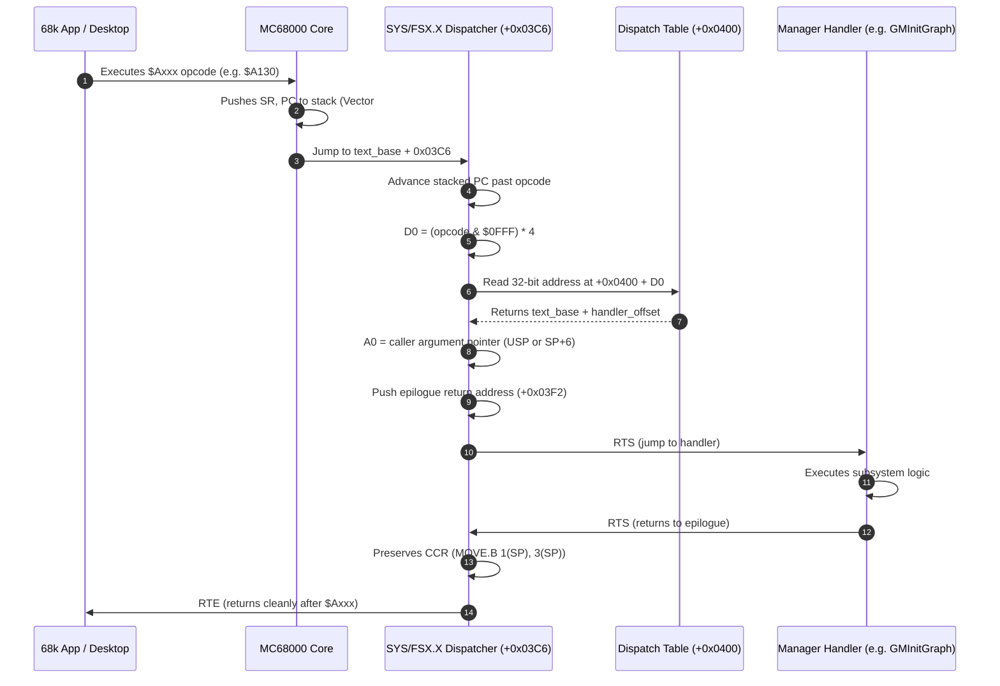
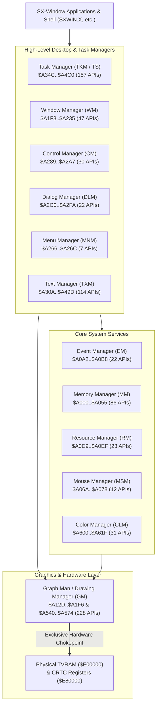

# SX-Window v3.1 Kernel Architecture, A-Line (`$Axxx`) API Catalog, and Master Hook Tracking Reference

This reference document specifies the low-level binary layout, the **Line 1010 Emulator (`Vector #10`) A-Line (`$Axxx`) Dispatcher**, the complete **SX-Window v3.1 Manager Subsystem Catalog (1,050 active APIs)**, and the exact hardware coupling points (TVRAM `$00E00000`, CRTC `$E80000`, 128-byte stride) inside **`SYS/FSX.X`**. It establishes the technical blueprint for **Phase 2: Decoupled High-Resolution & TrueColor Native Execution** in **msx68k**.

---

## 1. `SYS/FSX.X` Binary Layout & Vector #10 Dispatcher Architecture

### 1.1 Executable Structure & Invariant Offset Model
In SX-Window v3.1, the entire system kernel (Graphics, Window Management, Event Dispatching, Memory Management, Resource Management, and Peripheral Drivers) is contained within **`SYS/FSX.X`** (367,436 bytes on disk, loaded via `CONFIG.SYS` as character device `"SXTools"`).

The file layout conforms to the Human68k `HU` executable format with an embedded device driver header:
- **`+0x0000..+0x003F` (64 bytes)**: Human68k `HU` header (`magic = b"HU"`, `text_len = 0x53B6A`, `data_len = 0x022A8`, `bss_len = 0x0E50E`, `reloc_len = 0x03CFA`).
- **`+0x0040..+0x005F` (32 bytes)**: Character Device Driver Header (`"SXTools"`, `strategy = +0x004E`, `interrupt = +0x0056`).
- **`+0x0040..+0x53BAA`**: Relocatable code segment (`text`).
- **`+0x53BAA..+0x55E52`**: Initialized data segment (`data`).
- **`+0x55E52..+0x59B4C`**: 16-bit word-delta relocation table (`reloc`).

```text
[Disk File Offset]                 [Main RAM Physical Space]
0x000000: +-----------------------+
          | Human68k HU (64B)     | (Stripped by device driver loader)
0x000040: +-----------------------+ <=== text_base (e.g. $0581E4 on SCSI HDD boot)
          | Device Header "SXTools"
          | Vector #10 Installer  | (+0x036C: IOCS $80 _B_INTVEC)
          | Vector #10 Dispatcher | (+0x03C6: Line 1010 handler)
          | 16KB Dispatch Table   | (+0x0400..+0x4400: 4096 entries)
          | Code & Subsystems     | (+0x4400..+0x53B6A)
          | Screen Mode Table     | (+0x552FC..+0x55450: 22B records)
          | MouseWorkArea Pointer | (+0x633CA -> +0x5CA44)
          +-----------------------+
```

> [!IMPORTANT]
> **Invariant Offset Principle**: When `SYS/FSX.X` initializes, it hooks the IOCS mouse packet completion vector at `$0000_0938` to `text_base + 0x04F82A`. The emulator dynamically derives `text_base = handler_addr - 0x04F82A`. Any internal function or data structure inside `SYS/FSX.X` is addressed at an **invariant offset** `text_base + offset`, corresponding exactly to `file_offset = 0x40 + offset` in the un-relocated binary.

---

### 1.2 Line 1010 Emulator (`Vector #10`) Installation
During driver initialization (`SYS/FSX.X` entry), `Vector #10` (memory address `$0000_0028`) is configured via the standard IOCS interrupt vector interface:

```m68k
text+0x036C:  48E7 0040         MOVEM.L D1, -(SP)
text+0x0370:  7080              MOVEQ   #$80, D0          ; IOCS $80: _B_INTVEC (Get/Set Vector)
text+0x0372:  720A              MOVEQ   #10, D1           ; Vector #10 ($0A): Line 1010 Emulator
text+0x0374:  43F9 0000 03C6    LEA     ($03C6, text), A1 ; A1 = Handler address (text + $03C6)
text+0x037A:  4E4F              TRAP    #15               ; IOCS Call -> D0 = Old Vector #10 Address
text+0x037C:  23C0 0000 03BA    MOVE.L  D0, ($03BA, text) ; Save previous Vector #10 at text + $03BA
text+0x0382:  4A39 0000 0CBC    TST.B   ($0CBC).L         ; Test IOCS _CPU_TYPE (0=68000, 1=68010, 2=68020, 3=68030)
text+0x0388:  6708              BEQ.S   is_68000          ; If 68000 (3-word stack frame), skip
text+0x038A:  33FC 0008 0000 03B8 MOVE.W #8, ($03B8, text); On 68010/020/030, exception frame is 8 bytes
is_68000:
text+0x0392:  4CDF 0200         MOVEM.L (SP)+, D1
text+0x0396:  4E75              RTS
```

- When running on a Motorola MC68000, the Line 1010 exception stack frame is **6 bytes** (`SR` [2B] + `PC` [4B]), so `($03B8, text) = 6`.
- On MC68010/68020/68030, the frame is **8 bytes** (`SR` [2B] + `PC` [4B] + `Format/Offset` [2B]), so `($03B8, text) = 8`.
- Uninstaller at `text_base + 0x0398` restores the original vector from `text_base + 0x03BA` via `IOCS $80`.

---

### 1.3 Stack Frame & Opcode Decoding Mechanism
Whenever a 68000 application executes an `$Axxx` opcode (e.g. `GMInitGraph` `$A130`), the CPU pushes an exception frame onto the active stack and branches to `text_base + 0x03C6`:

```m68k
text+0x03C6:  206F 0002         MOVEA.L 2(SP), A0         ; A0 = Faulting PC (points to $Axxx opcode)
text+0x03CA:  3018              MOVE.W  (A0)+, D0         ; D0 = $Axxx opcode word, A0 advanced past $Axxx
text+0x03CC:  2F48 0002         MOVE.L  A0, 2(SP)         ; Update return PC on stack so RTE returns past $Axxx!
text+0x03D0:  C07C 0FFF         ANDI.W  #$0FFF, D0        ; Extract 12-bit trap index (0..4095)
text+0x03D4:  D040              ADD.W   D0, D0            ; D0 = index * 2
text+0x03D6:  D040              ADD.W   D0, D0            ; D0 = index * 4 (32-bit table stride)
text+0x03D8:  203B 0026         MOVE.L  $0026(PC, D0.W), D0 ; Fetch 32-bit handler from table at text + $0400!
text+0x03DC:  4E68              MOVE    USP, A0           ; Default parameter pointer: A0 = User Stack Pointer
text+0x03DE:  0817 0005         BTST    #5, (SP)          ; Test Supervisor bit (S) in stacked SR
text+0x03E2:  6706              BEQ.S   called_from_user  ; If User mode, USP already points to caller arguments!
text+0x03E4:  204F              MOVEA.L SP, A0            ; If Supervisor mode: A0 = SP
text+0x03E6:  D0FA FFD0         ADDA.W  -48(PC), A0       ; A0 += ($03B8, text) (Skip 6B or 8B exception frame!)
called_from_user:
text+0x03EA:  487A 0006         PEA     6(PC)             ; Push return address (text + $03F2) onto stack
text+0x03EE:  2F00              MOVE.L  D0, -(SP)         ; Push target handler address onto stack
text+0x03F0:  4E75              RTS                       ; Jumps to target handler with A0 = argument pointer!

; --- Dispatcher Epilogue (Handler returns here via RTS) ---
text+0x03F2:  40E7              MOVE    SR, -(SP)         ; Save handler condition codes
text+0x03F4:  1F6F 0001 0003    MOVE.B  1(SP), 3(SP)      ; Copy returned CCR flags (N,Z,V,C) into stacked SR
text+0x03FA:  548F              ADDQ.L  #2, SP            ; Pop temporary SR
text+0x03FC:  4E73              RTE                       ; Return to caller with updated CCR flags!
text+0x03FE:  4E71              NOP
text+0x0400:  ; === 16 KB DISPATCH TABLE BEGINS HERE ===
```



---

### 1.4 Dispatch Table Topology
- **Location**: `text_base + 0x0400` through `text_base + 0x4400` (exactly `0x4000` = 16,384 bytes).
- **Entries**: 4,096 consecutive 32-bit longwords indexed directly by `(opcode & $0FFF) * 4`.
- **Implemented APIs**: **1,050 active entries** point to distinct subroutines within `SYS/FSX.X`.
- **Default Handler**: Unimplemented opcodes contain `text_base + 0x000366`:
  ```m68k
  text+0x0366:  91C8              SUBA.L  A0, A0            ; Clear A0
  text+0x0368:  70FF              MOVEQ   #-1, D0           ; Return D0 = -1 (Error / Unimplemented)
  text+0x036A:  4E75              RTS
  ```

---

## 2. SX-Window v3.1 Manager Subsystems & A-Line API Catalog

The 1,050 implemented A-Line APIs are organized into 21 distinct functional managers:



### 2.1 Subsystem Summary Table

| Subsystem Name | Prefix | Opcode Range | Count | Primary Role & Responsibilities |
| :--- | :--- | :--- | :---: | :--- |
| **Memory Manager** | `MM` | `$A000`–`$A055` | 86 | Heap zones, relocatable handles, non-relocatable pointers, compaction, locking/unlocking. |
| **Exception Manager** | `XM` / `EX` | `$A068`–`$A069` | 2 | V-DISP vertical blanking interrupt exception hooks. |
| **Mouse Manager** | `MSM` / `MS` | `$A06A`–`$A078` | 12 | Hardware/software cursor display, visibility counts, bounding box (`MSBoundSet`). |
| **Animation Manager** | `AM` / `EX` | `$A073`–`$A075` | 3 | Animated cursor timing and state transitions. |
| **Keyboard Manager** | `KBM` / `KB` | `$A086`–`$A093` | 14 | Raw keyboard input ring buffers, LED control, repeat rates. |
| **Key Manager** | `KM` | `$A09A`–`$A0A1` | 8 | Key code translation, shift/caps/kana modifiers. |
| **Event Manager** | `EM` | `$A0A2`–`$A0B8` | 22 | Event queues, mouse crossing (`EMEnCross`/`EMDeCross`), double-click threshold. |
| **Resource Manager** | `RM` | `$A0D9`–`$A0EF` | 23 | Desktop item resources, string tables, icons, font metrics. |
| **Graph Man (Drawing Manager)** | `GM` | `$A12D`–`$A1F6`, `$A540`–`$A574` | 228 | QuickDraw-style 2D primitives: Lines, Rects, Ovals, Polygons, Regions, Text, BitMaps, Blits. |
| **Window Manager** | `WM` | `$A1F8`–`$A235` | 47 | Window creation, Z-order layering, title bars, dirty update regions, desktop port (`WMGetDTGS`). |
| **Sub Window Manager** | `SWM` | `$A227`–`$A22B` | 5 | Child window clipping and local coordinate translation. |
| **Menu Manager** | `MNM` / `MN` | `$A266`–`$A26C` | 7 | Pull-down menubars, hierarchical menus, item selection tracking. |
| **Control Manager** | `CM` | `$A289`–`$A2A7` | 30 | UI widgets: push buttons, radio buttons, checkboxes, vertical/horizontal scrollbars. |
| **Dialog Manager** | `DLM` / `DM` | `$A2C0`–`$A2FA` | 22 | Modal/modeless dialogs, alert boxes, file open/save dialogs. |
| **Text Manager** | `TXM` / `TM` | `$A30A`–`$A49D` | 114 | Multi-line text editor widgets, cursor navigation, line-wrapping, selection highlighting. |
| **Task Manager** | `TKM` / `TS` | `$A34C`–`$A4C0` | 157 | Cooperative process scheduler, IPC messages, inter-task drag-and-drop (`TSPutDrag`). |
| **Print Manager** | `PRM` | `$A4E0`–`$A4FE` | 31 | Hardcopy printer drivers, raster spooling, page layout. |
| **Semaphore Manager** | `SMM` | `$A5F0`–`$A5F3` | 4 | Inter-task synchronization semaphores and critical section locks. |
| **Color Manager** | `CLM` | `$A600`–`$A61F` | 31 | 16-color / 256-color palette allocation, color lookup tables, color dialogs. |
| **Kernel Internal / Private** | `SYS` | Various | 204 | Private kernel routines embedded within the table for inter-subsystem dispatch. |

---

### 2.2 Key Drawing Manager (`GM`) Primitives

The Drawing Manager (`GM`) is the **single choke-point** through which all visual output passes:

| Opcode | API Name | Invariant Handler Offset | Arguments & Description |
| :---: | :--- | :---: | :--- |
| **`$A12D`** | `GMOpenGraph` | `text_base + 0x01EAAE` | Allocates and opens an active `Graph` (RastPort) structure. |
| **`$A12E`** | `GMCloseGraph` | `text_base + 0x01EC36` | Closes and releases resources associated with a `Graph`. |
| **`$A130`** | `GMInitGraph` | `text_base + 0x01EB30` | Initializes a `Graph` record with default clipping and visible regions. |
| **`$A131`** | `GMSetGraph` | `text_base + 0x01ECA6` | Sets the current active `Graph` port for subsequent drawing calls. |
| **`$A132`** | `GMGetGraph` | `text_base + 0x01ECB2` | Retrieves a pointer to the current active `Graph` port. |
| **`$A138`** | `GMSetClip` | `text_base + 0x01EEF2` | Sets the clipping region (`RgnHandle`) for the active `Graph`. |
| **`$A13A`** | `GMClipRect` | `text_base + 0x01EF7E` | Sets the clipping bounds to an explicit `Rect [left, top, right, bottom]`. |
| **`$A13D`** | `GMSetBitmap` | `text_base + 0x01EE2C` | Associates a `BitMap` structure with the active `Graph`. |
| **`$A147`** | `GMForeColor` | `text_base + 0x01F82E` | Sets foreground drawing color index (0..15). |
| **`$A148`** | `GMBackColor` | `text_base + 0x01F83E` | Sets background drawing color index (0..15). |
| **`$A170`** | `GMLine` | `text_base + 0x0204C2` | Draws a 1-pixel solid or patterned line from pen location to `(X, Y)`. |
| **`$A172`** | `GMFrameRect` | `text_base + 0x020A84` | Outlines the boundary of a rectangle using current pen attributes. |
| **`$A173`** | `GMFillRect` | `text_base + 0x020A88` | Fills the interior of a rectangle with the current pen pattern. |
| **`$A17E`** | `GMScroll` | `text_base + 0x01D746` | Scrolls a rectangular region on screen by `(dX, dY)` (hardware or blit). |
| **`$A17F`** | `GMCopy` | `text_base + 0x023288` | Bit-block transfer (`CopyBits`) between arbitrary source and dest `BitMap`s. |
| **`$A180`** | `GMCopyMask` | `text_base + 0x024AF2` | Bit-block transfer with an arbitrary 1-bit transparency mask. |
| **`$A191`** | `GMDrawStr` | `text_base + 0x0256FA` | Renders a string of 16-dot or 24-dot JIS Kanji/ANK characters. |
| **`$A1C4`** | `GMGetScrnSize` | `text_base + 0x02F1A4` | Returns active screen dimensions `(Width, Height)` in `D0`. |
| **`$A1CA`** | `GMNewBits` | `text_base + 0x02F1F6` | Allocates a `BitMap` buffer (binds to `$00E00000` for screen mode 4). |
| **`$A1CC`** | `GMLockBits` | `text_base + 0x02F2C8` | Locks pixel buffer in RAM / VRAM and returns 32-bit base address. |
| **`$A1CD`** | `GMUnlockBits` | `text_base + 0x02F30E` | Unlocks pixel buffer and sets base pointer to `$00E00000`. |

---

## 3. Screen Resolution & TVRAM (`$E00000`) Architecture in `SYS/FSX.X`

### 3.1 The 1024×1024 Physical TVRAM Limit & Screen Mode Table
SX-Window v3.1 was designed to keep the entire Graphics VRAM (`GVRAM` at `$00C00000..$00C7FFFF`, 512 KB) free for user applications and games. Therefore, the entire GUI desktop is rendered exclusively into **Text VRAM (`TVRAM` at `$00E00000..$00E7FFFF`, 512 KB)** across 4 bitplanes.

Inside `SYS/FSX.X` at **`text_base + 0x552FC`**, there is a master **Screen Mode Configuration Table** composed of **22-byte records**:

```text
Offset +0: Width (16-bit BE)
Offset +2: Height (16-bit BE)
Offset +4: Base Address (32-bit BE)
Offset +8: RowBytes / Stride (16-bit BE)
Offset +10: Planes (16-bit BE)
Offset +12: Mode ID (16-bit BE)
Offset +14..+21: CRTC Register Template Parameters (8 bytes)
```

#### Decoded Screen Mode Table (`text_base + 0x552FC`):

| Mode | Offset in `FSX.X` | Width × Height | Base Address | Scanline Stride | Planes | Target Domain |
| :---: | :---: | :---: | :---: | :---: | :---: | :--- |
| **0** | `text_base + 0x552FC` | 256 × 256 | `$00E00000` | 128 Bytes | 2 | TVRAM (Low-Res) |
| **1** | `text_base + 0x55312` | 512 × 512 | `$00E00000` | 128 Bytes | 2 | TVRAM (Standard) |
| **2** | `text_base + 0x55328` | 640 × 480 | `$00E00000` | 128 Bytes | 2 | TVRAM (VGA 60Hz) |
| **3** | `text_base + 0x5533E` | **768 × 512** | **`$00E00000`** | **128 Bytes** | **2** | **TVRAM (Default SX-Window Desktop)** |
| **4** | `text_base + 0x55354` | 1024 × 424 | `$00E00000` | 128 Bytes | 2 | TVRAM (Wide 24kHz) |
| **5** | `text_base + 0x5536A` | 1024 × 848 | `$00E00000` | 128 Bytes | 2 | TVRAM (Interlaced) |
| **6** | `text_base + 0x55380` | **1024 × 1024** | **`$00E00000`** | **128 Bytes** | **2** | **TVRAM Hardware Limit (Full 512KB)** |
| **7** | `text_base + 0x55396` | 256 × 256 | `$00C00000` | 1024 Bytes | 16 | GVRAM (Application graphics mode) |

> [!WARNING]
> **Why 1024×1024 is the Hardware Ceiling in Original SX-Window**:
> 1. In all TVRAM modes (0..6), `RowBytes` is hardcoded to **`128` bytes** (`1024 dots / 8 = 128`).
> 2. The maximum addressable height is `512 KB / (128 B * 4 planes) = 1024` scanlines.
> 3. Drawing routines in Graph Man compute pixel offsets using `Y * 128 + (X >> 3)`.
> 4. Physical TVRAM ends at `$00E7FFFF`. Any access beyond `Y=1024` or `X=1024` triggers a bus error or wraps around to unmapped I/O.

---

### 3.2 Direct Hardware Access Audit in `SYS/FSX.X`
Only five specific locations in the entire `SYS/FSX.X` kernel access TVRAM or CRTC registers directly:

1. **Screen Clear & Mode Init (`text_base + 0x133D8`)**:
   - Writes `#$01F0` to CRTC R21 bitmask register (`$E8002A`) to enable simultaneous 4-plane multiwrite.
   - Clears 512 KB of TVRAM at `$00E00000` via a fast `MOVEM.L / DBRA` loop (32,768 longwords).
   - Configures text palette via `IOCS $13` (`_B_COLOR`) and shows cursor via `IOCS $0E`.
2. **Software Mouse Cursor Blit (`text_base + 0x04F852`)**:
   - Subroutine 4 of the mouse receiver handler.
   - Accesses CRTC base `$E80000` and masks bits via `$E8002A`.
   - Directly renders the 16×16 cursor bitmap into TVRAM at `$00E00000 + CurY * 128 + (CurX >> 3)`.
3. **Hardware Raster Copy Engine (`text_base + 0x04732`)**:
   - Programs CRTC R20 (`$E80028`), `$E80024`, and `$E80026`.
   - Polls bit 4 of CRTC status register (`$E88001`) until the hardware block-transfer engine completes.
4. **Emergency Panic Alert Box (`text_base + 0x4BFC0`, `SXER`)**:
   - Invoked on unhandled exceptions (Bus Error, Address Error).
   - Computes TVRAM address directly (`MULU #128, D1` + `ADDA.L D1, A0` + `LEA (A0, D0.W), A0` with base `$00E00000`) to draw the "System Error" dialog over corrupted desktops.
5. **Mouse Clipping Bounds (`text_base + 0x04FE4C`, `MSBoundSet` `$A077`)**:
   - Updates `$34(A4)..$3B(A4)` (`min_x, min_y, max_x, max_y`) in `MouseWorkArea`.
   - Clamps mouse coordinates inside Subroutine 3 (`text_base + 0x04F768`, currently intercepted by `HypercallId::SxMouseSync`).

---

### 3.3 Complete Subsystem Isolation
**Crucial Architectural Finding**:
All higher-level managers—**Window Manager (`WM`)**, **Control Manager (`CM`)**, **Dialog Manager (`DLM`)**, **Menu Manager (`MNM`)**, **Text Manager (`TXM`)**, **Task Manager (`TKM`)**, and **all external applications (`SXWIN.X`, `カレンダ.X`, `電卓.X`, `GRW.X`)**—**NEVER** touch TVRAM (`$00E00000`) or CRTC registers (`$E80000`) directly.

Every window, button, menu item, dialog box, icon, and character is rendered strictly through calls to **Graph Man (`GM`) primitives (`$A12D..$A1F6`)**!

```text
[Applications / WM / CM / DLM / MNM / TXM]
                  |
                  v (Calls A-Line $Axxx Primitives)
      [Graph Man / Drawing Manager]
                  |
   +--------------+---------------+
   |                              |
[Legacy TVRAM Engine]   [NEW: Mixed Mode Hook Native Surface]
($00E00000, 128B stride) (Direct wgpu Texture / Arbitrary Resolution)
```

---

### 3.4 Roadmap to Arbitrary High Resolutions & TrueColor

#### Phase 2A: Virtual Viewport & Coordinate Expansion (`1024×768`, `1280×720`, `1920×1080`)
1. **Screen Mode Table Patch (`text_base + 0x5533E`)**:
   - Overwrite Mode 3 width (`768` -> host width, e.g. `1280`) and height (`512` -> host height, e.g. `720`).
2. **Dynamic Mouse WorkArea Clamping**:
   - Hook `MSBoundSet` (`$A077` at `text_base + 0x04FEB6`) to store host desktop boundaries.
   - Expand `HypercallId::SxMouseSync` (`$FE81`) to clamp to host window dimensions.
3. **Screen Query Hooks**:
   - Intercept `GMGetScrnSize` (`$A1C4` at `text_base + 0x02F1A4`) and `WMGetDTGS` (`$A224` at `text_base + 0x0477AE`) to return host window dimensions to `SXWIN.X` and apps.

#### Phase 2B: Native Graph Man (`GM`) & TrueColor Framebuffer Surface
1. **Intercept Graph Man Primitives at Vector Level**:
   - Replace 68k drawing routines (`GMFillRect` `$A173`, `GMFrameRect` `$A172`, `GMLine` `$A170`, `GMScroll` `$A17E`, `GMCopy` `$A17F`, `GMDrawStr` `$A191`) with native hypercall stubs (`$FE88..$FE8F`).
2. **Host Surface Redirection**:
   - When a drawing primitive executes, read 68k coordinates from stack arguments (`A0`), and draw directly into a 32-bit RGBA texture in host memory (`wgpu` surface) with arbitrary width and arbitrary stride.
   - Completely disable TVRAM writes and CRTC raster copy polling.

#### Phase 2C: Direct GPU Composition & Host Window Integration
1. **Rootless / Unity Multi-Window Mode**:
   - Hook `WMSelect`, `WMCarry`, and `WMUpdate` to map individual SX-Window windows directly to host OS desktop windows (`winit` surfaces).

---

## 4. Master Hook & Patch Tracking Table

This living status table tracks all active and planned Mixed Mode hypercalls, module patches, and A-Line hooks across the **msx68k** project:

| Hook ID / Opcode | Target Module & Invariant Location | Original Signature Bytes | Subsystem / API Name | Status | Description & Functional Role |
| :---: | :--- | :--- | :--- | :---: | :--- |
| **`$FE81`** | `SYS/FSX.X`<br/>`text_base + 0x04F768` | `48 E7 E0 04`<br/>(`MOVEM.L D0-D2/A5, -(SP)`) | `FSX.X` Mouse Subroutine 3 | **`[x] Hooked`** | **1:1 Host Mouse Sync**: Injects `[$FE81, $4E75]`, synchronizes host `(X, Y)` into `MouseWorkArea` (`$0A`, `$0C`, `$10`, `$12`), clears sub-pixel remainders, updates global vectors (`+0x549F6`, `+0x549F8`). |
| **`$FE82`** | Virtual SCSI ROM<br/>`$FC0000` | ROM Entry Point | `ScsiRomBoot` | **`[x] Hooked`** | **SCSI IPL Boot**: Synthesizes 1024B IPL and partition boot sector, initializes SCSI controller state, loads `HUMAN.SYS` HU header to `$0067C0` and code to `$006800`. |
| **`$FE83`** | Virtual SCSI ROM<br/>`$FC0020` | ROM Subroutine | `ScsiRomdbBuild` | **`[x] Hooked`** | **`HUMAN.SYS` `romdb` Builder**: Constructs Human68k block device driver structure at `*(P-16)` with strategy and interrupt hypercall stubs. |
| **`$FE84`** | Virtual SCSI ROM<br/>`$FC0040` | ROM Subroutine | `ScsiIocsInstall` | **`[x] Hooked`** | **`IOCS $F5` Installer**: Installs `IOCS $F5` vector handler at `*(P-12)` pointing to `$FC0060`. |
| **`$FE85`** | Virtual SCSI ROM<br/>`$FC0060` | ROM Entry Point | `ScsiIocsDispatch` | **`[x] Hooked`** | **`IOCS $F5` (`_SCSIDRV`) Bridge**: Handles SCSI command packets (read, write, inquiry, capacity, ready) directly from guest space. |
| **`$FE86`** | SCSI Block Driver<br/>`driver_addr + 0x14` | Injected Stub in RAM | `ScsiDriverStrategy` | **`[x] Hooked`** | **Block Driver Strategy**: Latches request packet pointer (`A5`) into emulator state. |
| **`$FE87`** | SCSI Block Driver<br/>`driver_addr + 0x18` | Injected Stub in RAM | `ScsiDriverInterrupt` | **`[x] Hooked`** | **Block Driver Interrupt**: Executes Human68k commands: 0 (INIT), 1 (MEDIA CHECK), 2 (BUILD BPB), 4 (READ), 5 (MEDIA SENSE), 8/9 (WRITE). |
| **`Patch-ModeTable`** | `SYS/FSX.X`<br/>`text_base + 0x5533E` | `03 00 02 00 00 E0 00 00 00 80` | Screen Mode Table (Mode 3) | **`[ ] Planned (Phase 2A)`** | **Hi-Res Viewport Patch**: Overwrites Mode 3 width (`768`) and height (`512`) with host display dimensions (e.g. `1280×720`). |
| **`$A077`** | `SYS/FSX.X`<br/>`text_base + 0x04FEB6` | `2F 10 61 92` | Mouse Manager: `MSBoundSet` | **`[ ] Planned (Phase 2A)`** | **Mouse Bounding Box Hook**: Intercepts guest desktop boundary configuration to maintain host aspect ratio and screen boundaries. |
| **`$A1C4`** | `SYS/FSX.X`<br/>`text_base + 0x02F1A4` | `4E 56 FF C0` | Graph Man: `GMGetScrnSize` | **`[ ] Planned (Phase 2A)`** | **Screen Dimension Query Hook**: Returns dynamic host window dimensions `(Width, Height)` in `D0`. |
| **`$A224`** | `SYS/FSX.X`<br/>`text_base + 0x0477AE` | `4E 56 00 00` | Window Manager: `WMGetDTGS` | **`[ ] Planned (Phase 2A)`** | **Desktop Graph Port Query Hook**: Returns desktop work area dimensions matching host viewport. |
| **`$A130`** | `SYS/FSX.X`<br/>`text_base + 0x01EB30` | `48 E7 00 70` | Graph Man: `GMInitGraph` | **`[ ] Planned (Phase 2B)`** | **Native Graph Port Init**: Initializes RastPort bound to host native texture instead of physical TVRAM. |
| **`$A170`** | `SYS/FSX.X`<br/>`text_base + 0x0204C2` | `4E 56 FF D0` | Graph Man: `GMLine` | **`[ ] Planned (Phase 2B)`** | **Native Line Drawing**: Hardware-accelerated line primitive rendered via `wgpu` or SIMD CPU rasterizer. |
| **`$A172`** | `SYS/FSX.X`<br/>`text_base + 0x020A84` | `4E 56 FF C0` | Graph Man: `GMFrameRect` | **`[ ] Planned (Phase 2B)`** | **Native Rect Outline**: 1-pixel / patterned rectangle outline on host surface. |
| **`$A173`** | `SYS/FSX.X`<br/>`text_base + 0x020A88` | `4E 56 FF C0` | Graph Man: `GMFillRect` | **`[ ] Planned (Phase 2B)`** | **Native Rect Fill**: Pattern/solid rectangle fill bypassing TVRAM plane loops. |
| **`$A17E`** | `SYS/FSX.X`<br/>`text_base + 0x01D746` | `4E 56 FF 4A` | Graph Man: `GMScroll` | **`[ ] Planned (Phase 2B)`** | **Native Surface Scroll**: Instant GPU texture blit bypassing CRTC raster copy and TVRAM 128B stride. |
| **`$A17F`** | `SYS/FSX.X`<br/>`text_base + 0x023288` | `4E 56 FF 10` | Graph Man: `GMCopy` | **`[ ] Planned (Phase 2B)`** | **Native BitMap Blit**: Alpha-blended and masked bit-block transfers on host surfaces. |
| **`$A191`** | `SYS/FSX.X`<br/>`text_base + 0x0256FA` | `4E 56 FF 00` | Graph Man: `GMDrawStr` | **`[ ] Planned (Phase 2B)`** | **Native Text Rendering**: TrueType / high-DPI antialiased font rendering with 16/24-dot fallback. |
| **`$A1CA`** | `SYS/FSX.X`<br/>`text_base + 0x02F1F6` | `42 A7 3F 28` | Graph Man: `GMNewBits` | **`[ ] Planned (Phase 2B)`** | **Native BitMap Allocation**: Allocates pixel buffers in host memory instead of physical VRAM. |
| **`$A1CC`** | `SYS/FSX.X`<br/>`text_base + 0x02F2C8` | `4E 56 00 00` | Graph Man: `GMLockBits` | **`[ ] Planned (Phase 2B)`** | **Native BitMap Lock**: Returns virtual host pointer / handle for direct rendering. |
| **`$A1CD`** | `SYS/FSX.X`<br/>`text_base + 0x02F30E` | `40 40 20 10` | Graph Man: `GMUnlockBits` | **`[ ] Planned (Phase 2B)`** | **Native BitMap Unlock**: Flushes dirty regions to host GPU texture. |
| **`WM-Rootless`** | `SYS/FSX.X`<br/>`text_base + 0x0476D8` | Various | Window Manager Rootless Hook | **`[ ] Planned (Phase 2C)`** | **Host OS Window Decoupling**: Maps SX-Window windows directly to host OS desktop windows (`winit`). |
