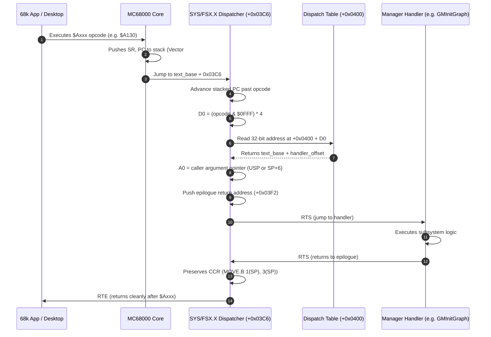
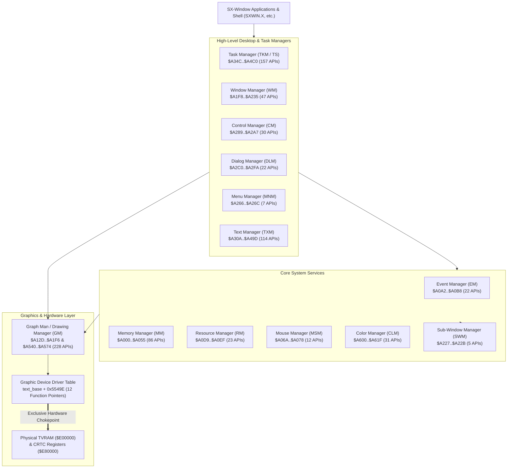
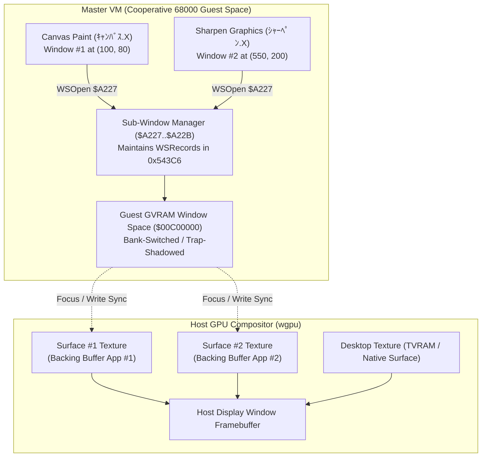

# SX-Window v3.1 Kernel Architecture, A-Line (`$Axxx`) API Catalog, and Master Hook Tracking Reference

This reference document specifies the low-level binary layout, the **Line 1010 Emulator (`Vector #10`) A-Line (`$Axxx`) Dispatcher**, the complete **SX-Window v3.1 Manager Subsystem Catalog (1,050 active APIs)**, **Screen Mode Selection & Battery-Backed SRAM Storage**, the **Sub-Window Manager (`SWM`) & Virtualized GVRAM Architecture**, and the low-level **Graph Man (`GM`) Drawing Engine Internals** inside **`SYS/FSX.X`**. It establishes the technical blueprint for **Phase 2: Decoupled High-Resolution & TrueColor Native Execution** in **msx68k**.

---

## 1. `SYS/FSX.X` Binary Layout & Vector #10 Dispatcher Architecture

### 1.1 Executable Structure & Invariant Offset Model
In SX-Window v3.1, the entire system kernel (Graphics, Window Management, Event Dispatching, Memory Management, Resource Management, and Peripheral Drivers) is contained within **`SYS/FSX.X`** (367,436 bytes on disk, loaded via `CONFIG.SYS` as character device `"SXTools"`).

The file layout conforms to the Human68k `HU` executable format with an embedded device driver header:
- **`+0x0000..+0x003F` (64 bytes)**: Human68k `HU` header (`magic = b"HU"`, `text_len = 0x53B6A`, `data_len = 0x022A8`, `bss_len = 0x0E50E`, `reloc_len = 0x03CFA`).
- **`+0x0040..+0x005F` (32 bytes)**: Character Device Driver Header (`"SXTools"`, `strategy = +0x004E`, `interrupt = +0x0056`).
- **`+0x0040..+0x53BAA`**: Relocatable code segment (`text`).
- **`+0x53BAA..+0x55E52`**: Initialized data segment (`data`).
- **`+0x55E52..+0x59B4C`**: 16-bit word-delta relocation table (`reloc`, 7,805 relocation entries).

```text
[Disk File Offset]                 [Main RAM Physical Space]
0x000000: +-----------------------+
          | Human68k HU (64B)     | (Stripped by device driver loader)
0x000040: +-----------------------+ <=== text_base (e.g. $0581E4 on SCSI HDD boot)
          | Device Header "SXTools"
          | Vector #10 Installer  | (+0x036C: IOCS $80 _B_INTVEC)
          | Vector #10 Dispatcher | (+0x03C6: Line 1010 handler)
          | 16KB Dispatch Table   | (+0x0400..+0x4400: 4096 entries)
          | Code & Subsystems     | (+0x4400..+0x53B6A)
          | Mode Table & Records  | (+0x55278 active record, +0x552F6 mode table)
          | Drawing Driver Table  | (+0x5549E: 12 primitive function pointers)
          | MouseWorkArea Pointer | (+0x633CA -> +0x5CA44)
          +-----------------------+
```

> [!IMPORTANT]
> **Invariant Offset Principle**: When `SYS/FSX.X` initializes, it hooks the IOCS mouse packet completion vector at `$0000_0938` to `text_base + 0x04F82A`. The emulator dynamically derives `text_base = handler_addr - 0x04F82A`. Any internal function or data structure inside `SYS/FSX.X` is addressed at an **invariant offset** `text_base + offset`, corresponding exactly to `file_offset = 0x40 + offset` in the un-relocated binary.

---

### 1.2 Line 1010 Emulator (`Vector #10`) Installation
During driver initialization (`SYS/FSX.X` entry), `Vector #10` (memory address `$0000_0028`) is configured via the standard IOCS interrupt vector interface:

```m68k
text+0x036C:  48E7 0040         MOVEM.L D1, -(SP)
text+0x0370:  7080              MOVEQ   #$80, D0          ; IOCS $80: _B_INTVEC (Get/Set Vector)
text+0x0372:  720A              MOVEQ   #10, D1           ; Vector #10 ($0A): Line 1010 Emulator
text+0x0374:  43F9 0000 03C6    LEA     ($03C6, text), A1 ; A1 = Handler address (text + $03C6)
text+0x037A:  4E4F              TRAP    #15               ; IOCS Call -> D0 = Old Vector #10 Address
text+0x037C:  23C0 0000 03BA    MOVE.L  D0, ($03BA, text) ; Save previous Vector #10 at text + $03BA
text+0x0382:  4A39 0000 0CBC    TST.B   ($0CBC).L         ; Test IOCS _CPU_TYPE (0=68000, 1=68010, 2=68020, 3=68030)
text+0x0388:  6708              BEQ.S   is_68000          ; If 68000 (3-word stack frame), skip
text+0x038A:  33FC 0008 0000 03B8 MOVE.W #8, ($03B8, text); On 68010/020/030, exception frame is 8 bytes
is_68000:
text+0x0392:  4CDF 0200         MOVEM.L (SP)+, D1
text+0x0396:  4E75              RTS
```

- When running on a Motorola MC68000, the Line 1010 exception stack frame is **6 bytes** (`SR` [2B] + `PC` [4B]), so `($03B8, text) = 6`.
- On MC68010/68020/68030, the frame is **8 bytes** (`SR` [2B] + `PC` [4B] + `Format/Offset` [2B]), so `($03B8, text) = 8`.
- Uninstaller at `text_base + 0x0398` restores the original vector from `text_base + 0x03BA` via `IOCS $80`.

---

### 1.3 Stack Frame & Opcode Decoding Mechanism
Whenever a 68000 application executes an `$Axxx` opcode (e.g. `GMInitGraph` `$A130`), the CPU pushes an exception frame onto the active stack and branches to `text_base + 0x03C6`:

```m68k
text+0x03C6:  206F 0002         MOVEA.L 2(SP), A0         ; A0 = Faulting PC (points to $Axxx opcode)
text+0x03CA:  3018              MOVE.W  (A0)+, D0         ; D0 = $Axxx opcode word, A0 advanced past $Axxx
text+0x03CC:  2F48 0002         MOVE.L  A0, 2(SP)         ; Update return PC on stack so RTE returns past $Axxx!
text+0x03D0:  C07C 0FFF         ANDI.W  #$0FFF, D0        ; Extract 12-bit trap index (0..4095)
text+0x03D4:  D040              ADD.W   D0, D0            ; D0 = index * 2
text+0x03D6:  D040              ADD.W   D0, D0            ; D0 = index * 4 (32-bit table stride)
text+0x03D8:  203B 0026         MOVE.L  $0026(PC, D0.W), D0 ; Fetch 32-bit handler from table at text + $0400!
text+0x03DC:  4E68              MOVE    USP, A0           ; Default parameter pointer: A0 = User Stack Pointer
text+0x03DE:  0817 0005         BTST    #5, (SP)          ; Test Supervisor bit (S) in stacked SR
text+0x03E2:  6706              BEQ.S   called_from_user  ; If User mode, USP already points to caller arguments!
text+0x03E4:  204F              MOVEA.L SP, A0            ; If Supervisor mode: A0 = SP
text+0x03E6:  D0FA FFD0         ADDA.W  -48(PC), A0       ; A0 += ($03B8, text) (Skip 6B or 8B exception frame!)
called_from_user:
text+0x03EA:  487A 0006         PEA     6(PC)             ; Push return address (text + $03F2) onto stack
text+0x03EE:  2F00              MOVE.L  D0, -(SP)         ; Push target handler address onto stack
text+0x03F0:  4E75              RTS                       ; Jumps to target handler with A0 = argument pointer!

; --- Dispatcher Epilogue (Handler returns here via RTS) ---
text+0x03F2:  40E7              MOVE    SR, -(SP)         ; Save handler condition codes
text+0x03F4:  1F6F 0001 0003    MOVE.B  1(SP), 3(SP)      ; Copy returned CCR flags (N,Z,V,C) into stacked SR
text+0x03FA:  548F              ADDQ.L  #2, SP            ; Pop temporary SR
text+0x03FC:  4E73              RTE                       ; Return to caller with updated CCR flags!
text+0x03FE:  4E71              NOP
text+0x0400:  ; === 16 KB DISPATCH TABLE BEGINS HERE ===
```



---

### 1.4 Dispatch Table Topology
- **Location**: `text_base + 0x0400` through `text_base + 0x4400` (exactly `0x4000` = 16,384 bytes).
- **Entries**: 4,096 consecutive 32-bit longwords indexed directly by `(opcode & $0FFF) * 4`.
- **Implemented APIs**: **1,050 active entries** point to distinct subroutines within `SYS/FSX.X`.
- **Default Handler**: Unimplemented opcodes contain `text_base + 0x000366`:
  ```m68k
  text+0x0366:  91C8              SUBA.L  A0, A0            ; Clear A0
  text+0x0368:  70FF              MOVEQ   #-1, D0           ; Return D0 = -1 (Error / Unimplemented)
  text+0x036A:  4E75              RTS
  ```

---

## 2. SX-Window v3.1 Manager Subsystems & A-Line API Catalog

The 1,050 implemented A-Line APIs are organized into 21 distinct functional managers:



### 2.1 Subsystem Summary Table

| Subsystem Name | Prefix | Opcode Range | Count | Primary Role & Responsibilities |
| :--- | :--- | :--- | :---: | :--- |
| **Memory Manager** | `MM` | `$A000`–`$A055` | 86 | Heap zones, relocatable handles, non-relocatable pointers, compaction, locking/unlocking. |
| **Exception Manager** | `XM` / `EX` | `$A068`–`$A069` | 2 | V-DISP vertical blanking interrupt exception hooks. |
| **Mouse Manager** | `MSM` / `MS` | `$A06A`–`$A078` | 12 | Hardware/software cursor display, visibility counts, bounding box (`MSBoundSet`). |
| **Animation Manager** | `AM` / `EX` | `$A073`–`$A075` | 3 | Animated cursor timing and state transitions. |
| **Keyboard Manager** | `KBM` / `KB` | `$A086`–`$A093` | 14 | Raw keyboard input ring buffers, LED control, repeat rates. |
| **Key Manager** | `KM` | `$A09A`–`$A0A1` | 8 | Key code translation, shift/caps/kana modifiers. |
| **Event Manager** | `EM` | `$A0A2`–`$A0B8` | 22 | Event queues, mouse crossing (`EMEnCross`/`EMDeCross`), double-click threshold. |
| **Resource Manager** | `RM` | `$A0D9`–`$A0EF` | 23 | Desktop item resources, string tables, icons, font metrics. |
| **Graph Man (Drawing Manager)** | `GM` | `$A12D`–`$A1F6`, `$A540`–`$A574` | 228 | QuickDraw-style 2D primitives: Lines, Rects, Ovals, Polygons, Regions, Text, BitMaps, Blits. |
| **Window Manager** | `WM` | `$A1F8`–`$A235` | 47 | Window creation, Z-order layering, title bars, dirty update regions, desktop port (`WMGetDTGS`). |
| **Sub Window Manager** | `SWM` | `$A227`–`$A22B` | 5 | Sub-window creation, 118-byte `WSRecord` management, child window clipping, graphics plane attach. |
| **Menu Manager** | `MNM` / `MN` | `$A266`–`$A26C` | 7 | Pull-down menubars, hierarchical menus, item selection tracking. |
| **Control Manager** | `CM` | `$A289`–`$A2A7` | 30 | UI widgets: push buttons, radio buttons, checkboxes, vertical/horizontal scrollbars. |
| **Dialog Manager** | `DLM` / `DM` | `$A2C0`–`$A2FA` | 22 | Modal/modeless dialogs, alert boxes, file open/save dialogs. |
| **Text Manager** | `TXM` / `TM` | `$A30A`–`$A49D` | 114 | Multi-line text editor widgets, cursor navigation, dynamic `destRect` line-wrapping, fixed-point text scaling (`$A488` `TMScaleSet`), selection highlighting. |
| **Task Manager** | `TKM` / `TS` | `$A34C`–`$A4C0` | 157 | Cooperative process scheduler, IPC messages, inter-task drag-and-drop (`TSPutDrag`). |
| **Print Manager** | `PRM` | `$A4E0`–`$A4FE` | 31 | Hardcopy printer drivers, raster spooling, page layout. |
| **Font Manager** | `IFM` / `FM` | `$A500`–`$A516` | 23 | Outline font engine (`IFM.X`): Bezier curve evaluation, polygon triangulation, font caching, and `$A198` `GMFontInfo` interception. |
| **Semaphore Manager** | `SMM` | `$A5F0`–`$A5F3` | 4 | Inter-task synchronization semaphores and critical section locks. |
| **Color Manager** | `CLM` | `$A600`–`$A61F` | 31 | 16-color / 256-color palette allocation, color lookup tables, color dialogs. |
| **Kernel Internal / Private** | `SYS` | Various | 204 | Private kernel routines embedded within the table for inter-subsystem dispatch. |

---

## 3. Screen Mode Selection, SRAM Storage (`$ED0072..$ED0084`), and CRTC / VICON Capabilities

### 3.1 SRAM Storage Layout (`$ED0072..$ED0089`) & `$E8E00D` Protocol
SX-Window decouples the **Virtual Desktop Size (仮想画面サイズ)** from the **Physical CRT Display Size (実画面サイズ)**, persisting screen configuration, mouse acceleration, and desktop defaults across reboots in battery-backed SRAM starting at `$00ED0072`:

| Address | Size | Name | Description & Bit Layout |
| :---: | :---: | :--- | :--- |
| **`$ED0072..$ED0073`** | 2 B | `sram_magic` | ASCII signature `"SX"` (`$5358`). Validated on boot by `__SXSRAMVer` (`$A435` at `text_base + 0x2FCA8` via `cmpi.w #$5358, ($00ED0072).L`). If absent, restored from default template at `text_base + 0x02FD5A`. |
| **`$ED0074`** | 1 B | `display_flags` | Display settings and double-click timing multiplier (`* 10 -> global $54A88`). |
| **`$ED0075`** | 1 B | `mouse_speed` | Mouse acceleration curve index passed to `$A072` (`MSCurSpeed`). |
| **`$ED0076..$ED0077`** | 2 B | `palette_tcolor0` | 16-bit RGB 5-5-5 for text palette entry 0. |
| **`$ED0078..$ED007A`** | 3 B | `palette_defaults` | 16-bit RGB 5-5-5 desktop colors (read by `text_base + 0x1E9BC` and `0x3C142` via `IOCS $12` `_TCOLOR`). |
| **`$ED007B`** | 1 B | `printer_port` | Hardcopy printer driver index (read by `text_base + 0x3DA2C` to load `"PRTD"` resource). |
| **`$ED007C`** | 1 B | **`virtual_screen_mode`** | **Virtual Desktop Screen Mode (仮想画面モード)**:<br/>• **Upper nibble (`val >> 4`)**: Virtual Screen Mode Index (0..6 from Screen Mode Table at `text_base + 0x552F6`).<br/>• **Bit 1 (`val & $02`)**: Display option flag (read by `__TSGetDtopMode` `$A3FA`, written by `__TSSetDtopMode` `$A3FB`).<br/>• **Bit 0 (`val & $01`)**: Display option flag (read by `__TSGetStartMode` `$A364`, written by `__TSSetStartMode` `$A365`). |
| **`$ED007D`** | 1 B | `wallpaper_id` | Desktop background pattern / wallpaper ID (read by `text_base + 0x426DE` to load `"PICT"` resource). |
| **`$ED007E`** | 1 B | **`physical_crt_mode`** | **Physical Monitor CRT Mode & Virtual Scroll (実画面モード & スクロール)**:<br/>• **Bits 0..4 (`val & $1F`)**: Physical Monitor CRT Mode ID (0..19 from table at `text_base + 0x151C0`, e.g. `16` = `768×512`, `17` = `1024×424`, `18` = `1024×848`, `19` = `640×480`).<br/>• **Bit 5 (`val & $20`)**: Reserved by Sharp; utilized by msx68k as Extended Mode flag (`$B0`). Ignored by `SYS/FSX.X`'s `ANDI.W #$1F` mask!<br/>• **Bit 6 (`val & $40`)**: **Virtual Screen Scroll Enable Flag (仮想画面スクロール許可)** (1 = scroll enabled when mouse reaches viewport edge, 0 = disabled).<br/>• **Bit 7 (`val & $80`)**: Configured flag (1 = custom configured, 0 = default to mode 16 `768×512`). |
| **`$ED007F..$ED0089`** | 11 B | `reserved` | Reserved desktop parameters; `$ED0080` and `$ED0084` store wallpaper geometry (`text_base + 0x426E8`). |

#### Hardware Write-Protection Protocol (`$E8E00D`):
SRAM write protection is enforced by hardware gate array register **`$00E8E00D`**. Any write to SRAM while locked is ignored:
- **Unlock Sequence**: Write `#$31` (`49` decimal) to `$00E8E00D`.
- **Perform SRAM Writes**: Modify target SRAM bytes.
- **Lock Sequence**: Write `#$00` (`0` decimal) to `$00E8E00D`.

Disassembly from `SYS/FSX.X` (`text_base + 0x2FD00`):
```m68k
text+0x2FD00:  13FC 0031 00E8 E00D  MOVE.B  #$31, ($E8E00D).L   ; Unlock SRAM writes!
text+0x2FD08:  41F9 00ED 007C       LEA     ($ED007C).L, A0     ; Point to Screen Mode byte
text+0x2FD0E:  103C 0020            MOVE.B  #$20, D0            ; Screen Mode 2 (Default 768x512)
text+0x2FD12:  0210 000F            ANDI.B  #$0F, (A0)          ; Preserve lower 4 bits
text+0x2FD16:  8110                 OR.B    D0, (A0)            ; Set new mode in upper nibble
text+0x2FD18:  13FC 0000 00E8 E00D  MOVE.B  #$00, ($E8E00D).L   ; Lock SRAM writes!
text+0x2FD20:  4E75                 RTS
```

---

### 3.2 Dual Resolution Tables: Virtual Mode Table vs. Physical CRT Table

SX-Window distinguishes between the **Virtual Desktop coordinate canvas** where applications place windows, and the **Physical Monitor viewport** that the CRTC scans out to the display.

#### 1. Virtual Screen Mode Table (`text_base + 0x552F6`):
Defines the dimensions of the active desktop canvas in 22-byte records:

| Mode | Offset in `FSX.X` | Virtual Canvas (W × H) | Base Address | Scanline Stride | Planes | Target Domain & Display Role |
| :---: | :---: | :---: | :---: | :---: | :---: | :--- |
| **0** | `text_base + 0x552F6` | 256 × 256 | `$00E00000` | 128 Bytes | 2 | TVRAM (Low-Res 15kHz) |
| **1** | `text_base + 0x5530C` | 512 × 512 | `$00E00000` | 128 Bytes | 2 | TVRAM (Standard 31kHz) |
| **2** | `text_base + 0x55322` | 640 × 480 | `$00E00000` | 128 Bytes | 2 | TVRAM (VGA 60Hz 31kHz) |
| **3** | `text_base + 0x55338` | **768 × 512** | **`$00E00000`** | **128 Bytes** | **2** | **TVRAM (Default SX-Window Desktop 31kHz)** |
| **4** | `text_base + 0x5534E` | 1024 × 424 | `$00E00000` | 128 Bytes | 2 | TVRAM (Wide 24kHz) |
| **5** | `text_base + 0x55364` | **1024 × 848** | **`$00E00000`** | **128 Bytes** | **2** | **TVRAM (Interlaced High-Density)** |
| **6** | `text_base + 0x5537A` | **1024 × 1024** | **`$00E00000`** | **128 Bytes** | **2** | **TVRAM Hardware Limit (Full 1024×1024 Virtual Desktop)** |
| **7** | `text_base + 0x55390` | 256 × 256 | `$00C00000` | 1024 Bytes | 16 | GVRAM (Application graphics mode) |

#### 2. Physical CRT Resolution Table (`text_base + 0x151C0`):
Defines the hardware monitor scanning modes programmed via `IOCS $10` (`_CRTMOD`), returned by **`$A432`** (`text_base + 0x15196`):

| CRT Mode | Resolution (W × H) | Monitor Scanning Frequency | Hardware Notes |
| :---: | :---: | :---: | :--- |
| **00..01, 04..05, 08..09, 12..13** | 512 × 512 | 31.5 kHz | Standard square monitor mode |
| **02..03, 06..07, 10..11, 14..15** | 256 × 256 | 15.75 kHz | Low-resolution television mode |
| **16** | **768 × 512** | **31.5 kHz** | **Standard X68000 CRT Monitor (Default Physical Display)** |
| **17** | **1024 × 424** | **24.8 kHz** | High-resolution wide monitor mode |
| **18** | **1024 × 848** | **31.5 kHz Interlaced** | High-density interlaced monitor mode |
| **19** | **640 × 480** | **31.5 kHz VGA** | Standard VGA 60Hz CRT mode |

#### Active Screen Mode Record (`text_base + 0x55278`):
When SX-Window initializes, it copies the selected 22-byte entry from the mode table into the **Active Screen Mode Record** at **`text_base + 0x55278`**. This active record is used by `GMInitBitmap` (`$A13C` at `text_base + 0x01ECBC`) whenever `type=0` is passed to initialize a screen-backed `BitMap`.

---

### 3.3 `SYS/FSX.X` SRAM & Screen Mode Routines Disassembly

Disassembly of `SYS/FSX.X` reveals the exact routines governing SRAM reading, writing, and startup resolution decisions:

#### 1. `__SXSRAMVer` (`$A435`, `text_base + 0x2FCA8`):
Validates the `"SX"` signature at `$00ED0072` and returns the virtual screen mode:
```m68k
text+0x2FCA8:  0C79 5358 00ED 0072  CMPI.W  #$5358, ($00ED0072).L  ; Valid "SX" signature?
text+0x2FCB0:  660A                 BNE.S   sram_uninit
text+0x2FCB2:  1039 00ED 007C       MOVE.B  ($00ED007C).L, D0      ; Virtual screen mode byte
text+0x2FCB8:  E808                 LSR.B   #4, D0                 ; Extract upper nibble (mode 0..6)
text+0x2FCBA:  4E75                 RTS
sram_uninit:
text+0x2FCBC:  70FF                 MOVEQ   #-1, D0                ; Return -1 if SRAM uninitialized
text+0x2FCBE:  4E75                 RTS
```

#### 2. `__TSGetDtopMode` / `__TSSetDtopMode` (`$A3FA` / `$A3FB`, `text_base + 0x150BC` / `0x150CC`):
Reads and writes Bit 1 of `$00ED007C` (Desktop Display Option flag):
```m68k
text+0x150BC:  7000                 MOVEQ   #0, D0
text+0x150BE:  0839 0001 00ED 007C  BTST    #1, ($00ED007C).L      ; Test Bit 1
text+0x150C6:  56C0                 SNE     D0                     ; $FF if set, $00 if clear
text+0x150C8:  4E75                 RTS

text+0x150CC:  13FC 0031 00E8 E00D  MOVE.B  #$31, ($E8E00D).L      ; Unlock SRAM
text+0x150D4:  4A2F 0004            TST.B   4(SP)
text+0x150D8:  6708                 BEQ.S   clear_dtop_bit1
text+0x150DA:  08F9 0001 00ED 007C  BSET    #1, ($00ED007C).L
text+0x150E2:  6006                 BRA.S   dtop_done
clear_dtop_bit1:
text+0x150E4:  08B9 0001 00ED 007C  BCLR    #1, ($00ED007C).L
dtop_done:
text+0x150EC:  13FC 0000 00E8 E00D  MOVE.B  #$00, ($E8E00D).L      ; Lock SRAM
text+0x150F4:  4E75                 RTS
```

#### 3. `__TSGetStartMode` / `__TSSetStartMode` (`$A364` / `$A365`, `text_base + 0x150F4` / `0x15102`):
Reads and writes Bit 0 of `$00ED007C` (Startup Mode flag) with identical `$E8E00D` lock sequences.

#### 4. `__TSSetGraphMode` (`$A430`, `text_base + 0x15134`) & `__TSGetGraphMode` (`$A431`, `text_base + 0x15160`):
Encodes and decodes the physical CRT configuration byte at `$00ED007E`:
```m68k
text+0x15160:  7000                 MOVEQ   #0, D0
text+0x15162:  1039 00ED 007E       MOVE.B  ($00ED007E).L, D0      ; Read physical CRT byte
text+0x15168:  0800 0007            BTST    #7, D0                 ; Test Bit 7 (configured flag)
text+0x1516C:  6712                 BEQ.S   return_default_16      ; If not configured, return Mode 16
text+0x1516E:  0800 0006            BTST    #6, D0                 ; Test Bit 6 (virtual scroll flag)
text+0x15172:  57C1                 SEQ     D1                     ; D1 = scroll flag ($FF / $00)
text+0x15174:  23C1 0001 5368       MOVE.L  D1, (0x15368, text)    ; Save scroll flag in kernel global
text+0x15178:  0240 001F            ANDI.W  #$001F, D0             ; MASK BITS 4..0 ONLY!
text+0x1517C:  4E75                 RTS
return_default_16:
text+0x1517E:  7010                 MOVEQ   #16, D0                ; Default: Mode 16 (768x512)
text+0x15180:  4E75                 RTS
```
> [!IMPORTANT]
> **Bit 5 Mask Invariance**: Note instruction `ANDI.W #$001F, D0` at `0x15178`. `SYS/FSX.X` isolates the mode index strictly using `ANDI.W #$1F`, completely ignoring **Bit 5 (`$20`)**! This provides the exact mathematical foundation for msx68k's extended mode encoding (`$B0 = $80 | $20 | 16`), which sets Bit 5 to signify extended capabilities while preserving `16` (`768×512`) under `SYS/FSX.X`'s 5-bit mask.

#### 5. `__SXGetDispRect` (`$A432`, `text_base + 0x15196`):
Queries the active CRT display resolution rectangle:
```m68k
text+0x15196:  48E7 2000            MOVEM.L D2, -(SP)
text+0x1519A:  72FF                 MOVEQ   #-1, D1                ; D1 = -1 (query active mode)
text+0x1519C:  7010                 MOVEQ   #$10, D0               ; IOCS $10: _CRTMOD
text+0x1519E:  4E4F                 TRAP    #15                    ; Execute _CRTMOD(-1) -> D0 = current mode
text+0x151A6:  0240 001F            ANDI.W  #$001F, D0             ; Mask lower 5 bits (0..31)!
text+0x151AA:  E540                 LSL.W   #2, D0                 ; Index into 32-entry table (stride 4)
text+0x151AC:  41FA 0012            LEA     $0012(PC, D0.W), A0    ; Pointer into CRT Table at text + 0x151C0
text+0x151B0:  2010                 MOVE.L  (A0), D0               ; D0 = (width << 16) | height
text+0x151B2:  4CDF 0004            MOVEM.L (SP)+, D2
text+0x151B6:  4E75                 RTS
```
Extended mode `$50` also lands on entry 16 because only the low 5 bits are used, so msx68k answers `$A432` natively in extended modes. Entry 16 in the table at `text_base + 0x151C0` is located at `text_base + 0x15200` (`0x0300 0x0200` = `768 × 512`).

#### 6. Startup Mode Switcher (`text_base + 0x13334`, called from `0x12F2A` in `TSInitTaskM`):
During SX-Window kernel initialization, `TSInitTaskM` synchronizes the active CRT mode with SRAM settings:
1. Calls `IOCS $10` (`_CRTMOD(-1)`) to query current hardware monitor mode.
2. Calls `__TSGetGraphMode` (`$A431`) to query SRAM `$00ED007E`.
3. Consults the 28-entry monitor frequency matching table at `text_base + 0x133BC` and remap table at `text_base + 0x13384` to ensure monitor horizontal scanning compatibility (15kHz vs 24kHz vs 31kHz).
4. If a mode switch is required, calls `IOCS $10` (`_CRTMOD(mode | $0100)`) with Bit 8 (`$0100`) set to prevent clearing text/graphics VRAM.

---

### 3.4 `IPLROM.DAT` `IOCS _CRTMOD` (`$10`) Analysis & Mode Reservation Table

Disassembly of the official Sharp `IPLROM.DAT` (`$FF0000`, vector at `$000440` -> `$00FF638E`) establishes how the firmware executes `_CRTMOD`:

```m68k
FF638E:  48E7 3800            MOVEM.L D2-D4, -(SP)
FF6392:  7000                 MOVEQ   #0, D0
FF6394:  4A41                 TST.W   D1                     ; Test requested mode in D1.W
FF6396:  6B28                 BMI.S   query_mode             ; If D1.W < 0 (i.e. -1), query active mode!
FF6398:  0C41 0013            CMPI.W  #19, D1                ; On IPLROM 1.2: maximum mode is 19!
FF639C:  622C                 BHI.S   invalid_mode           ; If D1 > 19, reject!
...
query_mode:
FF63C0:  1039 0000 093C       MOVE.B  ($0000_093C).L, D0     ; Return active mode from IOCS variable $093C
FF63C6:  4CDF 001C            MOVEM.L (SP)+, D2-D4
FF63CA:  4E75                 RTS
```

#### Complete `_CRTMOD` Mode Reservation Hierarchy across X68000 Systems:

| Mode Range | Hex Range | System / Origin | Description & Capabilities |
| :---: | :---: | :--- | :--- |
| **00..15** | `$00..$0F` | **Sharp IPLROM 1.0–1.1** (Standard X68000) | Standard 15kHz / 31kHz modes: 256×256, 512×512, 16/256 colors. |
| **16..19** | `$10..$13` | **Sharp IPLROM 1.2** (XVI / Compact) | High-resolution modes: `16` = 768×512 (31.5kHz), `17` = 1024×424 (24.8kHz), `18` = 1024×848 (31.5kHz interlaced), `19` = 640×480 VGA. |
| **20..27** | `$14..$1B` | **Sharp IPLROM 1.3** (X68030) | X68030 modes: high-density 31kHz and truecolor 65,536-color modes. |
| **28..73** | `$1C..$49` | **XEiJ (`IPLROM 1.6` / `crtmod16.x`)** | Community emulator extensions: 800×600, 1024×768, 1280×720, 1280×1024, 1920×1080 fixed raster modes. |
| **74..79** | `$4A..$4F` | *Unallocated* | Guard band. |
| **80** | **`$50`** | **msx68k Extended Mode** | Single dynamic mode supporting arbitrary resolutions, 1:1 windowed, and host fullscreen! |

---

### 3.5 msx68k Extended Screen Mode Specification (`_CRTMOD` Mode `$50`)

To eliminate collisions with Sharp firmware (`0..27`) and XEiJ emulator extensions (`28..73`) while maintaining 100% binary compatibility with legacy applications that mask with `ANDI.W #$1F`, msx68k introduces the **Extended Screen Mode Architecture**:

#### 1. The Single Reserved Mode Number: `$50` (`80` Decimal):
- **Collision Immunity**: Mode `$50` (`80`) sits safely beyond XEiJ's maximum allocation (`73`).
- **Legacy Compatibility Mask**:
  $$\$50 \pmod{\$20} = \$50 \text{ AND } \$1F = \$10 \quad (16 \text{ decimal})$$
  Because `SYS/FSX.X` routines (such as `__TSGetGraphMode` `$A431` and `__SXGetDispRect` `$A432`) apply `ANDI.W #$1F`, Mode `$50` cleanly collapses to **Mode 16 (`768×512`)** in legacy tables, preventing index overflow crashes!

#### 2. Register Interface on `IOCS $10` (`_CRTMOD`):
- **Call Parameters**: `D0.L = $10` (`_CRTMOD`), `D1.W = $50` (or `$0150` with bit 8 no-clear flag).
- **Sub-commands passed in `D2.L`**:
  - **`D2.L = -1` (Extended Query)**:
    - Returns active mode number in `D0.L` (`$50`).
    - Returns current guest desktop resolution in `D1.L`: `(width << 16) | height` (e.g. `$04000300` for 1024×768, `$04000400` for 1024×1024).
    - Returns display mode flags in `D2.L`: `0` = 1:1 Windowed Mode, `1` = Host Native Fullscreen 1:1 Mode.
    - Returns host physical monitor native resolution in `D3.L`: `(native_w << 16) | native_h` (e.g. `$0F000870` for 3840×2160, `$0A0005A0` for 2560×1440).
  - **`D2.L = 0` (Host Native Fullscreen 1:1 Mode)**:
    - Automatically matches guest display resolution to host monitor native resolution (`D3`), enabling zero-scaling fullscreen productivity.
  - **`D2.L = (width << 16) | height` (Arbitrary 1:1 Windowed Mode)**:
    - Switches guest resolution to specified `(width, height)` dynamically in real time.

#### 3. Battery-Backed SRAM `$00ED007E` Encoding:
- **Standard SX-Window 768×512**: `$90` (`0x80 | 16`, lower 6 bits = `$10`).
- **msx68k Extended Mode**: **`$B0` (`0x80 | 0x20 | 16`, lower 6 bits = `$30`)**.
  - **Bit 7 (`0x80`)**: Configured flag (read by `__TSGetGraphMode` `$A431`).
  - **Bit 5 (`0x20`)**: msx68k Extended Mode indicator flag. Ignored by `SYS/FSX.X`'s `ANDI.W #$1F` mask!
  - **Bits 0..4 (`16`)**: Preserves base CRT Mode 16 identity for all unpatched firmware paths.

#### 4. Disk-Based Extended Configuration File (`A:\SYS\MSX68K.CFG`):
Because the SX-Window SRAM partition contains only 16 bytes (`$ED0072..$ED0081`), detailed settings (custom resolutions like 1920×1080, fullscreen preference, integer scaling vs bilinear filtering, audio latency) are stored in an ASCII configuration file on the boot drive at **`A:\SYS\MSX68K.CFG`**:
```ini
[display]
mode=extended
width=1024
height=1024
fullscreen=0
aspect_ratio=1:1
```
This guarantees that resolution preferences persist cleanly across cold boots without crowding SRAM or altering standard Human68k system files.

---

### 3.6 Control Panel (`コントロール.X` / `コントロール.LB`) User Configuration Interface

The user configures Virtual Screen and Physical Monitor settings through the official SX-Window Control Panel:
- **Executable**: `コントロール.X` (13,532 bytes, root directory of `SXWIN312.XDF` and `SXWIN31.HDS`).
- **Resource Library**: `コントロール.LB` (167,101 bytes, contains dialogs, items, and event handlers).

When launched (from desktop icon or the Apple-like SX system menu), `コントロール.X` displays modular control applets:
1. `画面モード` (Screen Mode Settings)
2. `システム設定` (System Settings)
3. `マウス` (Mouse Speed & Thresholds)
4. `キーボード` (Keyboard Repeat & Modifiers)
5. `背景設定` (Background / Wallpaper Configuration)
6. `時刻設定` (Clock / Calendar)
7. `用紙設定` (Printer Paper Layout)

#### The Screen Configuration Dialog (`コントロール.LB` at `0x1E850..0x1E8E0` and `0xB2F00..0xB2F70`):
Opening `画面モード` presents an interactive dialog containing:
- **`画面モード` (Virtual Desktop Screen Mode Dropdown)**: Selects Virtual Desktop dimensions (e.g. `768×512`, `1024×848`, `1024×1024`).
- **`実画面` (Real Screen / 1024×1024 VRAM Toggle) & `実画面モード` (Physical CRT Mode Dropdown)**:
  - In X68000 terminology, **`実画面` (Real Screen)** refers to the full 1024×1024 TVRAM memory space, while **`表示画面` (Display Screen)** refers to the physical monitor viewport (e.g. `768×512`).
  - When the user enables the **`実画面`** toggle in the Control Panel screen settings, SX-Window activates the full 1024×1024 virtual desktop with hardware text/graphics panning inside the 768×512 monitor viewport!
  - The physical display viewport (`768×512`) is established via **`IOCS $10` (`_CRTMOD`)**. Extending `_CRTMOD` (and its underlying CRT Mode Table) provides a clean, native hook for exposing decoupled high-resolution display modes directly to the guest OS.
- **`65,536色モード` (65,536 Color Mode Checkbox)**: Toggles high-color graphics plane.
- **Margins (`上マージン`, `下マージン`, `左マージン`, `右マージン`)**: Controls screen edge scroll thresholds.
- **Action Buttons**: `実行` (Apply & Save to SRAM) and `中止` (Cancel).

When the user clicks `実行`:
1. Virtual mode index is written to upper nibble of `$00ED007C` (`$A1C2` / `$A436`).
2. Physical CRT mode, scroll enable flag (bit 6), and valid flag (bit 7) are packed and written to `$00ED007E` via **`$A430`** (`text_base + 0x15134`) under `$E8E00D` unlock protection.
3. System prompts for restart or applies mode dynamically.

---

### 3.7 Virtual Desktop Hardware Scrolling Mechanics & `$A42E` / `$A42F`

When **Virtual Desktop Size > Physical CRT Size** (e.g. Virtual = `1024×1024`, CRT = `768×512`, Scroll Enable = `1`):

1. **Two Coordinate Viewports in Kernel**:
   - **Full Virtual Desktop Coordinates**: Tracked by `MouseWorkArea[52..59]` (`$34(A4)..$3B(A4)`), configured by `MSBoundSet` (`$A077` at `text_base + 0x04FEB6`). For a 1024×1024 virtual desktop, bounds are `[0, 0, 1024, 1024]`. The mouse cursor moves freely across the entire 1024×1024 virtual canvas.
   - **Physical CRT Viewport Origin**: Tracked at `text_base + 0x15364` (`scroll_x, scroll_y`) and `text_base + 0x5525A` (`0x5525A = scroll_x, 0x5525C = scroll_y`).
2. **Edge Pan Trigger**:
   - As the user moves the mouse toward the right edge (`x >= scroll_x + 768 - margin`) or bottom edge (`y >= scroll_y + 512 - margin`), SX-Window increments the scroll offset.
3. **CRTC Hardware Text Scroll API (`$A42E` at `text_base + 0x152F6`)**:
   ```m68k
   text+0x152F6:  48E7 7040         MOVEM.L D1-D3/A1, -(SP)
   text+0x152FA:  4CA8 0006 0000    MOVEM.W (A0), D1-D2        ; D1 = scroll_x, D2 = scroll_y
   text+0x15300:  48B9 0006 0001 5364 MOVEM.W D1-D2, (0x15364) ; Save active text scroll offset!
   text+0x15308:  43F9 00E8 0014    LEA     ($00E80014).L, A1  ; CRTC R10 (Text Scroll X)!
   text+0x1530E:  32C1              MOVE.W  D1, (A1)+          ; Write CRTC R10 ($E80014: Text Scroll X)!
   text+0x15310:  32C2              MOVE.W  D2, (A1)+          ; Write CRTC R11 ($E80016: Text Scroll Y)!
   text+0x15314:  7603              MOVEQ   #3, D3             ; 4 graphics planes
   scroll_loop:
   text+0x15316:  3001              MOVE.W  D1, D0
   text+0x15318:  9058              SUB.W   (A0)+, D0
   text+0x1531A:  32C0              MOVE.W  D0, (A1)+          ; Write Graphic Scroll X!
   text+0x1531C:  3002              MOVE.W  D2, D0
   text+0x1531E:  9058              SUB.W   (A0)+, D0
   text+0x15320:  32C0              MOVE.W  D0, (A1)+          ; Write Graphic Scroll Y!
   text+0x15322:  51CB FFF2         DBF     D3, scroll_loop
   text+0x15326:  7000              MOVEQ   #0, D0
   text+0x15328:  4CDF 020E         MOVEM.L (SP)+, D1-D3/A1
   text+0x1532C:  4E75              RTS
   ```
   - **`$A42F`** (`text_base + 0x1532E`): Returns current scroll offset `(scroll_x << 16) | scroll_y` from `text_base + 0x15364`.
   - **Hardware Panning Without Redraw**: Modifying CRTC registers `$E80014` and `$E80016` shifts the raster scanout origin across the 512KB TVRAM instantaneously at 60 fps without redrawing any window contents!

---

### 3.8 CRTC & VICON High-Resolution Verification & Full Non-Scrolling 1024×1024 Mode

A critical question is how **msx68k**'s compositor handles virtual desktop scrolling and how users can achieve a **Full Non-Scrolling 1024×1024 View**:

1. **Native Hardware Scroll Support in `msx68k-vicon` (`crates/msx68k-vicon/src/lib.rs#L636-L637`)**:
   ```rust
   let tx = (x + params.text_scroll_x) & 1023;
   let ty = (y + params.text_scroll_y) & 1023;
   let in_plane = ((ty * 128) + (tx >> 3)) as usize;
   ```
   **Finding**: `ViconGpuCompositor` already reads `params.text_scroll_x` (CRTC R10) and `params.text_scroll_y` (CRTC R11)! When SX-Window's `$A42E` updates CRTC R10/R11 on mouse edge movement, `msx68k`'s host window pans across the virtual desktop smoothly in real time.

2. **How to Enable a Full Non-Scrolling 1024×1024 View**:
   If the user wants to see the **entire 1024×1024 desktop simultaneously on the host display without any edge panning**:
   - **Virtual Screen Mode**: Set `$ED007C >> 4 = 6` (Mode 6: `1024×1024` Virtual Desktop).
   - **Physical CRT Mode**: Set CRTC display timing to `1024×1024` (`H-Cols = 128` [1024 dots], `V-Lines = 1024` scanlines).
   - **Compositor Sizing**: In `crates/msx68k-bus/src/crtc.rs`, `active_resolution()` dynamically calculates:
     ```rust
     let h_cols = self.regs[3].saturating_sub(self.regs[2]) as u32; // 128 cols * 8 = 1024
     let v_lines = self.regs[7].saturating_sub(self.regs[6]) as u32; // 1024 lines
     (width, height) = (1024, 1024);
     ```
   - **Result**: `ViconGpuCompositor` receives `(width, height) = (1024, 1024)` with `scroll_x = 0, scroll_y = 0`. The host window renders all 1024×1024 pixels at 1:1 scale with **zero edge scrolling needed**!
   - For resolutions **beyond 1024** (e.g. `1280x720`, `1920x1080` in Phase 2B/2C), both the Virtual Canvas and Viewport decouple from TVRAM completely, rendering to an arbitrary-sized native host surface.

---

### 3.9 SX-Window Startup Splash Logo Sequence (`TITLE.SX` vs `TITLE.X`)

During boot (`CONFIG.SYS`), two distinct splash screens are rendered in sequence into **TVRAM** (`$00E00000`):

```text
TITLE   = \SHELL\TITLE.SX
...
DEVICE  = \SYS\FSX.X
PROGRAM = \SHELL\TITLE.X
SHELL   = \SHELL\SXWIN.X -@
```

1. **First Logo (`TITLE = \SHELL\TITLE.SX` — Top-Left `(16, 16)`)**:
   - Parsed and rendered directly by **`HUMAN.SYS`'s built-in `TITLE =` handler (`$006E80`)** during early kernel boot, *before* `SYS/FSX.X` is loaded.
   - `TITLE.SX` embeds a picture header at offset `+0x3C`: `[left: 16, top: 16, right: 400, bottom: 144]` (`384×128` pixels).
   - `HUMAN.SYS` calls `IOCS $1C` (`_CLIPPUT`) using the header's fixed coordinates `(16, 16)`, placing the first logo in the top-left corner of TVRAM while device drivers load.
2. **Second Logo (`PROGRAM = \SHELL\TITLE.X` — Centered `(192, 160)`)**:
   - Executed *after* `DEVICE = \SYS\FSX.X` has installed the Line 1010 (`$Axxx`) dispatcher.
   - `TITLE.X` queries the active CRT mode via `IOCS $10` (`_CRTMOD(-1)` → Mode 16 `768×512`), initializes a `Graph` port via `$A12D` (`portRect = [0, 0, 768, 512]`), shrinks the vertical container by `height >> 3` (`[0, 0, 768, 448]`), and calls **`$A1D6` (`CenterRect`)** to compute `[192, 160, 576, 288]`.
   - It then calls **`$A183` (`DrawPicture`)** to render the centered SX-Window logo before `SXWIN.X` opens the desktop.

---

## 4. SX-Window Graphics Plane (`GVRAM` `$C00000`) & Sub-Window Manager (`SWM` `$A227..$A22B`)

### 4.1 Sub-Window Manager Disassembly & `WSRecord` Architecture
In SX-Window, applications that require pixel-level graphics, bitmap editing, or 16-color/256-color image rendering do not draw into the shared TVRAM text desktop. Instead, they use the **Sub-Window Manager (`SWM` `$A227..$A22B`)** to bind a portion of their window to the hardware Graphics Plane (`GVRAM` at `$00C00000..$00C7FFFF`, 512 KB).

Sub-windows are represented by a **118-byte (`$76`) record** (`WSRecord`):

```text
+0x00 (4B): Link to parent window structure
+0x04 (2B): x1 (Window-relative left coordinate)
+0x06 (2B): y1 (Window-relative top coordinate)
+0x08 (2B): x2 (Window-relative right coordinate)
+0x0A (2B): y2 (Window-relative bottom coordinate)
+0x10 (4B): Next sibling sub-window pointer
+0x14 (4B): Previous sibling sub-window pointer
+0x40 (2B): Window attributes / flags (bit 5 = active, bit 0 = enabled)
+0x42 (1B): Visibility flag ($FF = visible, $00 = hidden)
+0x48 (4B): Visible Region handle (visRgn)
+0x4C (4B): Clipping Region handle (clipRgn)
+0x50 (4B): Dirty Update Region handle (updateRgn)
+0x62 (4B): Parent window pointer
+0x66 (4B): Root sub-window linked list pointer (anchored at text_base + 0x543C6)
+0x72 (4B): Sub-window Z-order / priority / display mode flags
```

#### SWM API Disassembly:
1. **`WSOpen` (`$A227` at `text_base + 0x047DCE`)**:
   - Parameters on stack: `(parent_win: *Window, bounds: *Rect, flags: Long)`.
   - Allocates 118 bytes (`pea $76; jsr 0x47610`) if caller passes NULL in `A2`.
   - Copies `(x1, y1, x2, y2)` from caller rect into `WSRecord + 0x04..0x0B`.
   - Allocates visible region (`visRgn` at `+0x48`), clip region (`clipRgn` at `+0x4C`), and update region (`updateRgn` at `+0x50`).
   - Inserts `WSRecord` into global Z-ordered sub-window chain anchored at **`text_base + 0x543C6`**.
   - Sets visibility flag to `$FF` (`move.b #$FF, 66(A2)`).
   - Recalculates desktop clip regions via `jsr 0x481BA`.
   - Returns pointer to `WSRecord` in `A0` and `D0 = 0` (Success).
2. **`WSClose` (`$A228` at `text_base + 0x047F42`)**:
   - Unlinks `WSRecord` from active display chain `text_base + 0x543C6`.
   - Clears visibility flag (`clr.b 66(A2)`).
   - Marks former region dirty and schedules desktop repaint via `jsr 0x43AF2`.
3. **`WSDispose` (`$A229` at `text_base + 0x047FFC`)**:
   - Calls `WSClose` (`jsr 0x47F52`).
   - Releases region handles (`visRgn`, `clipRgn`, `updateRgn`) via `MM` (`jsr 0x4764E`).
   - Deallocates the 118-byte `WSRecord` from heap.
4. **`WSEnlist` (`$A22A` at `text_base + 0x048022`)**:
   - Re-inserts an existing `WSRecord` into the active chain at `text_base + 0x543C6` maintaining priority order.
5. **`WSDelist` (`$A22B` at `text_base + 0x04812A`)**:
   - Temporarily removes `WSRecord` from the active display list without freeing memory.

---

### 4.2 Window Movement & GVRAM Scroll Tracking (`WMCarry` `$A200`)
When a user drags or moves a window containing sub-windows, the Window Manager executes **`WMCarry` (`$A200` at `text_base + 0x044670`)**:
```m68k
text+0x044682:  226C 0066      MOVEA.L 102(A4), A1     ; A1 = sub-window pointer from Window + 0x66
text+0x044686:  4A29 0042      TST.B   66(A1)          ; Test visibility flag (+0x42)
text+0x04468A:  6766           BEQ.S   skip_subwin
text+0x04468C:  2F29 0048      MOVE.L  72(A1), -(SP)   ; Push visRgn handle (+0x48)
text+0x044690:  2F07           MOVE.L  D7, -(SP)       ; Push delta (dX, dY)
text+0x044692:  A160           OFFSET_RGN              ; Shift region coordinates by (dX, dY)!
text+0x044694:  508F           ADDQ.L  #8, SP
```
In original X68000 hardware, there is only **one hardware Graphic 0 scroll offset register** (`CRTC R12..R15` at `$E80018..$E8001F`). Therefore:
- The system aligns the hardware GVRAM origin to the **active frontmost sub-window**.
- As a consequence, running multiple graphics apps simultaneously on real hardware causes them to clobber each other's visual space or fight over the hardware scroll origin!

---

### 4.3 Master VM Architecture: Per-App / Per-Window Virtualized GVRAM
In **msx68k**, all SX-Window applications run cooperatively within a single Master VM. To eliminate the hardware limitation where only one graphics window can be properly displayed at a time, we implement **Partial Virtualization of the Graphics Plane (`GVRAM`)**:



#### Implementation Strategy:
1. **Hook `WSOpen` (`$A227`) and `WSDispose` (`$A229`)**:
   - When an application registers a `WSRecord`, the hypercall allocates a dedicated `VirtualGvramSurface` on the host with dimensions matching `(WSRecord.x2 - WSRecord.x1, WSRecord.y2 - WSRecord.y1)`.
   - On `WSDispose`, the host surface is released.
2. **Context Bank-Switching on Task / Window Switch**:
   - When the active task or frontmost window changes (hooking `TSSelect` / `WMSelect`), the emulator saves `$00C00000..$00C7FFFF` into the outgoing window's backing buffer, and restores the incoming window's backing buffer into `$00C00000`.
   - Result: Fast 100% binary-compatible execution with zero CPU instruction emulation overhead during active drawing.
3. **Multi-Window `wgpu` Composition**:
   - In `ViconGpuCompositor`, rather than drawing a single Graphic 0 plane with a single hardware scroll register, the compositor iterates through all registered `WSRecord`s in `text_base + 0x543C6`.
   - Each window's virtual GVRAM surface is composited directly at its current window screen coordinates `(WSRecord.x1, WSRecord.y1)` clipped to its `visRgn`.
   - **Result**: Multiple graphics programs (`ｷｬﾝﾊﾞｽ.X`, `ｼｬｰﾍﾟﾝ`, `GRW.X`) can remain visible simultaneously side-by-side without clobbering each other or being tied to a single shared hardware origin!

---

## 5. Graph Man (`GM`) Internals for Phase 2B (Breaking the 1024×1024 TVRAM Limit)

### 5.1 Structure Layouts: `BitMap` and `Graph` (`RastPort`)
Disassembly of `GMCalcBitmap` (`text_base + 0x2F120`), `GMNewBits` (`text_base + 0x2F1F6`), `GMInitGraph` (`text_base + 0x01EB30`), `GMInitBitmap` (`text_base + 0x01ECBC`), and `GMSetBitmap` (`text_base + 0x01EE2C`) reveals the exact binary layouts of Graph Man's core data structures:

#### Verified `BitMap` Structure Layout (22 bytes):
```text
Offset +0x00 (2B): type         (bmKind: 0 = Planar 16-color, 1 = Chunky 16-bit,
                                         2 = Chunky 4-bit, 3 = Chunky 8-bit, 4 = Text 16-bit)
Offset +0x02 (2B): bounds.left  (Window / surface left coordinate)
Offset +0x04 (2B): bounds.top   (Window / surface top coordinate)
Offset +0x06 (2B): bounds.right (Window / surface right coordinate; width = right - left)
Offset +0x08 (2B): bounds.bottom(Window / surface bottom coordinate; height = bottom - top)
Offset +0x0A (4B): baseAddr     (32-bit Framebuffer / Plane 0 pointer, e.g. $00E00000)
Offset +0x0E (2B): rowBytes     (Bytes per scanline per plane: ((width + 15) / 16) * 2 for Type 0)
Offset +0x10 (4B): planeSize    (32-bit byte stride between planes = rowBytes * height,
                                 e.g. $00020000 [131,072 bytes] for 128 * 1024)
Offset +0x14 (2B): planeMask    (Active planes mask, e.g. $000F for 4 planes)
```

> [!NOTE]
> Previously, offsets `+0x10..+0x15` were hypothesized to be three 16-bit fields (`planes`, `modeFlags`, `modeIndex`). Complete disassembly of `GMCalcBitmap` (`0x2F120`) and inner planar rasterizers (e.g. `0x37212`) confirms that offset `+0x10` is a **32-bit longword (`planeSize`)** representing the exact memory offset between consecutive bit planes, and offset `+0x14` is a **16-bit word (`planeMask`)**.

#### `Graph` (`RastPort`) Structure Layout (64 bytes):
```text
Offset +0x00 (4B): *bitmap      (Pointer to associated BitMap structure)
Offset +0x04 (2B): portRect.left
Offset +0x06 (2B): portRect.top
Offset +0x08 (2B): portRect.right
Offset +0x0A (2B): portRect.bottom
Offset +0x0C (4B): *device      (Custom Graphic Device Driver dispatch table pointer; if NULL, uses 0x5549E)
Offset +0x10 (4B): visRgn       (Visible Region handle)
Offset +0x14 (4B): clipRgn      (Clipping Region handle)
Offset +0x18 (2B): penX         (Current pen X coordinate)
Offset +0x1A (2B): penY         (Current pen Y coordinate)
Offset +0x1C (4B): penMode      (Transfer mode: 0=COPY, 1=OR, 2=XOR, 3=BIC)
Offset +0x20 (4B): penPat       (32-bit pattern or pointer to 8x8 pattern)
Offset +0x24 (4B): foreColor    (Foreground color index, 0..15 or 0..255)
Offset +0x28 (4B): backColor    (Background color index, 0..15 or 0..255)
Offset +0x2C (2B): penWidth     (Pen outline width)
Offset +0x2E (2B): penHeight    (Pen outline height)
Offset +0x30 (2B): reserved
Offset +0x32 (2B): fontId       (Active font family identifier)
Offset +0x34 (2B): fontStyle    (Font style flags: Bold, Italic, Underline)
Offset +0x36 (2B): fontSize     (Font point size)
Offset +0x38 (2B): fontFace     (Kanji 16-dot vs 24-dot selector)
Offset +0x3A (2B): textMode     (Text drawing transfer mode)
Offset +0x3C (4B): reserved
```

---

### 5.2 Dynamic `rowBytes` & `planeSize` Across All `SYS/FSX.X` Primitives

A comprehensive audit of the entire 367,372-byte `SYS/FSX.X` kernel binary revealed fundamental architectural properties of the Graph Man drawing engine:

#### 1. Zero Hardcoded Secondary Plane Addresses:
Addresses `$00E20000` (Plane 1), `$00E40000` (Plane 2), and `$00E60000` (Plane 3) have **exactly 0 hardcoded occurrences** anywhere in `SYS/FSX.X`!
- Every single drawing routine steps through bit planes dynamically using the 32-bit `planeSize` longword at `BitMap + 0x10`.
- For example, in the inner planar rectangle rasterizer (`text_base + 0x20B68` -> `0x37212`):
  ```m68k
  text+0x37212:  226E 000A            MOVEA.L 10(A6), A1     ; A1 = BitMap.baseAddr (+0x0A)
                 ...
  plane_loop:
  text+0x37234:  D3EE 0010            ADDA.L  16(A6), A1     ; A1 += BitMap.planeSize (+0x10)!
                 51CB FFE0            DBF     D3, plane_loop ; Step across all active planes!
  ```
- Similarly, `CopyBits` (`text_base + 0x23548`), `Text` (`text_base + 0x34284` -> `0x38040`), `GMScroll` (`text_base + 0x1D746`), and the Mouse Cursor ISR (`text_base + 0x04F852` -> `0x522F2..0x5237A`) all dynamically load `baseAddr` (`+0x0A`), `rowBytes` (`+0x0E`), and `planeSize` (`+0x10`).

#### 2. Universal Chunky Mode Support in Drawing Primitives vs. Planar Cursor Restriction:
- All primary drawing primitives (`Dot` `0x2921C`, `Line` `0x206DC`, `Rect` `0x20B68`, `Rgn` `0x229A6`, `Bits`/`CopyBits` `0x23548`, `Text` `0x34284`) implement dedicated paths for **Type 2 (4-bit chunky)** and **Type 3 (8-bit chunky)**!
- In contrast, the software Mouse Cursor ISR at `text_base + 0x521C6` explicitly verifies:
  ```m68k
  text+0x521C6:  4A68 0000            TST.W   0(A0)          ; Test portBits.type (+0x00)
  text+0x521CA:  6600 06D0            BNE     cursor_stub_rts; If type != 0, branch to RTS at 0x5289C!
  ```
  The mouse cursor blitter only natively supports Type 0 (planar), making host cursor synchronization (`$FE81` `SxMouseSync`) and native cursor overlay essential for chunky/high-color display modes.

#### 3. Complete Inventory of `$00E00000` & CRTC R21 (`$00E8002A`) in `SYS/FSX.X`:
There are **exactly 13 occurrences of `$00E00000`** and **3 occurrences of `$00E8002A`** in the entire `SYS/FSX.X` kernel:

| Location / File Offset | Role / Context in `SYS/FSX.X` | Disassembly / Memory Context |
| :---: | :--- | :--- |
| **`text_base + 0x133E3`** | Fast TVRAM Screen Clear | `LEA ($00E00000).L, A0` inside CRTC simultaneous multi-write clear loop. |
| **`text_base + 0x2F22B`** | `GMCalcBitmap` (`0x2F120`) | Default TVRAM Plane 0 base pointer assigned to `BitMap.baseAddr` (+0x0A). |
| **`text_base + 0x2F31F`** | `GMNewBits` (`0x2F1F6`) | Default TVRAM Plane 0 base pointer assigned to newly created screen BitMaps. |
| **`text_base + 0x4C011`** | Panic Alert Box (`0x4BFC0`) | Emergency crash dialog writer targeting Plane 0 framebuffer directly. |
| **`text_base + 0x55282`** | `ActiveScreenModeRecord` | Mode 3 (`768×512`) active screen `baseAddr` in data segment (`0x55278 + 0x0A`). |
| **`text_base + 0x55298`** | Default Screen `Bitmap` | Master screen BitMap template `baseAddr` (`0x5528E + 0x0A`). |
| **`text_base + 0x55300`** | Virtual Screen Mode 0 | 256×256 Low-Res TVRAM `baseAddr` in mode table (`0x552F6 + 0x0A`). |
| **`text_base + 0x55316`** | Virtual Screen Mode 1 | 512×512 Standard TVRAM `baseAddr` in mode table (`0x5530C + 0x0A`). |
| **`text_base + 0x5532C`** | Virtual Screen Mode 2 | 640×480 VGA TVRAM `baseAddr` in mode table (`0x55322 + 0x0A`). |
| **`text_base + 0x55342`** | Virtual Screen Mode 3 | 768×512 Default Desktop `baseAddr` in mode table (`0x55338 + 0x0A`). |
| **`text_base + 0x55358`** | Virtual Screen Mode 4 | 1024×424 Wide TVRAM `baseAddr` in mode table (`0x5534E + 0x0A`). |
| **`text_base + 0x5536E`** | Virtual Screen Mode 5 | 1024×848 Interlaced `baseAddr` in mode table (`0x55364 + 0x0A`). |
| **`text_base + 0x55384`** | Virtual Screen Mode 6 | 1024×1024 Full Virtual `baseAddr` in mode table (`0x5537A + 0x0A`). |

The **3 occurrences of `$00E8002A`** (CRTC Register R21: Text Simultaneous Multi-plane Write & Palette Mask) are clustered entirely within the fast screen-clear routine at `text_base + 0x133D4`:
1. **`text_base + 0x133D5`**: `MOVE.W ($00E8002A).L, D2` (Save previous CRTC R21 register value).
2. **`text_base + 0x133DD`**: `MOVE.W #$01F0, ($00E8002A).L` (Enable simultaneous 4-plane multi-write mask).
3. **`text_base + 0x13403`**: `MOVE.W D2, ($00E8002A).L` (Restore previous CRTC R21 register value after clearing 16,384 double-words).

---

### 5.3 Graphic Device Driver Table (`text_base + 0x5549E`)
A crucial discovery is that all Graph Man drawing primitives dispatch through an internal **Device Driver Dispatch Table** at **`text_base + 0x5549E`** containing 12 function pointers:

| Table Offset | Function Pointer | Primitive Name | Description & Functional Role |
| :---: | :---: | :--- | :--- |
| **`+0x00`** | `text_base + 0x02921C` | Text | Reached from `GMDrawStrL` (`$A190`) and `GMDrawStr` (`$A191`), confirmed by tracing live calls. |
| **`+0x04`** | `text_base + 0x0206DC` | `Line` | Draws a line between pen location and target `(X, Y)`. |
| **`+0x08`** | `text_base + 0x020B68` | `Rect` | Frames or fills a rectangular area (`GMFillRect`, `GMFrameRect`). |
| **`+0x0C`** | `text_base + 0x021AD8` | `RRect` | Outlines or fills a rounded rectangle with corner radii. |
| **`+0x10`** | `text_base + 0x021952` | `Oval` | Outlines or fills an ellipse bounded by a rectangle. |
| **`+0x14`** | `text_base + 0x0222D6` | `Arc` | Draws or fills an elliptical arc or pie wedge. |
| **`+0x18`** | `text_base + 0x0216D4` | `Poly` | Renders a polygon described by a vertex list. |
| **`+0x1C`** | `text_base + 0x0229A6` | `Rgn` | Fills or inverts an arbitrary multi-boundary `Region`. |
| **`+0x20`** | `text_base + 0x023548` | `Bits` / `CopyBits`| High-speed bitmap block transfer between surfaces. |
| **`+0x24`** | `text_base + 0x034284` | Unverified | Not called during desktop, window open, or window drag traces. |
| **`+0x28`** | `text_base + 0x0291A2` | `DeviceSync` | Flushes pending drawing commands to hardware rasterizer. |
| **`+0x2C`** | `text_base + 0x02AA00` | `DeviceCustom` | Device-specific extension hook. |

If `Graph->device` (`+0x0C`) is NULL, Graph Man defaults to `text_base + 0x5549E`. If `Graph->device` is non-NULL, Graph Man dispatches through the custom table pointed to by `+0x0C`!

---

### 5.4 Low-Level Scanline Address Calculation Audit
Disassembly of `text_base + 0x0346E2` and `text_base + 0x034724` proves conclusively how Graph Man computes pixel addresses:

```m68k
text+0x0346EC:  2248           MOVEA.L A0, A1          ; A1 = BitMap pointer
text+0x0346EE:  9669 0004      SUB.W   4(A1), D3       ; D3 = Y - BitMap.bounds.top (+0x04)
text+0x0346F2:  C7E9 000E      MULS.W  14(A1), D3      ; D3 = (Y - top) * BitMap.rowBytes (+0x0E)!
text+0x0346F6:  D6A9 000A      ADD.L   10(A1), D3      ; D3 += BitMap.baseAddr (+0x0A)!
text+0x0346FA:  2043           MOVEA.L D3, A0          ; A0 = Scanline Base Address!
```

And in the multi-type pixel offset unpacker (`text_base + 0x034724`):
- **Type 0 (TVRAM 4-plane)**: Computes word offset `(X >> 4) * 2` and bit index `X & 15`.
- **Type 1 (16-bit packed)**: `ext.l D2; add.w D2, D2; adda.l D2, A0` (2 bytes/pixel).
- **Type 2 (4-bit chunky)**: `asr.w #1, D2; adda.l D2, A0` (1 byte / 2 pixels).
- **Type 3 (8-bit chunky)**: `ext.l D2; adda.l D2, A0` (1 byte/pixel).
- **Type 4 (16-bit direct color)**: `ext.l D2; add.w D2, D2; adda.l D2, A0` (2 bytes/pixel).

> [!IMPORTANT]
> **Definitive Architectural Proof**:
> Graph Man's internal primitive engine is **fully generic and variable-stride aware**! It dynamically reads:
> - `BitMap.baseAddr` at `+0x0A`
> - `BitMap.rowBytes` at `+0x0E`
> - `BitMap.planeSize` at `+0x10`
> - `BitMap.bounds` at `+0x02..+0x08`
>
> It does **NOT** hardcode secondary planes `$00E20000`, `$00E40000`, or `$00E60000` anywhere in the kernel!

---

### 5.5 Phase 2B Implementation: Minimal Chokepoints to Break TVRAM Barrier
Because the original X68000 24-bit (`16 MB`) physical address space (`$000000`–`$FFFFFF`) has no room for an extended guest VRAM and the 24-bit `HD63450` DMAC cannot address above `$FFFFFF`, **msx68k** provides two complementary architectures to break the 1024×1024 TVRAM barrier:
> [!IMPORTANT]
> The design decision is to replace the Graph Manager natively. The extended planar framebuffer below is only a transitional store while APIs migrate; its "Approach B" label does not match the option chosen when this work was planned, which was the native offload called Approach A here. Native replacement happens at the A-Line API boundary (Section 5.7).

1. **Approach A (Host Direct Acceleration)**: Native Mixed Mode hypercalls (`$FE89..$FE93`) in the Graphic Device Driver Table (`text_base + 0x5549E`).
2. **Approach B (Extended Planar Framebuffer - Implemented & Verified)**: Extended 32-bit linear planar framebuffer mapped at `EXT_TVRAM_BASE = $1000_0000`.

The four primary integration chokepoints:

1. **Chokepoint 1: `IOCS $10` (`_CRTMOD`), Mode Record & `GMInitBitmap` (`$A13C` / `text_base + 0x01ECBC`)**:
   - Extend `IOCS $10` (`_CRTMOD`) with Mode `$50` and patch the Active Screen Mode Record at `text_base + 0x55278`:
     - `bounds.right` = Target width (e.g. `1280` or `1920`).
     - `bounds.bottom` = Target height (e.g. `720` or `1080`).
2. **Chokepoint 2: Graphic Device Driver Table (`text_base + 0x5549E`)**:
   - Replace the 12 function pointers in `0x5549E` with native Mixed Mode hypercalls (`$FE89..$FE93`) for host hardware acceleration.
3. **Chokepoint 3: Bypass TVRAM Clear & CRTC Blitter**:
   - NOP out the hardware multiwrite clear loop at `text_base + 0x133E8` and replace it with a single host GPU clear call.
4. **Chokepoint 4: Hardware Mouse Overlay**:
   - Disable guest software cursor rendering at `text_base + 0x04F852`.
   - The host emulator (`crates/msx68k-app`) already receives exact cursor coordinates via `HypercallId::SxMouseSync` (`$FE81`) and renders the cursor on the host GPU overlay layer without touching guest VRAM.

---

### 5.6 Beyond 1K×1K Architecture: Extended Planar Framebuffer (`EXT_TVRAM_BASE = $1000_0000`) & Configuration Persistence

While 1024×768 and 1024×1024 fit within the standard 512 KB TVRAM memory space (`$00E0_0000..$00E7_FFFF`, 128 bytes/line * 1024 lines * 4 planes), display resolutions beyond 1024×1024 (e.g. 1280×720, 1280×960, 1600×1200, 1920×1080 Full HD, up to 3840×2160 4K UHD) exceed the physical capacity and 128-byte stride of standard TVRAM.

To support arbitrary modern high resolutions while maintaining **100% binary compatibility** with Graph Man's native 4-plane planar drawing routines without requiring hypercall translation of every single drawing primitive, **msx68k** implements **Approach B: Extended Planar Framebuffer**:

#### 1. 32-Bit Linear Memory Mapping (`$1000_0000`):
- In Motorola 68020/68030 32-bit linear address space, `msx68k-bus` maps an extended planar framebuffer at:
  ```text
  EXT_TVRAM_BASE = $1000_0000 (256 MB mark, safely above the 24-bit $0000_0000..$00FF_FFFF X68000 space)
  ```
- Any 68000/68030 memory access at `addr >= EXT_TVRAM_BASE` is redirected by `X68kBus` to `ext_tvram: Option<Vec<u8>>`:
  - When resolution is `w <= 1024 && h <= 1024`, standard TVRAM at `$00E0_0000` is active (`ext_tvram = None`).
  - When resolution exceeds 1024×1024 (e.g. 1920×1080), `apply_screen_resolution` allocates `ext_tvram` with exact dimensions, sets `ext_tvram_row_bytes`, `ext_tvram_plane_bytes`, and migrates existing TVRAM contents.

#### 2. Dynamic Scanline Stride & Plane Layout:
Because Graph Man primitives dynamically load `BitMap.rowBytes` (`+0x0E`) and `BitMap.planeSize` (`+0x10`) rather than assuming hardcoded addresses or strides (proven in Section 5.2):
- **`rowBytes`**: Calculated as `((width + 15) / 16) * 2`.
  - For `1920×1080`: `(1920 / 16) * 2 = 240` bytes per scanline per plane (compared to 128 bytes in standard TVRAM).
- **`planeSize`**: 32-bit byte offset between planes = `rowBytes * height`.
  - For `1920×1080`: `240 * 1080 = 259,200` bytes per plane ($0003_F480). Total 4-plane size = `1,036,800` bytes ($000F_D200).
- Plane starting addresses at `$1000_0000`:
  - Plane 0: `$1000_0000`
  - Plane 1: `$1000_0000 + planeSize` (`$1003_F480`)
  - Plane 2: `$1000_0000 + 2 * planeSize` (`$1007_E900`)
  - Plane 3: `$1000_0000 + 3 * planeSize` (`$100B_DD80`)

#### 3. Immediate Instruction Patches in `SYS/FSX.X`:
While Graph Man's drawing loops dynamically read `BitMap` fields, two functions in `SYS/FSX.X` contain immediate 32-bit constants initializing newly allocated screen bitmaps to `$00E0_0000`:
- **`GMNewBits` (`text_base + 0x02F23A`)**: `move.l #$00E00000, 10(A1)` (`2D 7C 00 E0 00 00 00 0A`).
- **`GMUnlockBits` (`text_base + 0x02F32E`)**: `move.l #$00E00000, 10(A1)` (`21 7C 00 E0 00 00 00 0A` or `20 3C ...`).

When `apply_screen_resolution` switches between standard TVRAM and Extended TVRAM, it dynamically updates these immediate constants in guest RAM:
- If `use_ext`: Patches immediates at `0x02F23A` and `0x02F32E` to `$1000_0000`.
- If standard: Restores immediates to `$00E0_0000`.

#### 4. Hardware CRTC & Host Vicon GPU Pipeline:
- **`Crtc`**: `active_resolution()` widened to accept horizontal columns up to `4096` (`h_cols * 8`) and vertical lines up to `4096`. Vertical timing registers (`regs[4], regs[6], regs[7]`) mask with `0x0FFF` (12 bits) instead of `0x07FF` (10 bits).
- **`ViconGpuCompositor`**:
  - Dynamically binds either `bus.tvram()` or `bus.ext_tvram()` via `bus.active_tvram()`.
  - Passes dynamic strides `(row_bytes: u32, plane_bytes: u32)` to WGSL render and presentation pipelines (`shader.wgsl` and `present.wgsl`) via uniform buffers, enabling direct GPU conversion of planar 16-color buffers of any resolution to 32-bit RGBA without CPU copy overhead.

#### 5. Disk Configuration File Persistence (`A:\SYS\MSX68K.CFG`):
To persist display resolutions across cold boots and emulator restarts:
- **Format** (ASCII text):
  ```text
  # MSX68K Display Configuration
  SCREEN_WIDTH=1920
  SCREEN_HEIGHT=1080
  FULLSCREEN=0
  ```
- **Guest Writer (`SXMODE.X`)**: When a new resolution or fullscreen toggle is applied in `SXMODE.X`, it creates or overwrites `A:\SYS\MSX68K.CFG` using standard Human68k DOS calls (`_CREATE` `$FF3C`, `_WRITE` `$FF40`, `_CLOSE` `$FF3E`), guarded against execution in pre-boot test environments.
- **Boot-Time Parser (`load_disk_config_if_present`)**:
  - During VM initialization, `X68kBus::load_disk_config_if_present()` inspects SCSI HDD 0's partition table and FAT filesystem.
  - Searches root directory `\MSX68K.CFG` and subdirectory `\SYS\MSX68K.CFG`.
  - Parses `SCREEN_WIDTH`, `SCREEN_HEIGHT`, and `FULLSCREEN` keys.
  - Applies the target resolution and fullscreen state before `HUMAN.SYS` or `SYS/FSX.X` boot, allowing seamless booting directly into 1920×1080 or native fullscreen mode without manual reconfiguration.

---

### 5.7 Native Graph Manager at the A-Line API Boundary
`BusTrapHandler::on_a_line` hands `$Axxx` calls to [`native_gm`](../crates/msx68k-bus/src/native_gm.rs) before the guest dispatcher runs. No guest memory is patched or consumed, and any API or case without a native implementation returns `PassToVector` and runs the original `SYS/FSX.X` routine. Tracing window operations confirmed that `SYS/FSX.X` reaches its drawing procedures through A-Line calls as well, so this boundary also covers internal callers.

- **Activation**: enabled from the `SYS/FSX.X` load tracker after checking that the procedure table holds the expected relocated `Rect` pointer. Only screens in `ext_tvram` are handled, so resolutions up to 1024×1024 stay on the guest routines.
- **Calling convention**: arguments start at `A7`. Results go in `D0.L` and the condition codes, because the dispatcher copies the handler's CCR back to the caller.
- **Records** (`SXGRAPH.H`): `Graph` holds `procs` at `+12`, `visible` at `+16`, `clipping` at `+20`, `drawLvl` at `+24`, `penMode` at `+26` (kind in the high byte, operation in the low byte), `workKind` at `+44`, `fgColor` at `+50`, and `bgColor` at `+52`. A `workKind` of 2 or 3 records drawing and is left to the guest.
- **`Region` rows**: a record of size 12 is a bare rectangle. Otherwise each row is a Y value followed by X edges terminated by `32767`, and each row toggles those edges against the previous row. A Y of `32767` ends the record.
- **Pens**: every pen resolves to one 16-word pattern per plane. Kinds `G_FORE` and `G_BACK` are solid, `G_PPAT` selects between the foreground and background color from `penPat`, and `G_EXPAT` reads four planes from `exPat`. Pattern words rotate by the bitmap's left edge and rows are indexed by the bitmap Y coordinate. Bit 2 of the operation inverts the color, swaps the two colors for `G_PPAT`, and inverts the pattern for `G_EXPAT`.
- **Cursor**: the host draws the mouse cursor. The guest's draw and erase entry points (`text_base + 0x521BA` and `+ 0x521DC`, both starting `48E7 000C 2868 0000`) are patched to `RTS`, while the VBlank routine keeps its bookkeeping in the official `Mouse` record (pointer at `text_base + 0x633CA`). Each frame the presenter applies the cursor over its copy of the screen when `Mouse.cached` (`+50`) is set: the `MsCsr` at `**csrHdl` (`+40`) is placed at `thePosition` (`+16`) minus its hot spot, and each plane enabled in `bits` (`+44`) becomes `(screen AND NOT mask) XOR pattern`, the same blend as the guest routine. Native drawing therefore never needs the guest's cursor shielding.
- **Verification**: native and guest `GMFrameRect`, `GMFillRect`, `GMFillRgn`, and `GMCopy` were run on identical live desktop and window ports over rectangle, region, pen kind, and operation combinations, and matched in VRAM, data registers, condition codes other than `X`, and address registers other than `A0`. Calls captured while opening, scrolling, and dragging windows and using popup menus were also replayed through both paths from a cloned machine state and matched, apart from the 68000 routines' scratch space below the stack pointers.

## 6. Master Hook & Patch Tracking Table

This living status table tracks all active and planned Mixed Mode hypercalls, module patches, and A-Line hooks across the **msx68k** project:

| Hook ID / Opcode | Target Module & Invariant Location | Original Signature Bytes | Subsystem / API Name | Status | Description & Functional Role |
| :---: | :--- | :--- | :--- | :---: | :--- |
| **`$FE81`** | `SYS/FSX.X`<br/>`text_base + 0x04F768` | `48 E7 E0 04`<br/>(`MOVEM.L D0-D2/A5, -(SP)`) | `FSX.X` Mouse Subroutine 3 | **`[x] Hooked`** | **1:1 Host Mouse Sync**: Injects `[$FE81, $4E75]`, synchronizes host `(X, Y)` into `MouseWorkArea` (`$0A`, `$0C`, `$10`, `$12`), clears sub-pixel remainders, updates global vectors (`+0x549F6`, `+0x549F8`). |
| **`$FE82`** | Virtual SCSI ROM<br/>`$FC0000` | ROM Entry Point | `ScsiRomBoot` | **`[x] Hooked`** | **SCSI IPL Boot**: Synthesizes 1024B IPL and partition boot sector, initializes SCSI controller state, loads `HUMAN.SYS` HU header to `$0067C0` and code to `$006800`. |
| **`$FE83`** | Virtual SCSI ROM<br/>`$FC0020` | ROM Subroutine | `ScsiRomdbBuild` | **`[x] Hooked`** | **`HUMAN.SYS` `romdb` Builder**: Constructs Human68k block device driver structure at `*(P-16)` with strategy and interrupt hypercall stubs. |
| **`$FE84`** | Virtual SCSI ROM<br/>`$FC0040` | ROM Subroutine | `ScsiIocsInstall` | **`[x] Hooked`** | **`IOCS $F5` Installer**: Installs `IOCS $F5` vector handler at `*(P-12)` pointing to `$FC0060`. |
| **`$FE85`** | Virtual SCSI ROM<br/>`$FC0060` | ROM Entry Point | `ScsiIocsDispatch` | **`[x] Hooked`** | **`IOCS $F5` (`_SCSIDRV`) Bridge**: Handles SCSI command packets (read, write, inquiry, capacity, ready) directly from guest space. |
| **`$FE86`** | SCSI Block Driver<br/>`driver_addr + 0x14` | Injected Stub in RAM | `ScsiDriverStrategy` | **`[x] Hooked`** | **Block Driver Strategy**: Latches request packet pointer (`A5`) into emulator state. |
| **`$FE87`** | SCSI Block Driver<br/>`driver_addr + 0x18` | Injected Stub in RAM | `ScsiDriverInterrupt` | **`[x] Hooked`** | **Block Driver Interrupt**: Executes Human68k commands: 0 (INIT), 1 (MEDIA CHECK), 2 (BUILD BPB), 4 (READ), 5 (MEDIA SENSE), 8/9 (WRITE). |
| **`IOCS $10` (`_CRTMOD` `$50`)** | Trap #15 Handler<br/>`D0 = $10, D1 = $0150` | IOCS Vector $10 | `IOCS _CRTMOD Mode $50` | **`[x] Hooked`** | **Dynamic Display Resolution Query & Mode Switch**: Standardized high-level resolution interface. Query (`D2 = -1`): returns current mode (`$50` or 16) in `D0`, `(W << 16) \| H` in `D1`, fullscreen flag in `D2`, host native `(W << 16) \| H` in `D3`. Apply (`D2 = 0` for host fullscreen, `D2 = (W << 16) \| H` for windowed): applies resolution (up to 3840×2160), updates SRAM `$ED007E = $B0`, updates `_CRT_MODE` (`$093C`), and persists to `A:\SYS\MSX68K.CFG`. |
| **`Patch-ModeTable`** | `SYS/FSX.X`<br/>`text_base + 0x55338` | `03 00 02 00 00 E0 00 00 00 80` | Screen Mode Table (Mode 3) | **`[ ] Planned (Phase 2A)`** | **Hi-Res Viewport Patch**: Overwrites Mode 3 width (`768`) and height (`512`) with host display dimensions (e.g. `1280×720`). |
| **`$A077`** | `SYS/FSX.X`<br/>`text_base + 0x04FEB6` | `2F 10 61 92` | Mouse Manager: `MSBoundSet` | **`[ ] Planned (Phase 2A)`** | **Mouse Bounding Box Hook**: Intercepts guest desktop boundary configuration to maintain host aspect ratio and screen boundaries. |
| **`$A1C4`** | `SYS/FSX.X`<br/>`text_base + 0x02F1A4` | `4E 56 FF C0` | Graph Man: `GMGetScrnSize` | **`[ ] Planned (Phase 2A)`** | **Screen Dimension Query Hook**: Returns dynamic host window dimensions `(Width, Height)` in `D0`. |
| **`$A224`** | `SYS/FSX.X`<br/>`text_base + 0x0477AE` | `4E 56 00 00` | Window Manager: `WMGetDTGS` | **`[ ] Planned (Phase 2A)`** | **Desktop Graph Port Query Hook**: Returns desktop work area dimensions matching host viewport. |
| **`$A227`** | `SYS/FSX.X`<br/>`text_base + 0x047DCE` | `4E 56 00 00` | Sub-Window Manager: `WSOpen` | **`[ ] Planned (Phase 2B)`** | **Virtualized GVRAM Allocator**: Intercepts sub-window opening, allocates host `VirtualGvramSurface`, and binds to `WSRecord`. |
| **`$A229`** | `SYS/FSX.X`<br/>`text_base + 0x047FFC` | `4E 56 00 00` | Sub-Window Manager: `WSDispose` | **`[ ] Planned (Phase 2B)`** | **Virtualized GVRAM Deallocator**: Releases host `VirtualGvramSurface` on sub-window closure. |
| **`$A13C`** | `SYS/FSX.X`<br/>`text_base + 0x01ECBC` | `48 E7 00 60` | Graph Man: `GMInitBitmap` | **`[ ] Planned (Phase 2B)`** | **Decoupled BitMap Init**: Initializes `BitMap` record with host framebuffer base pointer and arbitrary scanline stride. |
| **`$FE88`** | Mixed Mode Hypercall<br/>Host Bus Handler | Hypercall Opcode | `SxSetScreenMode` | **`[x] Hooked`** | **Low-Level Screen Mode Switch Hypercall**: Fallback hypercall superseded by `IOCS _CRTMOD $50`. Directly invokes `apply_screen_resolution` to update CRTC, SRAM, TVRAM/EXT_TVRAM, and resident `SYS/FSX.X` kernel structures. |
| **`Cursor-Draw`** | `SYS/FSX.X`<br/>`text_base + 0x521BA`, `+ 0x521DC` | `48 E7 00 0C 28 68 00 00` | Mouse cursor draw and erase | **`[x] Hooked`** | **Host Cursor**: Both entry points return immediately and the presenter draws the cursor from the `Mouse` and `MsCsr` records. |
| **`$A1A3`**, **`$A1A4`** | A-Line API<br/>`BusTrapHandler::on_a_line` | None (no guest patch) | Graph Man: `GMInvertRect`, unnamed marching frame | **`[x] Hooked`** | **Native Dashed Frames**: One-pixel outlines with a 16-bit dash style, clipped to the bitmap only. `$A1A3` XORs the dash; `$A1A4` (args: rect, pointer to style) writes it to every active plane, rotates the stored style right by one, and then holds the caller until a V-DISP falling edge, which the guest does by polling `GPIP` bit 4. The native version re-executes the A-Line instruction until the edge, so interrupts keep running while it waits. |
| **`$A17F`** | A-Line API<br/>`BusTrapHandler::on_a_line` | None (no guest patch) | Graph Man: `GMCopy` | **`[x] Hooked`** | **Native Copy**: Same-size transfers with the eight logical operations where at least one side is the extended screen and both sides are planar with all four planes active. Scaling and spans near the cursor stay on the guest routine. |
| **`$A432`** | A-Line API<br/>`BusTrapHandler::on_a_line` | None (no guest patch) | System: `SXGetDispRect` | **`[x] Hooked`** | **Actual Display Rect**: The guest indexes its fixed CRT table with the low 5 bits of the mode, so extended mode `$50` reads as 768×512. Desktop popup menus use this rect as their bounds. |
| **`$A172`**, **`$A173`**, **`$A17B`** | A-Line API<br/>`BusTrapHandler::on_a_line` | None (no guest patch) | Graph Man: `GMFrameRect`, `GMFillRect`, `GMFillRgn` | **`[x] Hooked`** | **Native Fill**: Screens above 1024×1024 only, for all pen kinds and the eight logical pen operations. Recording and spans near the cursor stay on the guest routine. |
| **`$FE89`** | `SYS/FSX.X`<br/>`text_base + 0x5549E` | `00 02 92 1C` | Driver Table +0x00 (`Dot`) | **`[ ] Planned (Phase 2B)`** | **Native Dot Hypercall**: Hardware-accelerated pixel plot directly onto `wgpu` surface. |
| **`$FE8A`** | `SYS/FSX.X`<br/>`text_base + 0x554A2` | `00 02 06 DC` | Driver Table +0x04 (`Line`) | **`[ ] Planned (Phase 2B)`** | **Native Line Hypercall**: Hardware-accelerated line primitive rendered via `wgpu`. |
| **`$FE8B`** | `SYS/FSX.X`<br/>`text_base + 0x554A6` | `00 02 0B 68` | Driver Table +0x08 (`Rect`) | **`[ ] Planned (Phase 2B)`** | **Native Rect Hypercall**: High-speed solid and patterned rectangle fill/outline bypassing TVRAM plane loops. |
| **`$FE8C`** | `SYS/FSX.X`<br/>`text_base + 0x554AA` | `00 02 1A D8` | Driver Table +0x0C (`RRect`) | **`[ ] Planned (Phase 2B)`** | **Native Rounded Rect Hypercall**: Antialiased GPU rounded rectangle primitive. |
| **`$FE8D`** | `SYS/FSX.X`<br/>`text_base + 0x554AE` | `00 02 19 52` | Driver Table +0x10 (`Oval`) | **`[ ] Planned (Phase 2B)`** | **Native Oval Hypercall**: Antialiased GPU ellipse/oval primitive. |
| **`$FE8E`** | `SYS/FSX.X`<br/>`text_base + 0x554B2` | `00 02 22 D6` | Driver Table +0x14 (`Arc`) | **`[ ] Planned (Phase 2B)`** | **Native Arc Hypercall**: GPU arc and pie wedge primitive. |
| **`$FE8F`** | `SYS/FSX.X`<br/>`text_base + 0x554B6` | `00 02 16 D4` | Driver Table +0x18 (`Poly`) | **`[ ] Planned (Phase 2B)`** | **Native Polygon Hypercall**: GPU convex/concave polygon rasterizer. |
| **`$FE90`** | `SYS/FSX.X`<br/>`text_base + 0x554BA` | `00 02 29 A6` | Driver Table +0x1C (`Rgn`) | **`[ ] Planned (Phase 2B)`** | **Native Region Hypercall**: Fast GPU multi-rectangle stencil/scissor region fill. |
| **`$FE91`** | `SYS/FSX.X`<br/>`text_base + 0x554BE` | `00 02 35 48` | Driver Table +0x20 (`Bits`) | **`[ ] Planned (Phase 2B)`** | **Native BitBlt Hypercall**: GPU texture-to-texture bit-block transfer with alpha masking and scaling. |
| **`$FE92`** | `SYS/FSX.X`<br/>`text_base + 0x554C2` | `00 03 42 84` | Driver Table +0x24 (`Text`) | **`[ ] Planned (Phase 2B)`** | **Native Text Hypercall**: High-DPI font rendering with sub-pixel antialiasing and JIS Kanji support. |
| **`$A17E`** | `SYS/FSX.X`<br/>`text_base + 0x01D746` | `4E 56 FF 4A` | Graph Man: `GMScroll` | **`[ ] Planned (Phase 2B)`** | **Native Surface Scroll**: Instant GPU texture blit bypassing CRTC raster copy and TVRAM 128B stride. |
| **`WM-Rootless`** | `SYS/FSX.X`<br/>`text_base + 0x0476D8` | Various | Window Manager Rootless Hook | **`[ ] Planned (Phase 2C)`** | **Host OS Window Decoupling**: Maps SX-Window windows directly to host OS desktop windows (`winit`). |

---

## 7. Clean-Room Toolchain & Guest Resolution Switcher (`SXMODE.X`)

### 7.1 Clean-Room Macro Headers (`guest/include/*.mac`)
To ensure complete independence from copyrighted or proprietary SDK headers, clean-room assembly macros were designed from scratch in `HAS060` format:
- **`guest/include/doscall.mac`**: Clean-room Human68k DOS call macro (`DOS macro call / .dc.w &call / endm`) and standard DOS vector numbers (`_EXIT`, `_PRINT`, `_OPEN`, `_READ`, `_WRITE`, `_MALLOC`, `_SETBLOCK`, `_EXEC`, `_EXIT2`, etc.).
- **`guest/include/iocscall.mac`**: Clean-room X68000 IOCS trap macro (`IOCS macro call / moveq.l #&call, d0 / trap #15 / endm`) and call numbers (`_B_KEYINP`, `_CRTMOD`, `_B_PUTC`, `_B_PRINT`, `_SCROLL`, `_SCSIDRV`, etc.).
- **`guest/include/sxcall.mac`**: Clean-room SX-Window macros:
  - `SXCALL macro call`: Injects `$A000 | (&call & $0FFF)`.
  - `HYPERCALL macro call`: Injects `&call` (F-Line hypercall opcode `$FE80..$FE8F`).
  - Full constants for all Manager trap ranges (`$A000..$A61F`), hypercall IDs (`HYPER_SX_MOUSE_SYNC`, `HYPER_SX_SET_SCREEN_MODE`), and kernel data structure offsets (`rect_*`, `gp_*`, `bm_*`, `mwa_*`).

### 7.2 In-Process Guest Assembler & Linker (`crates/msx68k-bus/src/guest_build.rs`)
Leverages `third_party/rhas` (HAS060-compatible MC68000 cross-assembler) and `third_party/rhlk` (Human68k object linker) as path dependencies within Rust:
- **`assemble_file`**: Runs `rhas` in-process against `.s` source files with `-i guest/include` include path support.
- **`link_objects`**: Runs `rhlk` to produce Human68k `HU` (`.X`) executable binaries in memory.
- **`build_guest_x_executable`**: Combines assembly and linking into a single build pipeline without external toolchain dependencies.

### 7.3 Guest Utility: `SXMODE.X` (`guest/sxmode/sxmode.s`)
A hybrid CLI and interactive SX-Window GUI application for querying and switching SX-Window desktop resolutions, adhering strictly to the verified binary format of `SYS/FSX.X` and `カレンダ.X`:
- **32-Byte 'OBJR' Header Structure & Dual Entry Points**:
  - `+0x00`: `'OBJR'` magic (`4F 42 4A 52`).
  - `+0x04`: `text_size` (32-bit big-endian).
  - `+0x08`: `gui_entry_offset` (32-bit big-endian offset from `OBJR` where `SYS/FSX.X` task dispatcher sets initial `PC` when launched from SX-Window Filer).
  - `+0x0C`: `stack_size` (32-bit big-endian, initial stack offset where `SYS/FSX.X` sets initial `USP`).
  - `+0x10`: `heap_size` (32-bit big-endian extra size allocated by `SYS/FSX.X` via `MALLOC $A003`).
  - `+0x14..+0x1C`: reserved (12 bytes, zeroes).
  - Dual entry points:
    - **CLI Entry Point (`exec = 0x0000_0020`)**: Used when invoked from Human68k `COMMAND.X` (`DOS _EXEC`). Jumps to `_start` to parse CLI arguments, apply resolution, and exit via `DOS _EXIT2` without launching GUI.
    - **GUI Entry Point (`gui_entry_offset`)**: Used by SX-Window Process Manager (`SYS/FSX.X`) when double-clicked in Filer. Jumps directly to `gui_start`.
- **System Error 2 (Address Error) Root Cause & Fix**:
  - *Cause*: `OBJR[+0x08]` was previously set to `$00001800` (mistakenly assuming it was work area size). When double-clicked in Filer, `SYS/FSX.X` line `0x0C4F20` (`add.l 8(a1), a0; move.l a0, 0x01BC(a2)`) set initial PC to `code_base + 0x1800`, jumping into unmapped memory past the binary end and triggering 68000 Exception Vector 3 (Address Error / "システムエラー２でドクロ").
  - *Fix*: Set `OBJR[+0x08]` to `gui_start - objr_header`. On GUI entry, `PC` starts accurately at `gui_start`, queries `TSGetID` (`$A360`), initializes via `TSInitApp` (`$A350`), and opens the window without any crash.
- **Entry Register Handling**:
  - Works whether entered via CLI or SX-Window Process Manager. Switches stack immediately to internal 2 KB application stack (`app_stack_top`).
  - Obtains Task ID cleanly via `TSGetID` (`$A360`), which queries `SYS/FSX.X` kernel directly, eliminating reliance on entry pointer registers.
- **Official `IOCS _CRTMOD` (`$10`) Mode `$50` Interface**:
  - `SXMODE.X` interfaces with the emulator using standard IOCS `TRAP #15` (`D0 = $10, D1 = $0150`):
    - **Query Active Resolution**: Call with `D2.L = -1`. Returns `D0.L = mode ($50 or 16)`, `D1.L = (cur_w << 16) | cur_h`, `D2.L = fullscreen flag`, `D3.L = (native_w << 16) | native_h`.
    - **Apply Resolution**: Call with `D2.L = (w << 16) | h` for windowed mode, or `D2.L = 0` for host native fullscreen 1:1.
- **8 Resolution Presets**:
  - Preset 0 (`$03000200`): `768 x 512 ` (Standard Desktop, Mode 16)
  - Preset 1 (`$04000300`): `1024 x 768 ` (XGA 4:3)
  - Preset 2 (`$04000400`): `1024 x 1024` (Full VRAM)
  - Preset 3 (`$050002D0`): `1280 x 720 ` (HD 16:9)
  - Preset 4 (`$050003C0`): `1280 x 960 ` (SXGA 4:3)
  - Preset 5 (`$064004B0`): `1600 x 1200` (UXGA 4:3)
  - Preset 6 (`$07800438`): `1920 x 1080` (Full HD 16:9)
  - Preset 7 (`$00000000`): `Native Full` (Host Native 1:1 Fullscreen)
- **Configuration Persistence (`A:\SYS\MSX68K.CFG`)**:
  - Automatically generates `A:\SYS\MSX68K.CFG` using standard Human68k DOS calls (`_CREATE` `$FF3C`, `_WRITE` `$FF40`, `_CLOSE` `$FF3E`), guarded by verifying that DOS vectors are initialized (`$002C.w != 0`).
- **CLI Mode**:
  - Reads command line argument buffer from `A3` (Human68k ABI: `0(A3)` is length byte, `1(A3)` is argument characters).
  - Supported CLI options:
    - `sxmode 0`..`sxmode 7`: Select preset mode by index.
    - `sxmode 768x512`, `sxmode 1024x768`, `sxmode 1024x1024`, `sxmode 1280x720`, `sxmode 1280x960`, `sxmode 1600x1200`, `sxmode 1920x1080`: Select preset by resolution.
    - `sxmode native` or `sxmode fullscreen`: Activate host native fullscreen 1:1.
  - Applies mode immediately via `IOCS _CRTMOD` (`$10, $0150`), saves configuration file, and exits via `DOS _EXIT2` without launching GUI.
- **Interactive GUI Mode (Launched without arguments in SX-Window)**:
  - Detects SX-Window runtime by checking Vector #10 (`Line 1010 Emulator` at `$0000_0028 < $00E0_0000`).
  - Switches stack to dedicated 2 KB application stack (`app_stack_top`).
  - **Task ID Resolution & App Initialization**:
    - When launched by SX-Window Process Manager (`SYS/FSX.X`), `%a0` points to the Task Control Block, and `8(%a0)` contains the assigned Task ID.
    - If `8(%a0)` is not positive (or when invoked from CLI fallback), queries `TSGetID(-1)` (`$A360` with a negative word pushed on stack, matching `SYS/FSX.X`'s handler at `0x1481e` which requires `4(USP) < 0` to return the current task ID).
    - Stores the verified Task ID in `app_task_id`, then passes it to `TSInitApp` (`$A350`) alongside the 6 KB work buffer (`work_area: .ds.b 6144`, which `SYS/FSX.X` clears by writing 5,962 zeroes).
  - Creates a standard document window titled `"SXMODE"` via `WMOpen` (`$A1F9`) at bounds `(top=120, left=180, bottom=396, right=400)` (`w=220, h=276`) with Pascal string title (`6, "SXMODE", 0`) and `refCon = app_task_id`.
  - Sets port (`GMSetGraph` `$A131`), selects 12×13 system font (`GMFontKind` `$A18B`, `GMFontSize` `$A18E`), and renders eight framed buttons using Pascal strings with `GMDrawStrL` (`$A190`) with height 22, vertical stride 28, and spacing 6:
    - Button 0 (`y=16..38, x=20..200`): `" 768 x 512 "`
    - Button 1 (`y=44..66, x=20..200`): `"1024 x 768 "`
    - Button 2 (`y=72..94, x=20..200`): `"1024 x 1024"`
    - Button 3 (`y=100..122, x=20..200`): `"1280 x 720 "`
    - Button 4 (`y=128..150, x=20..200`): `"1280 x 960 "`
    - Button 5 (`y=156..178, x=20..200`): `"1600 x 1200"`
    - Button 6 (`y=184..206, x=20..200`): `"1920 x 1080"`
    - Button 7 (`y=212..234, x=20..200`): `"Native Full"`
    *(Note: Buttons 0..2 remain at identical local positions for backward compatibility with automated tests).*
  - Queries active mode via `IOCS _CRTMOD` (`$10, $0150`) and inverts the active button rectangle using XOR fill:
    - `GMForeColor(2)` (`move.w #2, -(sp)` / `SXCALL GMForeColor`), because `9 ^ 2 == 11` (light gray background becomes black) and `11 ^ 2 == 9` (black text becomes light gray).
    - `GMPenMode(3)` (`move.w #3, -(sp)` / `SXCALL GMPenMode`, `G_XOR`).
    - `GMFillRect(btn_rect)` (`pea btn_rect` / `SXCALL GMFillRect`).
  - Executes canonical cooperative event loop via `TSEventAvail` (`$A357`):
    - `updateEvt` (7, verified from `SYS/FSX.X`): pushes `win_ptr` once, calls `WMUpdate` (`$A20D`), redraws buttons, calls `WMUpdtOver` (`$A20E`), and pops `win_ptr`.
    - `appQuitEvt` (12): cleans up via `WMDispose` (`$A1FC`) and `TSExit` (`$A352`).
    - `mouseDown` (1): brings window to front (`WMSelect` `$A1FE`), sets port (`GMSetGraph` `$A131`), and delegates window drag, close box, and content testing to `SXCallWindM` (`$A3A2`):
      - Close box confirmed (`D0 == 7`): calls `WMDispose` (`$A1FC`), `TSExit` (`$A352`), and exits cleanly via `DOS _EXIT2`.
      - Content click (`D0 == 3`): converts global click coordinates to window-local coordinates via `GMGlobalToLocal` (`$A13F`, which takes Point by value and returns local Point `[y:word, x:word]` in `D0`), detects button hit (looping across 8 button bounds), invokes `IOCS _CRTMOD` (`$10, $0150`) to dynamically resize the desktop in real time, persists to `A:\SYS\MSX68K.CFG`, redraws buttons with updated active mode highlighting, and yields cooperatively via `TSGetEvent` (`$A358`).
- **Console Fallback Mode (Launched without arguments outside SX-Window)**:
  - If Vector #10 is 0 or points to IPLROM (`>= $00E0_0000`), automatically queries and cycles resolution (`0 -> 1 -> 2 -> ... -> 0`) and exits cleanly.
- **SCSI HDD Installation & File Layout**:
  - `build_bootable_sxwin_scsi_hdd` organizes files into the official Sharp `SX31_HD.INS` HDD hierarchy:
    - Root `A:\`: contains standard system files (`HUMAN.SYS`, `COMMAND.X`, `CONFIG.SYS`, `AUTOEXEC.BAT`, `STARTUP.ENV`, `KEY.SYS`, `USKCG.SYS`, `BEEP.SYS`), `SXMODE.X` (for 1-click access), and official subdirectories.
    - `\X68`: contains all 32 desktop applications and tools from `SXWIN312.XDF` (`カレンダ.X`, `電卓.X`, `時計.X`, `コントロ.X`, etc.), `HDフォーマット.X`, and `SXMODE.X`.
    - `\DIC`: contains Japanese dictionary files `X68K.DIC` and `POST.DIC` from `SXWIN315.XDF`.
    - `\SHELL`: contains shell components including recovered `SHELL\SXCON.X` (39,558 bytes), which initializes `Trap $A44E` and `Trap $A44F` (`__SXSetVector`) during `SXWIN.X` boot, enabling console execution for `ｼｬｰﾍﾟﾝ\EXCOM\CONW.EX`.
    - `\FONT`: contains outline fonts (`*.IFM`, etc.) from `SXWIN313.XDF`.
    - `\SAMPLE`: contains sample media files from `SXWIN314.XDF`.
    - `\INST`: contains installation utilities from `SXWIN316.XDF`.
    - `CONFIG.SYS`: automatically patched via byte-level replacement to `/DA:\DIC\X68K.DIC` without Shift-JIS / UTF-8 corruption.
    - `SHELL/SXWIN.ENV`: configured with canonical search path `path=A:\;A:\SHELL;A:\SYS;A:\BIN;A:\X68;A:\ｼｬｰﾍﾟﾝ;A:\ｼｬｰﾍﾟﾝ\EXCOM;A:\FONT;A:\SAMPLE;`.
    - `.ENV` Files (`ｼｬｰﾍﾟﾝ\ｺﾝｿｰﾙ.ENV` etc.): preserved byte-for-byte as original binary `'EdEV'` databases without offset distortion.
  - **Mouse Startup Acceleration**:
    - During boot and title sequences, VM executes in unpaced Burst mode until graphics desktop mode is reached and active mouse polling begins (`is_mouse_polling_active` checks `vicon` graphics display registers and `scc.poll_count() >= 8`).
    - Once mouse polling starts, peripheral pacing locks to exact 60Hz wall-clock time (`run_burst_frame` with 166,667 10MHz ticks/frame).

### 7.4 Host Emulator Integration
- **CLI Arguments**:
  - `--resolution <WxH>`: Configures initial screen mode (`768x512`, `1024x768`, `1024x1024`, `1280x720`, `1280x960`, `1600x1200`, `1920x1080`, or arbitrary dimensions).
  - `--fullscreen` / `-f`: Starts directly in host native fullscreen 1:1 mode.
  - `--resolution native` / `--resolution fullscreen`: Equivalent to `--fullscreen`.
- **Primary Monitor Probing**:
  - In `msx68k-app`, `resumed()` queries the active/primary monitor physical dimensions, clamped to `768..=3840` (aligned to 16) and `512..=2160`, stored in `bus.host_native_resolution`.
- **Hotkey `F5`**: Dynamically cycles display resolutions at runtime (`768x512` -> `1024x768` -> `1024x1024` -> `1280x960` -> `1920x1080` -> `768x512`).
- **Dynamic Window Resizing & Wayland Compatibility**:
  - In `WindowEvent::RedrawRequested`, the app checks for changes in `active_resolution()` or `fullscreen_mode`.
  - On Wayland (`winit 0.30`), calling `window.request_inner_size(...)` synchronously updates the window size without emitting `WindowEvent::Resized`. The app immediately reconfigures `gpu.surface_config` and `gpu.surface.configure(...)` to ensure seamless 1:1 display without letterboxing or stale buffer scaling.

### 7.5 Window Clipping, Desktop Region Hierarchy & Live Resolution Switching

When switching SX-Window desktop resolutions dynamically (e.g. from `768×512` to `1024×768`, `1024×1024`, or `1920×1080`) or booting directly with an extended resolution, simply expanding CRTC timings and TVRAM memory tiling is insufficient. Without updating internal kernel Window Manager structures, windows dragged or resized beyond `(768, 512)` were clipped to the original 768×512 boundary.

Reverse-engineering of `SYS/FSX.X` window management (`text_base + 0x41484..0x41630`, `0x15A34`, `0x4175E..0x41A28`) revealed the exact desktop region hierarchy, window traversal mechanics, and clipping algorithms.

#### 1. Desktop GrafPort (`0x5437A`) vs. Desktop Window (`0x54384`) Kernel Architecture:
Inside `SYS/FSX.X`, two distinct global pointers define the root drawing and window hierarchy:
- **`desktopGrafPort` (`*(text_base + 0x5437A)`)**: A standard `Graph` record representing the global screen port (`portRect = [0, 0, width, height]`, `bmap = text_base + 0x5528E`, `visible = visRgn handle`).
- **`desktopWindow` (`*(text_base + 0x54384)`)**: A full `Window` record (size 144+ bytes) representing the desktop window itself. Crucially, because `struct Window` embeds a `Graph` record starting at `+0x00`:
  - `desktopWindow + 0x00` is the embedded `Graph` (`bmap`, `rect`, `visRgn`, `clipRgn`).
  - `desktopWindow + 0x48..0x8C` holds the Window Manager's private region handles and child window linked list anchor!

#### 2. The Six Region Handles of `desktopWindow`:
The desktop window maintains 6 specialized region handles:

| Offset on `desktopWindow` | Region Name | Dimensions & Structure | Role & Interaction in `SYS/FSX.X` |
| :---: | :---: | :---: | :--- |
| **`+0x10`** | **`graph.visible` (`visRgn`)** | `(0, 18, width, height)` | Shares region handle with `+0x8C`. When child windows are open, scanline data (`size = 38+`) carves holes out of the desktop. Must be reset to `size = 12` (simple rectangle) on resolution change so stale 768×512 inversions are cleared. |
| **`+0x14`** | **`graph.clip` (`clipRgn`)** | `(-32767, -32767, 32767, 32767)` | Unlimited clipping rectangle for root graphics operations. |
| **`+0x48`** | **`outside`** | `(0, 18, width, height)` | Bounding box of the entire desktop window frame below the menubar. |
| **`+0x4C`** | **`inside`** | **`(0, 18, width, height)`** | **Critical Window Boundary**: Whenever any window is opened (`WMOpen` `$A1F9`), moved (`WMMove` `$A1FA`), or resized (`WMSize` `$A1FB`), `recalc_vis_rgns` at `text_base + 0x4149A` computes `window->graph.visible` by intersecting (`GMSectRgn` `$A178`) the window's rectangle with **`desktopWindow->inside`** and **`desktopGrafPort->visible`**! If `inside` is left at `(0, 18, 768, 512)`, all child windows are clipped at `x = 768` and `y = 512`! |
| **`+0x88`** | **`rgn88`** | Bounding rect of all windows | Union of all open child windows' `outside` regions. Recomputed at `text_base + 0x4296E`. |
| **`+0x8C`** | **`rgn8C`** | Uncovered desktop area | Region representing uncovered desktop background pattern (`desktopWindow->inside` minus child windows). |

#### 3. Open Child Window Linked List & Drag/Grow Limits (`0x15B7E`):
- `desktopWindow + 0x80` holds the 32-bit pointer to the topmost open child window (`curr = *(desktopWindow + 0x80)`).
- Successive windows are linked via `next = *(curr + 0x66)`.
- When a window is opened, `GMOpenGraph` (`text_base + 0x1ECBC`) allocates a private 22-byte `Bitmap` record at `*(win + 0x00)` copied from `text_base + 0x55278`.
- When the user drags or resizes a window, `SXCallWindM` (`$A3A2` at `text_base + 0x15B7E`) invokes `WMDrag` (`$A205`) or `WMGrow` (`$A203`), using **`win->graph.bmap->rect` as the default `limitRect`**!
- Therefore, when switching resolutions dynamically, `apply_screen_resolution` must traverse the open window linked list (`*(desktopWindow + 0x80)`) and update `*(win + 0x00)` (`bmap->rect.right = width`, `bmap->rect.bottom = height`, and `bmap->baseAddr`, `rowBytes`, `planeSize` if switching to/from `EXT_TVRAM`) so child windows can be dragged and resized across the entire extended desktop without hitting an invisible boundary or writing to stale framebuffer addresses.

#### 4. Global Screen Rects & Mode Templates:
To ensure new windows opened after a resolution switch inherit the correct dimensions, `apply_screen_resolution` updates:
- **Global Screen Rect (`text_base + 0x54372`)**: `[0, 0, width, height]`.
- **Max Window Bounds (`text_base + 0x543B6`)**: `width - 2, height - 24` (content bounds accounting for menubar and borders).
- **Mode Records & Templates**:
  - `ActiveScreenModeRecord` (`text_base + 0x55278`): `rect = [0, 0, width, height]`.
  - `Bitmap` copy (`text_base + 0x5528E`): `rect = [0, 0, width, height]`.
  - Graphic `Bitmap` template (`text_base + 0x552A4`): `rect = [0, 0, width, height]`.
  - Default `GrafPort` rect template (`text_base + 0x552BA`): `bounds.right = width, bounds.bottom = height`.
  - Mode table entries (`0x55338`, `0x5534E`, `0x5537A`) and CRT table (`0x15200`).

#### 5. Desktop Background Repaint (`text_base + 0x4175E..0x41A28`):
When resolution expands live:
- Newly uncovered desktop regions are repainted by `SYS/FSX.X` using `GMFillRgn` (`$A17B`) with the 8-byte stipple pattern at `text_base + 0x543DA`, clipped against `desktopWindow->inside` and `desktopGrafPort->visible`.
- In `apply_screen_resolution`, the emulator tiles the extended TVRAM memory space (`x >= 768` and `y >= 512`) from an icon-free 32×16 stipple sample (`col = 46..47, y = 0..15`), ensuring instant clean visuals without waiting for a guest redraw.

#### 6. Live Desktop Resize & Boot-Time Persistence Implementation:
1. **CRTC Write Intercept (`MemoryRegion::Crtc`)**:
   - When `--resolution` is specified on the command-line or applied via `apply_screen_resolution()`, `bus.target_resolution` is configured.
   - During `IPLROM` and `HUMAN.SYS` boot, or when `SXWIN.X` initializes at `$001A86`, guest code calls `IOCS $10` (`_CRTMOD(16)`), which attempts to reset CRTC registers `R02, R03, R06, R07, R10, R11, R20` back to standard 768×512.
   - The memory write handler for `MemoryRegion::Crtc` intercepts guest writes to these registers when `target_resolution` is active, enforcing the requested resolution without breaking other CRTC registers.
2. **FSX.X Kernel Structure Patching**:
   - `apply_screen_resolution()` in `crates/msx68k-bus/src/sxwin.rs` updates `ActiveScreenModeRecord`, mode table entries, screen templates, `desktopGrafPort`, and `desktopWindow` regions as detailed above.
   - Clears text scroll registers (`text_base + 0x15364`, `+0x5525A`) to (0, 0).
   - Patches Menubar GrafPort `portRect.right` (`menu_gp + 8`) and `menu_bm.bounds.right` (`menu_bm + 6`).
   - Clamps and updates `MouseWorkArea` bounds (`a4 + 0x34..3C`) and mouse position (`a4 + 0x0A..0E`).
   - **Menu GrafPort & Popup Clamping Value Chain (`0x552F6` -> `0x55278` -> `menuGrafPort` -> `MNSelect`)**:
     - `MNInit` (`0x049CB2`) allocates a 64-byte `GrafPort` at boot and stores its pointer in `menuGrafPort = *(text_base + 0x54AE0)`.
     - When `MNInit` initializes `menuGrafPort`, it invokes `GMInitGraph(0, menuGrafPort)`, which copies the active screen mode bitmap structure from `text_base + 0x55278` into `menuGrafPort->bmap`.
     - At boot time, `SYS/FSX.X` invokes `GMInitScreen` (`Trap $A1C2` at `0x012F48`), copying the selected screen mode definition from the mode preset table (`text_base + 0x552F6..0x5537A`, 7 entries, stride 22 bytes) into `text_base + 0x55278`.
     - When the user right-clicks on the desktop (`E_MSRDOWN`), `SXWIN.X` invokes `MNSelect` (`Trap $A268` at `0x04A4AE`), which sets the active port to `menuGrafPort` and passes `menuGrafPort->bmap->rect` as parameter `24(A6)` to the popup menu engine (`0x049F2A`). At `0x049FE6`, the engine reads `bounds.topleft` (`D6`) and `bounds.botright` (`D7`) from `24(A6)` and invokes `GMAdjustRect` (`0x04A002`) to clamp the menu inside this rectangle.
     - Therefore, updating all 7 mode table presets (`0x552F6..0x5537A`), `0x55278`, `0x5528E`, and `menuGrafPort` (when already allocated) in `apply_screen_resolution` establishes the single source of truth across the entire system. `menuGrafPort->bmap->rect` naturally spans the full extended dimensions `(0, 0, width, height)` without requiring any binary code patches in `SYS/FSX.X`.
     - The Menubar window `*(text_base + 0x543C6)` has its port rect width and bitmap dimensions updated to `(width, menu_h)` so the menubar spans full screen width.
   - **Extended TVRAM Window Preservation Across Resolution Switching Cycles**:
     - When switching between extended and standard resolutions (e.g. `1920×1080 -> 768×512 -> 1920×1080`), `X68kBus.saved_ext_tvram` preserves the highest watermark extended framebuffer.
     - When re-entering an extended mode, `saved_ext_tvram` is restored before applying active scanline copies.
     - During desktop stipple fill in Step 5, a 16-bit `keep_mask` is computed for each column intersecting any visible window in `open_window_outside_rects`, preserving window frames and client pixels in the extended desktop area.
   - **Application Window Geometries, TextEdit Architecture & Sharpen (`シャーペン.X`) Ruler Analysis**:
     - **Classic SX-Window Reconfiguration Limitation**: Applications executing during runtime resolution switches (e.g. via `SXMODE.X`) retain their previously configured window bounds and cached geometries. Classic SX-Window has no system-wide display reconfiguration broadcast or notification event mechanism, which is an accepted architectural limitation of 1990s desktop operating systems.
     - **Trap `$A488` is `TMScaleSet`, NOT a Wrap Setter**: Disassembly and official Sharp SDK header analysis (`SXCALL.MAC:682` / `sxwindow_3.1_dev_kit_1995.txt`) confirm that trap `$A488` is `TMScaleSet(mTEHdl, scaleX, scaleY)` (or `TMScaleSet(tEHandle, LPoint scale)` in C). The parameters specify horizontal and vertical text scaling as 16-bit fixed-point numbers with 6 bits integer and 10 bits fractional (`scale / 1024`; `$04000400` corresponds to `1024, 1024` = `1.0x` scaling on both axes). It is strictly a font scaling API for multi-font TextEdit records (`mTEHdl`), NOT a wrap setter, and enforces no 768px or screen-width boundary. Any earlier reference to `$A488` as `TMSetWrap` was an analysis misnomer.
     - **`SYS/FSX.X` TextEdit Dynamic Wrap Calculation**: The kernel TextEdit subsystem contains no hardcoded screen-size, 512px, 768px, or GVRAM clamping. Text wrapping is computed dynamically as `destRect.right - destRect.left`:
       - In the plain text formatting path (`text_base + 0x0089C0..0x0089C8`), line length is evaluated directly against the destination rectangle width.
       - In the styled/outline multi-font path (`text_base + 0x00EC58..0x00EC7C`), wrap width is scaled against the scale record located at `te + 134`.
       - TextEdit renders directly into the active window's `GrafPort` (TVRAM / `EXT_TVRAM`); the GVRAM graphic bitmap template at `text_base + 0x552A4` is not referenced by TextEdit.
     - **Sharpen (`シャーペン.X`) Application Ruler Architecture**:
       - `シャーペン.X` computes `config.destwidth` (the absolute ruler width in pixels) exactly once during document and window initialization:
         $$\text{destwidth} = \frac{\text{cols} \times \text{fullwidth\_font\_dots}}{2}$$
         (implemented at `0x002362..0x002368` and `0x00C814`).
       - Base font metrics are queried via `GMFontInfo` (`$A198`) at `0x0073FC` and cached in the application work area at `A5@(582)`. Built-in X68000 ROM fonts have fixed metrics in `SYS/FSX.X` `GMFontInfo` at `0x02A90C`: ID 0 = 12 dots, ID 1 = 16 dots, ID 2 = 24 dots. When `IFM.X` is installed, it hooks `$A198` for outline fonts.
       - Crucially, `destwidth` is NOT recomputed on font or font-size changes (`0x007264` only refreshes the cached metrics at `A5@(582)`). Window bounds are assigned as:
         $$\text{destRect.left} = \text{window.left} + 8, \quad \text{destRect.right} = \text{destRect.left} + \text{destwidth}$$
       - `destwidth` changes ONLY through:
         1. Command-line switch `-M<cols>` (maximum 1024 columns).
         2. Command-line switch `-MD<dots>` (maximum 10,000 dots, validated at `0x005FE6`).
         3. In-app interactive menu: `ESC+!` (set columns) or `ESC+#` (set dot width).
         4. Opening an existing `.PEN` document that saved a custom ruler width at header offset 6.
     - **User-Observed Line Wrapping at Extended Resolutions**:
       - In Full HD (`1920×1080`), a newly opened Sharpen window wraps lines at ~490–576 px local offset from the window left margin regardless of window position or desktop size. This matches the default `-M96` setting using the 12-dot system font:
         $$\text{destwidth} = \frac{96 \times 12}{2} = 576 \text{ px}$$
         (or ~490–500 px with internal margins and scrollbar padding).
       - This is purely Sharpen application-level ruler logic, not an emulator, CRTC, or operating system bug. Users wishing to utilize wide editing windows in high-resolution modes can configure the ruler via `-MD<dots>` or `ESC+#`.
     - **Kernel Binary Invariance**: `SYS/FSX.X` TextEdit remains completely unpatched and unmodified; source-of-truth configuration of screen mode presets and `menuGrafPort` maintains pristine kernel binary integrity without blanket binary patches.
   - **Font Manager (`IFM.X`) Vector Table (`$A500..$A516`, `$A198`) & Burst Frame Pacing**:
     - `IFM.X` installs 23 A-line trap vectors (`$A500` through `$A516`) for outline font handling (font open/close, metrics, Bezier curve evaluation, polygon triangulation, and glyph caching) and hooks `$A198` (`GMFontInfo`) to intercept and render outline fonts into any active `GrafPort`.
     - Outline font path rendering performs intensive floating-point and fixed-point Bezier subdivision on the 68000. In `msx68k-app`, `CpuSpeedMode::Burst` runs guest code flat out on the main thread for each host frame, leaving a small reserve for rendering, while peripherals follow host time so V-Blank and timer IRQs keep their real rates.
   - **Soft Reset vs. CPU Peripheral Reset & Storage Persistence**:
     - On standard 68000 systems, executing the `RESET` opcode (`0x4E70`) asserts the external peripheral reset pin (resetting DMAC, MFP, OPM, SCC, and FDC) but preserves CPU registers, memory mapping, CRTC geometry, and extended framebuffer state.
     - Cold/soft reboots (`X68kBus.soft_reset()`, invoked on `F12` or emulator reset) re-mirror IPLROM vectors to `$000000..$000007`, reset CRTC/VICON, and reset extended desktop configuration.
     - Persistent storage modifications (battery-backed SRAM `$ED0000..$ED3FFF` and SCSI hard disk writes) are tracked via `sram_dirty` and `scsi.dirty` flags, auto-flushing to `SRAM.DAT` and `*.HDS` images on disk during periodic title updates, on soft reset (`F12`), on window close, and on application exit.
   - **Font Path Redirection in SCSI Image Generation (`IFM.LB` & `IFM.X`)**:
     - Hardcoded font paths in `IFM.LB` (`D:\FONT\`) and `IFM.X` (`B:\FONT\`) on `SXWIN316.XDF` are patched to `A:\FONT\` during SCSI HDD generation, ensuring outline and image fonts load reliably from the boot partition.
   - **Cursor Save Buffer Stride Rescaling (`A4 + 0x24`, `save_buf + 0x00`)**:
     - When `SYS/FSX.X` draws the software cursor (`0x0522F2`), it caches a 32×16 pixel background block into `save_buf = *(A4 + 0x24)` (`text_base + 0x631C2`):
       - `A4 + 0x32`: `u8` flag (`0xFF` = cursor drawn & background saved).
       - `save_buf + 0x00`: `u32` cached linear byte offset `(y * rowBytes + x_bytes)` into TVRAM Plane 0.
       - `save_buf + 0x04`: `u32` restore routine descriptor pointer (`0` = skip restore).
       - `save_buf + 0x08`: 256-byte background save buffer (4 planes × 16 scanlines × 4 bytes).
     - When switching resolution dynamically (e.g. from 1024×1024 with `old_row_bytes = 128` to 1920×1080 with `new_row_bytes = 240`), `save_buf + 0x00` must be rescaled to `new_off = (old_y * new_row_bytes) + old_x_bytes` (where `old_y = old_off / old_row_bytes`, `old_x_bytes = old_off % old_row_bytes`).
     - Without this recalculation, `SYS/FSX.X`'s next cursor move restores the saved 32×16 block to `new_base + old_off`, which at `new_row_bytes = 240` wraps to `y = old_off / 240, x = (old_off % 240) * 8` (e.g. creating a stale 32×16 window remnant at `(1440, 293)` for `old_off = 70,500`)!
     - If the saved position falls outside the new screen dimensions, the emulator clears `A4 + 0x32` and `save_buf + 0x00..+0x07` to safely cancel the stale restore.
3. **Verification via In-Process SCSI Boot, Window Dragging & Beyond 1K×1K Testing**:
   - In `crates/msx68k-bus/tests/scsi_boot.rs` (`test_sxwin31_scsi_boot_and_mouse_sync`):
     - Boots `SXWIN31.HDS`, spawns `SXMODE.X` Task 6 via `TSFock` (`$A351`), and clicks Button 2 to switch resolution to 1024×1024 live.
     - Simulates dragging `SXMODE.X`'s window titlebar across the 768×512 boundary to `(730, 565)`.
     - Verifies `SXMODE->outside` and `SXMODE->inside` span past 768 and 512 with `visRgn` remaining unclipped at `(0, 0, 220, 276)` (`size = 12`).
     - Verifies configuration persistence: checks that `A:\SYS\MSX68K.CFG` exists on the SCSI HDD and SRAM mode byte is `$B0`.
     - Switches to Beyond 1K×1K (1920×1080) live via `IOCS _CRTMOD` (`$10, $0150, D2 = (1920<<16) | 1080`).
     - Verifies `active_resolution() == (1920, 1080)`, `is_ext_tvram_active() == true`, `row_bytes == 240`, `plane_bytes == 259,200`.
     - Drags `SXMODE.X` window past the 1024×1024 boundary to `(1300, 750)`.
     - Asserts `inside.right > 1300`, `inside.bottom > 750`, `vis_w == 220`, `vis_h == 276`, and global `inside.left + vis_w > 1300` and `inside.top + vis_h > 750`.
     - Renders 1920×1080 frame, verifies that `(1440..1472, 293..308)` is completely clean of any cursor background save buffer remnants, and samples window pixels at `(1350, 780)`, verifying pixel-perfect RGBA output across the 32-bit linear planar TVRAM planes without any clipping or artifacting.
     - Verifies `menuGrafPort` (`*(text_base + 0x54AE0)`) is expanded to 1920×1080 with `baseAddr = EXT_TVRAM_BASE` and `rowBytes = 240`.
     - Simulates right-click desktop popup menu at `(1500, 200)` in extended TVRAM.
     - Executes a complete downscale/upscale cycle `1920×1080 -> 768×512 -> 1920×1080`, verifying window pixel preservation at `(1350, 780)` and unclipped visible regions.
     - Switches back via CLI mode to 1024×1024, verifying V-Blank advance and seamless downscaling.
